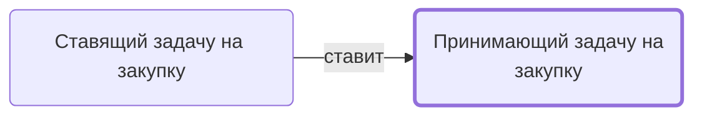

# Принимающий задачу на закупку

Знакомится с задачей на закупку, проверяет достаточность сведений, решает вопросы и принимает в работу.

- **Обязанность:** одна, один ответственный. Ключ: `prinyatie-zakupki`
- **Предполагаем, что выполняет:** [Закупщик (специалист по закупке)](../../reg/rol/zakupka.md)
- **Контур:** 2
- **Почему выделили:** По смыслу задачу принимает тот, кто будет закупать (Закупка 0 — у закупщика).
- **Догадка, не подтверждено:** В регламенте шаг «Принять задачу на закупку» (Передача в закупки 6) стоит у столбца H.
- *Черновик — проверить.*

## Откуда задача и кому результат

## Шаги

| Процесс | № | Шаг | Здесь |
|---|---|---|---|
| [Процесс. Передача в закупки](../../pro/r03-peredacha-v-zakupki/index.md) | 5 | Выполнить подзадачу "Поставить задачу на закупку" | принимает результат |
| [Процесс. Передача в закупки](../../pro/r03-peredacha-v-zakupki/index.md) | 6 | Выполнить подзадачу "Принять задачу на закупку" | делает |
| [Процесс. Передача в закупки](../../pro/r03-peredacha-v-zakupki/index.md) | 7 | Возобновление Закупок по проекту (в случае невыполнения поставок контрагентами, необходимости дозакупить что-либо и т.д.) | принимает результат |
| [Процесс. Закупка товара](../../pro/r04-zakupka-tovara/index.md) | 0 | Вход в процесс- Поставлена задача на закупку по проекту. №Проекта -Закзачик-предмет: Закупить товары" (или принятие этой задачи?!) | делает |

**Получает:** [Задача «Закупка»](../../reg/art.md#zadacha-zakupka)

**Где работает:** [Битрикс24: задачи по шаблонам](../../reg/mes.md#bitriks-zadacha)
