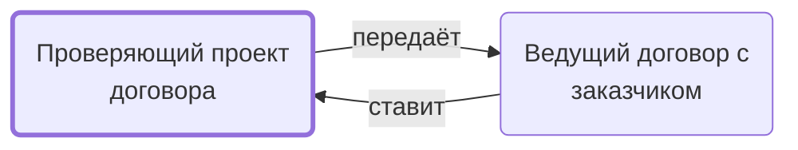

# Проверяющий проект договора

Проверяет или заполняет проект договора заказчика по инструкции.

- **Обязанность:** одна, один ответственный. Ключ: `proverka-dogovora`
- **Предполагаем, что выполняет:** [Хранитель учёта и документов (столбец K)](../../reg/rol/khranitel.md)
- **Контур:** 0
- **Почему выделили:** В регламенте исполнитель — столбец K (Контрактация 10).
- *Черновик — проверить.*

## Откуда задача и кому результат

## Шаги

| Процесс | № | Шаг | Здесь |
|---|---|---|---|
| [Процесс. Контрактация](../../pro/r02-kontraktatsiya/index.md) | 9 | Постановка задачи на проверку (или заполнение, если к нам вошел договор в редактируемом формате) направленного проекта договора. | принимает результат |
| [Процесс. Контрактация](../../pro/r02-kontraktatsiya/index.md) | 10 | Заполнение/проверка проекта договора. | делает |
