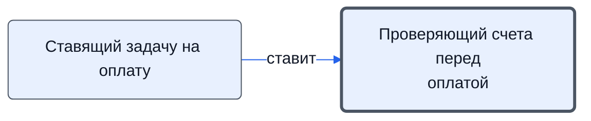

# Проверяющий счета перед оплатой

Проверяет готовые к оплате счета и договоры на формальные требования: 5 обязательных пунктов, договор при сумме свыше 100 000.

- **Обязанность:** одна, один ответственный. Ключ: `proverka-schetov`
- **Предполагаем, что выполняет:** [Хранитель учёта и документов (столбец K)](../../reg/rol/khranitel.md), [Казначей](../../reg/rol/kaznachey.md)
- **Контур:** 3
- **Почему выделили:** Регламент: шаг 19 — столбец K; роли.docx: Казначей «проверяет счёт перед оплатой».
- *Черновик — проверить.*

## Откуда задача и кому результат

## Шаги

| Процесс | № | Шаг | Здесь |
|---|---|---|---|
| [Процесс. Закупка товара](../../pro/r04-zakupka-tovara/index.md) | 17 | Постановка Задачи K на проверку и оплату счетов и договоров, созданию в 1с Заказа покупателя и заказов поставщикам | принимает результат |
| [Процесс. Закупка товара](../../pro/r04-zakupka-tovara/index.md) | 19 | Проверка готовых к оплате счетов и договоров | делает |

**Получает:** [Задача «Оплатить счета»](../../reg/art.md#zadacha-oplatit), [Счета и договоры «готов к оплате»](../../reg/art.md#scheta-v-oplatu)

**Где работает:** [Диск: «Рабочие документы» → «Закупки»](../../reg/mes.md#disk-zakupki)
