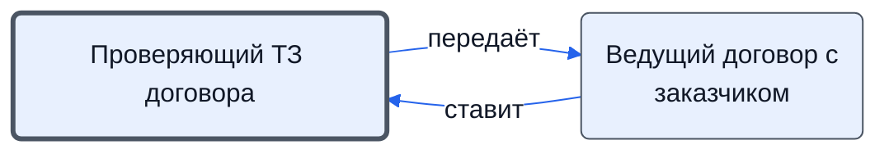

# Проверяющий ТЗ договора

Сверяет наименования, характеристики и ТЗ договора с нашим ТП; даёт заключение в задаче.

- **Обязанность:** одна, один ответственный. Ключ: `proverka-tz`
- **Предполагаем, что выполняет:** [Технический эксперт (ТС)](../../reg/rol/tekh.md)
- **Контур:** 0
- **Почему выделили:** Техническая проверка — у ТС (Контрактация 12, роли.docx «согласует ТЗ, договор»).
- *Черновик — проверить.*

## Откуда задача и кому результат

## Шаги

| Процесс | № | Шаг | Здесь |
|---|---|---|---|
| [Процесс. Контрактация](../../pro/r02-kontraktatsiya/index.md) | 11 | Постановка задачи на проверку ТЗ (или заполнение, если к нам вошел договор в редактируемом формате) направленного ТЗ и перечня документов которые нужно включить в счета или договоры (лист 3-3) | принимает результат |
| [Процесс. Контрактация](../../pro/r02-kontraktatsiya/index.md) | 12 | Заполнение/проверка ТЗ | делает |

**Получает:** [Подзадача на проверку ТЗ](../../reg/art.md#podzadacha-tz)

**Отдаёт:** [Заключение по ТЗ](../../reg/art.md#zaklyuchenie-tz)

**Где работает:** [Битрикс24: задачи по шаблонам](../../reg/mes.md#bitriks-zadacha)
