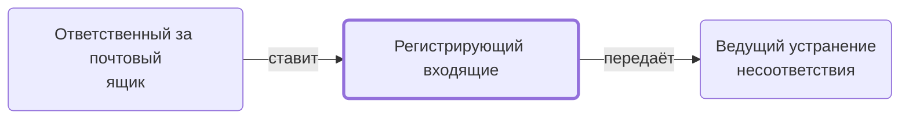

# Регистрирующий входящие

Регистрирует документ о несоответствии в журнале входящих, кладёт в папку проекта и ставит менеджеру задачу на решение.

- **Обязанность:** одна, один ответственный. Ключ: `registratsiya-vhodyashchih`
- **Предполагаем, что выполняет:** [Хранитель учёта и документов (столбец K)](../../reg/rol/khranitel.md)
- **Контур:** 3
- **Почему выделили:** Регламент: шаги 18–20 — столбец K.
- **Догадка, не подтверждено:** Регламент говорит «передача на регистрацию Координатору», а регистрирует K; директор: Координатор — не K.
- *Черновик — проверить.*

## Откуда задача и кому результат

## Шаги

| Процесс | № | Шаг | Здесь |
|---|---|---|---|
| [Процесс. Устранение несоответствий](../../pro/r10-nesootvetstviya/index.md) | 17 | Передача документа о несоответствии на регистрацию Координатору | принимает результат |
| [Процесс. Устранение несоответствий](../../pro/r10-nesootvetstviya/index.md) | 18 | Регистрация в Журнале регистрации входящих документа о несоответствии | делает |
| [Процесс. Устранение несоответствий](../../pro/r10-nesootvetstviya/index.md) | 19 | Размещение в папке Проекта документа о несоответствии | делает |
| [Процесс. Устранение несоответствий](../../pro/r10-nesootvetstviya/index.md) | 20 | Передача документа о несоответствии менеджеру проекта с постановкой задачи | делает |
| [Процесс. Устранение несоответствий](../../pro/r10-nesootvetstviya/index.md) | 21 | Принятие решения по устранению несоответствий | ставит задачу |

**Получает:** [Документ о несоответствии](../../reg/art.md#dokument-nesootv)

**Отдаёт:** [Задача «Принятие решения по устранению несоответствий»](../../reg/art.md#zadacha-nesootv), [Документ о несоответствии](../../reg/art.md#dokument-nesootv)

**Где работает:** [Журнал регистрации входящих](../../reg/mes.md#zhurnal-vhodyashchih), [Диск: документы исполнения](../../reg/mes.md#disk-ispolnenie), [Битрикс24: задачи по шаблонам](../../reg/mes.md#bitriks-zadacha)
