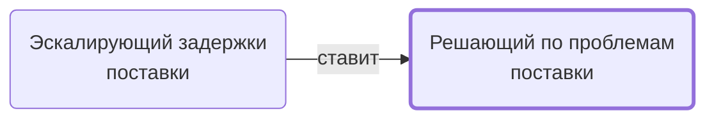

# Решающий по проблемам поставки

Принимает решение по эскалированным проблемам.

- **Обязанность:** одна, один ответственный. Ключ: `reshenie-problem`
- **Предполагаем, что выполняет:** [Менеджер проекта](../../reg/rol/proekt.md)
- **Контур:** 4
- *Черновик — проверить.*

## Откуда задача и кому результат

## Шаги

| Процесс | № | Шаг | Здесь |
|---|---|---|---|
| [Процесс. Поступление: контроль поставки, доплаты, доставка, приёмка](../../pro/r06-postuplenie/index.md) | 7 | Эскалация проблемы в случае затягивания сроков | принимает результат |
| [Процесс. Поступление: контроль поставки, доплаты, доставка, приёмка](../../pro/r06-postuplenie/index.md) | 8 | Принятие решение по эскалированным проблемам | делает |
