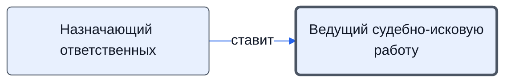

# Ведущий судебно-исковую работу

Ведёт суд по назначению.

- **Обязанность:** одна, один ответственный. Ключ: `sud`
- **Предполагаем, что выполняет:** *не знаем*
- **Контур:** 3
- **Почему выделили:** Шаг без исполнителя: «выполняет назначенное ответственное лицо».
- *Черновик — проверить.*

## Откуда задача и кому результат

## Шаги

| Процесс | № | Шаг | Здесь |
|---|---|---|---|
| [Процесс. Контроль исполнения заказчиком](../../pro/r11-kontrol-zakazchika/index.md) | 38 | Планирование судебно исковой работы. | принимает результат |
| [Процесс. Контроль исполнения заказчиком](../../pro/r11-kontrol-zakazchika/index.md) | 39 | Судебно-исковая работа | делает |

**Получает:** [Назначение ответственного](../../reg/art.md#naznachenie)
