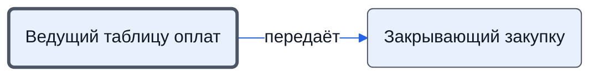

# Ведущий таблицу оплат

Вносит в таблицу оплат оплаты, доплаты и сведения об отгрузочных документах.

- **Обязанность:** одна, один ответственный. Ключ: `tablitsa-oplat`
- **Предполагаем, что выполняет:** [Хранитель учёта и документов (столбец K)](../../reg/rol/khranitel.md)
- **Контур:** 3
- **Почему выделили:** Регламент: шаги 24 (закупка) и 16 (доплаты) — столбец K.
- *Черновик — проверить.*

## Откуда задача и кому результат

## Шаги

| Процесс | № | Шаг | Здесь |
|---|---|---|---|
| [Процесс. Закупка товара](../../pro/r04-zakupka-tovara/index.md) | 24 | Внесение в Таблицу Оплат сведений о произведенных оплатах по проекту | делает |
| [Процесс. Поступление: контроль поставки, доплаты, доставка, приёмка](../../pro/r06-postuplenie/index.md) | 16 | Внесение в таблицу оплат сведений о произведенных доплатах по проекту. Перемещение в папку "Платежные поручения" всех Платежных поручений по оплаченным счетам и договорам | делает |

**Получает:** [Платёжные поручения](../../reg/art.md#platezhki)

**Отдаёт:** [Сведения об оплатах (таблица оплат)](../../reg/art.md#oplaty-v-tablitse)

**Где работает:** [Внешняя таблица оплат](../../reg/mes.md#tablitsa-oplat), [Лист «6 Оплаты»](../../reg/mes.md#lis-6-oplaty), [Диск: «Рабочие документы» → «Закупки»](../../reg/mes.md#disk-zakupki)
