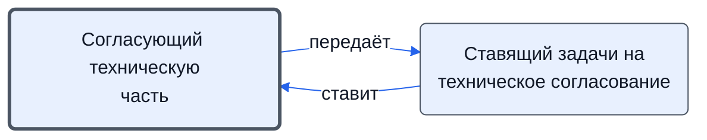

# Согласующий техническую часть

Рассматривает предложения, счета, договоры, ТЗ, изготовителя и состав документации в технической части.

- **Обязанность:** одна, один ответственный. Ключ: `teh-soglasovanie`
- **Предполагаем, что выполняет:** [Технический эксперт (ТС)](../../reg/rol/tekh.md)
- **Контур:** 2
- **Почему выделили:** роли.docx: ТС «согласует техническую часть: ТЗ, договор, спецификацию, Изготовителя, состав документации».
- *Черновик — проверить.*

## Откуда задача и кому результат

## Шаги

| Процесс | № | Шаг | Здесь |
|---|---|---|---|
| [Процесс. Закупка товара](../../pro/r04-zakupka-tovara/index.md) | 8 | Постановка задачи на проверку выбранных предложений ТС | принимает результат |
| [Процесс. Закупка товара](../../pro/r04-zakupka-tovara/index.md) | 9 | Рассмотрение предложений поставщиков в технической части | делает |
| [Процесс. Закупка товара](../../pro/r04-zakupka-tovara/index.md) | 14 | Постановка Задачи на согласование счетов/договоров в технической части | принимает результат |
| [Процесс. Закупка товара](../../pro/r04-zakupka-tovara/index.md) | 15 | Рассмотрение и согласование счетов и договоров и других документов в технической части (в том числе путем подготовки ТЗ для договора с поставщиком) | согласуют |
| [Процесс. Поступление: контроль поставки, доплаты, доставка, приёмка](../../pro/r06-postuplenie/index.md) | 11 | Взаимодействие с поставщиками по вопросу получения технических документов на товар; Размещение в папке проекта "Техническая документация на товар" всех документов, полученных от поставщиков | согласуют |
| [Процесс. Поступление: контроль поставки, доплаты, доставка, приёмка](../../pro/r06-postuplenie/index.md) | 25 | Составление и направление мотивированного отказа | согласуют |
| [Процесс. Подготовка к отгрузке](../../pro/r07-podgotovka-k-otgruzke/index.md) | 6 | Проверка комплектности отгружаемого товара( в том числе документации) и соответствие отгрузочным документам | согласуют |
| [Процесс. Подготовка к отгрузке](../../pro/r07-podgotovka-k-otgruzke/index.md) | 7 | Составление ведомости передаваемых технических документов на отгружаемый товар | согласуют |

**Получает:** [Подзадача ТС на проверку предложений](../../reg/art.md#podzadacha-ts)

**Отдаёт:** [Заключение ТС по предложениям](../../reg/art.md#zaklyuchenie-ts)

**Где работает:** [Битрикс24: задачи по шаблонам](../../reg/mes.md#bitriks-zadacha)
