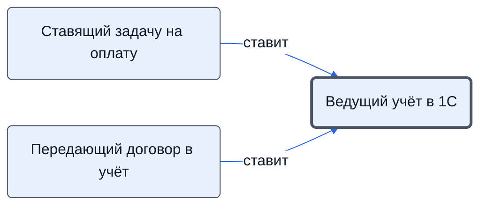

# Ведущий учёт в 1С

Создаёт заказ покупателя и заказы поставщикам, оприходует товары.

- **Обязанность:** одна, один ответственный. Ключ: `uchet-1s`
- **Предполагаем, что выполняет:** [Хранитель учёта и документов (столбец K)](../../reg/rol/khranitel.md)
- **Контур:** 3
- **Почему выделили:** Все шаги 1С в регламенте — у столбца K.
- *Черновик — проверить.*

## Откуда задача и кому результат

## Шаги

| Процесс | № | Шаг | Здесь |
|---|---|---|---|
| [Процесс. Контрактация](../../pro/r02-kontraktatsiya/index.md) | 18 | Передача в отдел Исполнения заключенного договора для внесения информации в 1с и табличные системы. | принимает результат |
| [Процесс. Закупка товара](../../pro/r04-zakupka-tovara/index.md) | 20 | Создание заказа покупателя и поставщикам в 1с | делает |
| [Процесс. Поступление: контроль поставки, доплаты, доставка, приёмка](../../pro/r06-postuplenie/index.md) | 27 | Оприходование товаров в 1с | делает |

**Получает:** [Приходные документы (сканы)](../../reg/art.md#prihodnye)

**Где работает:** [1С](../../reg/mes.md#1s)
