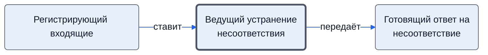

# Ведущий устранение несоответствия

Решает, как устранять, выдаёт поручения на устранение и на ответ, организует устранение, собирает объяснения, закрывает процесс.

- **Обязанность:** одна, один ответственный. Ключ: `vedenie-nesootvetstviya`
- **Предполагаем, что выполняет:** [Менеджер проекта](../../reg/rol/proekt.md)
- **Контур:** 4
- *Черновик — проверить.*

## Откуда задача и кому результат

## Шаги

| Процесс | № | Шаг | Здесь |
|---|---|---|---|
| [Процесс. Устранение несоответствий](../../pro/r10-nesootvetstviya/index.md) | 20 | Передача документа о несоответствии менеджеру проекта с постановкой задачи | принимает результат |
| [Процесс. Устранение несоответствий](../../pro/r10-nesootvetstviya/index.md) | 21 | Принятие решения по устранению несоответствий | делает |
| [Процесс. Устранение несоответствий](../../pro/r10-nesootvetstviya/index.md) | 23 | Выдача поручения по устранению несоответствий и организация его выполнения | делает |
| [Процесс. Устранение несоответствий](../../pro/r10-nesootvetstviya/index.md) | 24 | Выдача поручения по подготовке ответа на документ о несоответствии и организация его выполнения | делает |
| [Процесс. Устранение несоответствий](../../pro/r10-nesootvetstviya/index.md) | 25 | Устранение несоответствий | делает |
| [Процесс. Устранение несоответствий](../../pro/r10-nesootvetstviya/index.md) | 26 | Подготовка предложений по ответу и согласование с заинтересованными сторонами | ставит задачу |
| [Процесс. Устранение несоответствий](../../pro/r10-nesootvetstviya/index.md) | 26 | Подготовка предложений по ответу и согласование с заинтересованными сторонами | согласуют |
| [Процесс. Устранение несоответствий](../../pro/r10-nesootvetstviya/index.md) | 28 | Сбор объяснений по возникновению несоответствий и сбор предложений по предотвращению/снижению рисков возникновения подобных несоответствий | делает |
| [Процесс. Устранение несоответствий](../../pro/r10-nesootvetstviya/index.md) | 29 | Закрытие процесса Устранение несоответствий | делает |

**Получает:** [Задача «Принятие решения по устранению несоответствий»](../../reg/art.md#zadacha-nesootv), [Документ о несоответствии](../../reg/art.md#dokument-nesootv), [Ответ на документ о несоответствии](../../reg/art.md#otvet-nesootv)

**Отдаёт:** [Решение по устранению несоответствия](../../reg/art.md#reshenie-nesootv), [Поручение подготовить ответ на несоответствие](../../reg/art.md#poruchenie-otvet), [Объяснения и предложения по предотвращению](../../reg/art.md#obyasneniya)

**Где работает:** [Битрикс24: задачи по шаблонам](../../reg/mes.md#bitriks-zadacha)
