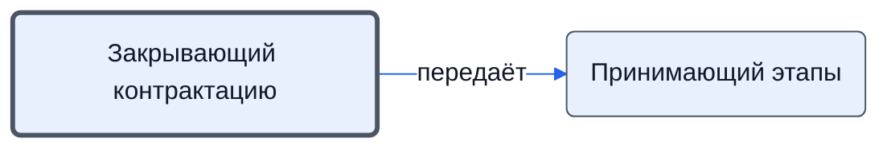

# Закрывающий контрактацию

Ставит статус «Договор заключен», завершает задачу и сдаёт её Координатору.

- **Обязанность:** одна, один ответственный. Ключ: `zakrytie-kontraktatsii`
- **Предполагаем, что выполняет:** [Менеджер по продажам](../../reg/rol/prodazhi.md)
- **Контур:** 0
- **Почему выделили:** Выход из процесса (Контрактация 19, 20).
- *Черновик — проверить.*

## Откуда задача и кому результат

## Шаги

| Процесс | № | Шаг | Здесь |
|---|---|---|---|
| [Процесс. Контрактация](../../pro/r02-kontraktatsiya/index.md) | 19 | Закрытие этапа Контрактация | делает |
| [Процесс. Контрактация](../../pro/r02-kontraktatsiya/index.md) | 20 | Приемка этапа Контрактации | делает |

**Где работает:** [Битрикс24: статус проекта](../../reg/mes.md#bitriks-status-proekta), [Битрикс24: задачи по шаблонам](../../reg/mes.md#bitriks-zadacha)
