# Закрывающий закупку

Когда по всем счетам есть платёжные поручения — закрывает этап, принимает задачу по оплате и передаёт задачу по закупке логисту.

- **Обязанность:** одна, один ответственный. Ключ: `zakrytie-zakupki`
- **Предполагаем, что выполняет:** [Закупщик (специалист по закупке)](../../reg/rol/zakupka.md)
- **Контур:** 2
- **Почему выделили:** Регламент: шаг 25; директор (раунд 2, №8): сотрудник контура 2 принимает задачу по оплате, логист — задачу по закупке у него.
- **Догадка, не подтверждено:** Статус проекта «Исполняем договор» меняет менеджер — комментарий в регламенте.
- *Черновик — проверить.*

## Откуда задача и кому результат

```mermaid
%%{init: {"theme": "base", "themeVariables": {"fontSize": "16px", "primaryColor": "#e8f0fe", "primaryTextColor": "#111827", "primaryBorderColor": "#4b5563", "lineColor": "#2563eb", "textColor": "#111827", "clusterBkg": "#fffbe6", "clusterBorder": "#9ca3af", "edgeLabelBackground": "#ffffff", "signalColor": "#2563eb", "signalTextColor": "#1d4ed8", "noteBkgColor": "#fff3b0", "noteTextColor": "#111827", "noteBorderColor": "#a16207", "actorBkg": "#e8f0fe", "actorTextColor": "#111827", "actorBorder": "#4b5563", "actorLineColor": "#9ca3af", "labelBoxBkgColor": "#e8f0fe", "labelTextColor": "#111827"}}}%%
flowchart LR
  o_zakrytie_zakupki("Закрывающий закупку")
  style o_zakrytie_zakupki stroke-width:3px
  o_tablitsa_oplat("Ведущий таблицу оплат")
  o_kontrol_postavki("Отслеживающий поставку")
  o_tablitsa_oplat -->|ставит| o_zakrytie_zakupki
  o_zakrytie_zakupki -->|передаёт| o_kontrol_postavki
```

## Шаги

| Процесс | № | Шаг | Здесь |
|---|---|---|---|
| [Процесс. Закупка товара](../../pro/r04-zakupka-tovara/index.md) | 24 | Внесение в Таблицу Оплат сведений о произведенных оплатах по проекту | принимает результат |
| [Процесс. Закупка товара](../../pro/r04-zakupka-tovara/index.md) | 25 | Закрытие этапа Закупки | делает |

**Получает:** [Сведения об оплатах (таблица оплат)](../../reg/art.md#oplaty-v-tablitse)

**Отдаёт:** [Закрытая задача «Закупка» — логисту](../../reg/art.md#zadacha-zakupka-zakryta)

**Где работает:** [Битрикс24: задачи по шаблонам](../../reg/mes.md#bitriks-zadacha), [Битрикс24: статус проекта](../../reg/mes.md#bitriks-status-proekta)
