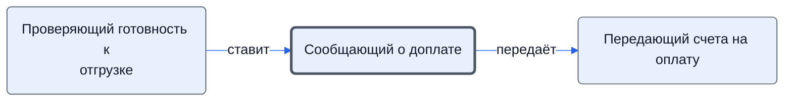

# Сообщающий о доплате

Когда поставщик готов к отгрузке — передаёт, что нужна доплата.

- **Обязанность:** одна, один ответственный. Ключ: `zapros-doplaty`
- **Предполагаем, что выполняет:** [Логист](../../reg/rol/logist.md)
- **Контур:** 4
- **Почему выделили:** Регламент: «Доплаты» и шаг 13 — у АС (логист).
- *Черновик — проверить.*

## Откуда задача и кому результат

## Шаги

| Процесс | № | Шаг | Здесь |
|---|---|---|---|
| [Процесс. Поступление: контроль поставки, доплаты, доставка, приёмка](../../pro/r06-postuplenie/index.md) | 12 | Информирование о том, что готовность к отгрузке подтверждена | принимает результат |
| [Процесс. Поступление: контроль поставки, доплаты, доставка, приёмка](../../pro/r06-postuplenie/index.md) | — | Доплаты | делает |
| [Процесс. Поступление: контроль поставки, доплаты, доставка, приёмка](../../pro/r06-postuplenie/index.md) | 13 | Передача данных K о необходимости доплаты при наличии готовности к отгрузке | делает |

**Получает:** [Подтверждённая готовность к отгрузке](../../reg/art.md#gotovnost)

**Отдаёт:** [Сведения о необходимости доплаты](../../reg/art.md#zapros-doplaty)
