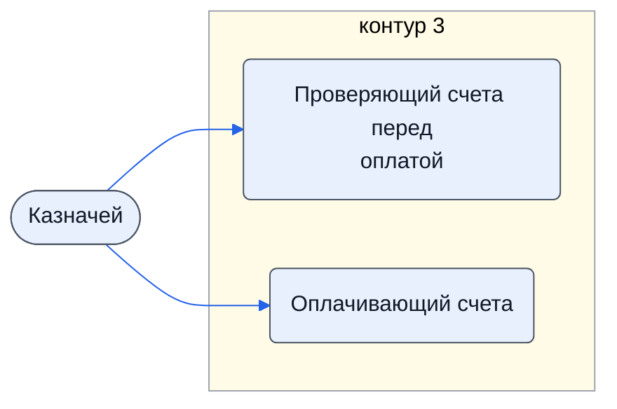

# Казначей

Проверяет счёт или договор перед оплатой, делает финальную проверку контрагента, оплачивает.

- **Контур:** 3 — оплаты и договоры
- **Источник:** роли.docx
- **Почему выделили:** Должность из роли.docx.
- **Догадка, не подтверждено:** В регламенте его обязанности делят столбцы K (проверка) и M (оплата); своего столбца нет.

## Обязанности, которые мы ей приписываем

- [Проверяющий счета перед оплатой](../../reg/oby/proverka-schetov.md) — Проверяет готовые к оплате счета и договоры на формальные требования: 5 обязательных пунктов, договор при сумме свыше 100 000. *(вместе с: [Хранитель учёта и документов (столбец K)](../../reg/rol/khranitel.md))*
- [Оплачивающий счета](../../reg/oby/oplata.md) — Оплачивает счета и доплаты и возвращает платёжные поручения. *(вместе с: [Подписант и плательщик (столбец M)](../../reg/rol/podpisant.md))*

## Шаги процессов

| Процесс | № | Шаг | Обязанность |
|---|---|---|---|
| [Процесс. Закупка товара](../../pro/r04-zakupka-tovara/index.md) | 19 | Проверка готовых к оплате счетов и договоров | [Проверяющий счета перед оплатой](../../reg/oby/proverka-schetov.md) |
| [Процесс. Закупка товара](../../pro/r04-zakupka-tovara/index.md) | 22 | Оплата полученных счетов и передача платежных поручений K | [Оплачивающий счета](../../reg/oby/oplata.md) |
| [Процесс. Поступление: контроль поставки, доплаты, доставка, приёмка](../../pro/r06-postuplenie/index.md) | 15 | Доплата полученных счетов и передача платежных поручений K | [Оплачивающий счета](../../reg/oby/oplata.md) |

