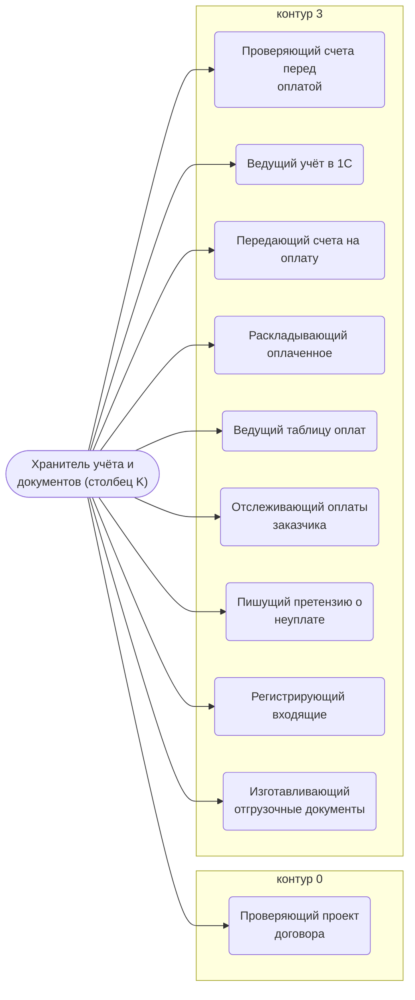
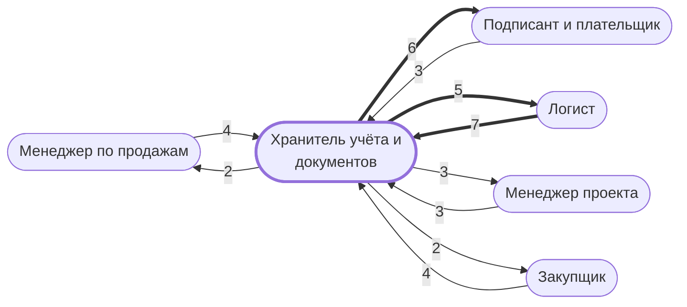

# Хранитель учёта и документов (столбец K)

Проверяет счета перед оплатой, ведёт 1С, папки оплат и таблицу оплат, регистрирует входящие, готовит отгрузочные документы, следит за оплатами заказчика.

- **Контур:** 3 — оплаты и договоры
- **Столбец регламента:** K
- **Источник:** регламент; ответы
- **Почему выделили:** Директор (раунд 2, №4): у этого сотрудника много обязанностей, «он хранитель там всего»; в регламенте его работа сведена в один столбец.
- **Догадка, не подтверждено:** Это одна должность или несколько мелких (бухгалтер, делопроизводитель, учёт в 1С) — проверить по обязанностям.

## Обязанности, которые мы ей приписываем

- [Проверяющий проект договора](../../reg/oby/proverka-dogovora.md) — Проверяет или заполняет проект договора заказчика по инструкции.
- [Проверяющий счета перед оплатой](../../reg/oby/proverka-schetov.md) — Проверяет готовые к оплате счета и договоры на формальные требования: 5 обязательных пунктов, договор при сумме свыше 100 000. *(вместе с: [Казначей](../../reg/rol/kaznachey.md))*
- [Ведущий учёт в 1С](../../reg/oby/uchet-1s.md) — Создаёт заказ покупателя и заказы поставщикам, оприходует товары.
- [Передающий счета на оплату](../../reg/oby/peredacha-na-oplatu.md) — Передаёт проверенные счета на оплату и доплату тому, кто платит.
- [Раскладывающий оплаченное](../../reg/oby/arhiv-oplat.md) — Создаёт «Оплачено» и «Платежные поручения» и перекладывает туда оплаченные счета, договоры и поручения.
- [Ведущий таблицу оплат](../../reg/oby/tablitsa-oplat.md) — Вносит в таблицу оплат оплаты, доплаты и сведения об отгрузочных документах.
- [Отслеживающий оплаты заказчика](../../reg/oby/oplaty-zakazchika.md) — Следит за сроками оплаты по проекту, учитывает поступления от заказчиков, поставщиков и страховых, вносит платежи в систему.
- [Пишущий претензию о неуплате](../../reg/oby/pretenziya-neuplata.md) — Пишет претензию заказчику о неуплате, согласует с менеджером.
- [Регистрирующий входящие](../../reg/oby/registratsiya-vhodyashchih.md) — Регистрирует документ о несоответствии в журнале входящих, кладёт в папку проекта и ставит менеджеру задачу на решение.
- [Изготавливающий отгрузочные документы](../../reg/oby/otgruzochnye-dokumenty.md) — Изготавливает отгрузочные документы и вносит сведения о них в таблицу оплат.

## Шаги процессов

| Процесс | № | Шаг | Обязанность |
|---|---|---|---|
| [Процесс. Контрактация](../../pro/r02-kontraktatsiya/index.md) | 10 | Заполнение/проверка проекта договора. | [Проверяющий проект договора](../../reg/oby/proverka-dogovora.md) |
| [Процесс. Закупка товара](../../pro/r04-zakupka-tovara/index.md) | 19 | Проверка готовых к оплате счетов и договоров | [Проверяющий счета перед оплатой](../../reg/oby/proverka-schetov.md) |
| [Процесс. Закупка товара](../../pro/r04-zakupka-tovara/index.md) | 20 | Создание заказа покупателя и поставщикам в 1с | [Ведущий учёт в 1С](../../reg/oby/uchet-1s.md) |
| [Процесс. Закупка товара](../../pro/r04-zakupka-tovara/index.md) | 21 | Передача полученных счетов M на оплату | [Передающий счета на оплату](../../reg/oby/peredacha-na-oplatu.md) |
| [Процесс. Закупка товара](../../pro/r04-zakupka-tovara/index.md) | 23 | Создание в папке ".... В оплату" подпапки "Оплачено" и перемещение в нее всех оплаченных счетов и договоров. Создание папки "Платежные поручения" и перемещение в нее всех Платежных поручений по оплаченным счетам и договорам | [Раскладывающий оплаченное](../../reg/oby/arhiv-oplat.md) |
| [Процесс. Закупка товара](../../pro/r04-zakupka-tovara/index.md) | 24 | Внесение в Таблицу Оплат сведений о произведенных оплатах по проекту | [Ведущий таблицу оплат](../../reg/oby/tablitsa-oplat.md) |
| [Процесс. Поступление: контроль поставки, доплаты, доставка, приёмка](../../pro/r06-postuplenie/index.md) | 14 | Передача полученных счетов M на доплату | [Передающий счета на оплату](../../reg/oby/peredacha-na-oplatu.md) |
| [Процесс. Поступление: контроль поставки, доплаты, доставка, приёмка](../../pro/r06-postuplenie/index.md) | 16 | Внесение в таблицу оплат сведений о произведенных доплатах по проекту. Перемещение в папку "Платежные поручения" всех Платежных поручений по оплаченным счетам и договорам | [Ведущий таблицу оплат](../../reg/oby/tablitsa-oplat.md) |
| [Процесс. Поступление: контроль поставки, доплаты, доставка, приёмка](../../pro/r06-postuplenie/index.md) | 27 | Оприходование товаров в 1с | [Ведущий учёт в 1С](../../reg/oby/uchet-1s.md) |
| [Процесс. Подготовка к отгрузке](../../pro/r07-podgotovka-k-otgruzke/index.md) | 3 | Изготовление Отгрузочных документов и внесение в таблицу оплат сведений об этих документах | [Изготавливающий отгрузочные документы](../../reg/oby/otgruzochnye-dokumenty.md) |
| [Процесс. Устранение несоответствий](../../pro/r10-nesootvetstviya/index.md) | 18 | Регистрация в Журнале регистрации входящих документа о несоответствии | [Регистрирующий входящие](../../reg/oby/registratsiya-vhodyashchih.md) |
| [Процесс. Устранение несоответствий](../../pro/r10-nesootvetstviya/index.md) | 19 | Размещение в папке Проекта документа о несоответствии | [Регистрирующий входящие](../../reg/oby/registratsiya-vhodyashchih.md) |
| [Процесс. Устранение несоответствий](../../pro/r10-nesootvetstviya/index.md) | 20 | Передача документа о несоответствии менеджеру проекта с постановкой задачи | [Регистрирующий входящие](../../reg/oby/registratsiya-vhodyashchih.md) |
| [Процесс. Контроль исполнения заказчиком](../../pro/r11-kontrol-zakazchika/index.md) | 31 | Отслеживание сроков оплаты по проекту, | [Отслеживающий оплаты заказчика](../../reg/oby/oplaty-zakazchika.md) |
| [Процесс. Контроль исполнения заказчиком](../../pro/r11-kontrol-zakazchika/index.md) | 32 | Отслеживание и учет оплат от заказчиков и поступлений (типа денег от поставщиков и страховых) по проекту | [Отслеживающий оплаты заказчика](../../reg/oby/oplaty-zakazchika.md) |
| [Процесс. Контроль исполнения заказчиком](../../pro/r11-kontrol-zakazchika/index.md) | 33 | Занесение информации о платежах в систему | [Отслеживающий оплаты заказчика](../../reg/oby/oplaty-zakazchika.md) |
| [Процесс. Контроль исполнения заказчиком](../../pro/r11-kontrol-zakazchika/index.md) | 34 | Написание претензии о неуплате | [Пишущий претензию о неуплате](../../reg/oby/pretenziya-neuplata.md) |

## С кем работает

Сколько раз работа переходит от должности к должности (ставит задачу, передаёт результат, следующий шаг) — по всем процессам.

## Где должность названа прямо

| Процесс | № | Шаг | Как |
|---|---|---|---|
| [Процесс. Закупка товара](../../pro/r04-zakupka-tovara/index.md) | 11 | Подготовка договора поставки с поставщиком | помогают |
| [Процесс. Планирование и контроль исполнения](../../pro/r05-planirovanie-ispolneniya/index.md) | 0 | Разработка Плана исполнения и Рекомендаций, Контрольных точек, Инструктаж по исполнению | узнают о результате |
| [Процесс. Планирование и контроль исполнения](../../pro/r05-planirovanie-ispolneniya/index.md) | 0 | Управление изменениями выявлено несоответствие между договором и реальностью | узнают о результате |
| [Процесс. Поступление: контроль поставки, доплаты, доставка, приёмка](../../pro/r06-postuplenie/index.md) | 9 | Подготовка и направление претензии поставщикам при задержке срока поставки, поставке некачественного товара, недопоставке и тд | помогают |
| [Процесс. Поступление: контроль поставки, доплаты, доставка, приёмка](../../pro/r06-postuplenie/index.md) | 19 | Сбор транспортных документов | узнают о результате |
| [Процесс. Поступление: контроль поставки, доплаты, доставка, приёмка](../../pro/r06-postuplenie/index.md) | 19 | Отчетность по расходам | узнают о результате |
| [Процесс. Устранение несоответствий](../../pro/r10-nesootvetstviya/index.md) | 25 | Устранение несоответствий | помогают |
| [Процесс. Устранение несоответствий](../../pro/r10-nesootvetstviya/index.md) | 28 | Сбор объяснений по возникновению несоответствий и сбор предложений по предотвращению/снижению рисков возникновения подобных несоответствий | помогают |
