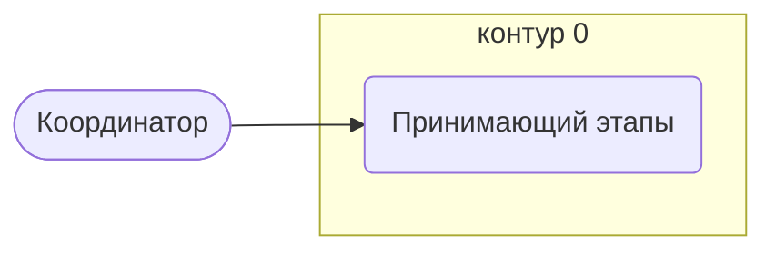

# Координатор

Контур 0: ставит и принимает задачи этапов (например, задачу на заключение договора).

- **Контур:** 0
- **Источник:** регламент; ответы
- **Почему выделили:** В регламенте «принять задачу у Координатора» (Контрактация 20) и «передача на регистрацию Координатору» (Несоответствия 17). Директор (раунд 2, №7): это не столбец K, а кто-то из контура 0.
- **Догадка, не подтверждено:** Столбца в регламенте нет; что ещё делает — не сказано.

## Обязанности, которые мы ей приписываем

- [Принимающий этапы](../../reg/oby/priemka-etapov.md) — Принимает закрытые задачи этапов у исполнителей.

