# Логист

Решает, как доставлять: «Деловые линии», другая транспортная компания или самовывоз, если это дешевле.

- **Контур:** 4 — исполнение
- **Как ещё называют:** АС (регламент)
- **Столбец регламента:** L
- **Источник:** роли.docx; регламент; ответы
- **Почему выделили:** Директор: столбец «АС» в регламенте — это логист.

## Обязанности, которые мы ей приписываем

```mermaid
flowchart LR
  r_logist(["Логист"])
  subgraph k_0["контур 0"]
    o_otpravka_originalov("Отправляющий оригиналы<br/>документов")
  end
  subgraph k_4["контур 4"]
    o_zapros_doplaty("Сообщающий о доплате")
    o_kontrol_postavki("Отслеживающий поставку")
    o_plan_sroki("Определяющий плановые<br/>сроки поставки")
    o_sposob_dostavki("Выбирающий способ доставки")
    o_dostavka("Организующий доставку")
    o_transportnye_dokumenty("Собирающий транспортные<br/>документы")
    o_upd_postavshchika("Предъявляющий к приёмке<br/>УПД поставщика")
    o_priemka_kolichestvo("Принимающий товар по<br/>количеству")
    o_prihodnye_dokumenty("Учитывающий приходные<br/>документы")
    o_hranenie("Хранящий товар")
    o_plan_otgruzok("Планирующий отгрузки")
    o_zapros_otgruzochnyh("Запрашивающий отгрузочные<br/>документы")
    o_dokumenty_otgruzki("Хранящий отгрузочные<br/>документы")
    o_komplektnost_otgruzki("Проверяющий комплектность<br/>отгрузки")
    o_komplektatsiya("Комплектующий партию")
    o_otgruzka("Отгружающий заказчику")
    o_kontrol_priemki_zakazchikom("Отслеживающий приёмку<br/>заказчиком")
    o_otvetstvennyy_za_yashchik("Ответственный за почтовый<br/>ящик")
  end
  subgraph k_3["контур 3"]
    o_otpravka_pretenzii("Отправляющий претензию<br/>заказчику")
  end
  r_logist --> o_otpravka_originalov
  r_logist --> o_zapros_doplaty
  r_logist --> o_kontrol_postavki
  r_logist --> o_plan_sroki
  r_logist --> o_sposob_dostavki
  r_logist --> o_dostavka
  r_logist --> o_transportnye_dokumenty
  r_logist --> o_upd_postavshchika
  r_logist --> o_priemka_kolichestvo
  r_logist --> o_prihodnye_dokumenty
  r_logist --> o_hranenie
  r_logist --> o_plan_otgruzok
  r_logist --> o_zapros_otgruzochnyh
  r_logist --> o_dokumenty_otgruzki
  r_logist --> o_komplektnost_otgruzki
  r_logist --> o_komplektatsiya
  r_logist --> o_otgruzka
  r_logist --> o_kontrol_priemki_zakazchikom
  r_logist --> o_otpravka_pretenzii
  r_logist --> o_otvetstvennyy_za_yashchik
```

- [Отправляющий оригиналы документов](../../reg/oby/otpravka-originalov.md) — Отправляет заказчику подписанный оригинал договора и другие бумажные документы. *(вместе с: [Подписант и плательщик (столбец M)](../../reg/rol/podpisant.md))*
- [Сообщающий о доплате](../../reg/oby/zapros-doplaty.md) — Когда поставщик готов к отгрузке — передаёт, что нужна доплата.
- [Отслеживающий поставку](../../reg/oby/kontrol-postavki.md) — Находит оплаченные товары без статуса, подтверждает у поставщиков получение денег и сроки, следит за просрочками.
- [Определяющий плановые сроки поставки](../../reg/oby/plan-sroki.md) — Определяет плановые сроки поставки. *(вместе с: [Закупщик (специалист по закупке)](../../reg/rol/zakupka.md))*
- [Выбирающий способ доставки](../../reg/oby/sposob-dostavki.md) — Решает, как доставлять, и выбирает исполнителя: «Деловые линии», другая ТК или самовывоз.
- [Организующий доставку](../../reg/oby/dostavka.md) — Организует доставку и получение товара и расчёты с перевозчиками.
- [Собирающий транспортные документы](../../reg/oby/transportnye-dokumenty.md) — Собирает транспортные документы и отчитывается по расходам на доставку.
- [Предъявляющий к приёмке УПД поставщика](../../reg/oby/upd-postavshchika.md) — Выкладывает УПД или ТОРГ-12 в задачу «Приемка» и папку «На приемке», ставит срок приёмки. *(вместе с: [Закупщик (специалист по закупке)](../../reg/rol/zakupka.md))*
- [Принимающий товар по количеству](../../reg/oby/priemka-kolichestvo.md) — Фотографирует товар, упаковку, маркировку, документы и принимает по количеству.
- [Учитывающий приходные документы](../../reg/oby/prihodnye-dokumenty.md) — Учитывает и сканирует приходные документы.
- [Хранящий товар](../../reg/oby/hranenie.md) — Хранит товар до отгрузки, если нужно.
- [Планирующий отгрузки](../../reg/oby/plan-otgruzok.md) — Начинает отгрузки, составляет план и ведомость отгрузки, ставит задачу на пакет документов.
- [Запрашивающий отгрузочные документы](../../reg/oby/zapros-otgruzochnyh.md) — Передаёт, что нужно изготовить отгрузочные документы.
- [Хранящий отгрузочные документы](../../reg/oby/dokumenty-otgruzki.md) — Физически получает отгрузочные документы и сохраняет их скан-копии в папку, в том числе подписанные заказчиком.
- [Проверяющий комплектность отгрузки](../../reg/oby/komplektnost-otgruzki.md) — Проверяет комплектность товара и документации и составляет ведомость передаваемых технических документов.
- [Комплектующий партию](../../reg/oby/komplektatsiya.md) — Укомплектовывает партию по УПД.
- [Отгружающий заказчику](../../reg/oby/otgruzka.md) — Отгружает товар заказчику и учитывает затраты на логистику.
- [Отслеживающий приёмку заказчиком](../../reg/oby/kontrol-priemki-zakazchikom.md) — Следит, что заказчик принял товар и соблюдает сроки приёмки.
- [Отправляющий претензию заказчику](../../reg/oby/otpravka-pretenzii.md) — Отправляет заказчику претензию о неуплате.
- [Ответственный за почтовый ящик](../../reg/oby/otvetstvennyy-za-yashchik.md) — Получив документ о несоответствии на свой ящик, передаёт его на регистрацию. *(вместе с: [Менеджер проекта](../../reg/rol/proekt.md), [Технический эксперт (ТС)](../../reg/rol/tekh.md), [Подписант и плательщик (столбец M)](../../reg/rol/podpisant.md))*

## Шаги процессов

| Процесс | № | Шаг | Обязанность |
|---|---|---|---|
| [Процесс. Контрактация](../../pro/r02-kontraktatsiya/index.md) | 17 | Направление подписанного оригинала договора заказчику. | [Отправляющий оригиналы документов](../../reg/oby/otpravka-originalov.md) |
| [Процесс. Поступление: контроль поставки, доплаты, доставка, приёмка](../../pro/r06-postuplenie/index.md) | 2 | Отслеживание товаров со статусом ОПЛАЧЕНО но пока без "статуса" (на листе Рабочий лист) | [Отслеживающий поставку](../../reg/oby/kontrol-postavki.md) |
| [Процесс. Поступление: контроль поставки, доплаты, доставка, приёмка](../../pro/r06-postuplenie/index.md) | 3 | Контакт с поставщиками подтверждение получения денег, уточнение сроков поставки | [Отслеживающий поставку](../../reg/oby/kontrol-postavki.md) |
| [Процесс. Поступление: контроль поставки, доплаты, доставка, приёмка](../../pro/r06-postuplenie/index.md) | 5 | Определить плановые сроки поставки | [Определяющий плановые сроки поставки](../../reg/oby/plan-sroki.md) |
| [Процесс. Поступление: контроль поставки, доплаты, доставка, приёмка](../../pro/r06-postuplenie/index.md) | 6 | Контроль соблюдения сроков поставки ( и выявление просрочки) | [Отслеживающий поставку](../../reg/oby/kontrol-postavki.md) |
| [Процесс. Поступление: контроль поставки, доплаты, доставка, приёмка](../../pro/r06-postuplenie/index.md) | — | Доплаты | [Сообщающий о доплате](../../reg/oby/zapros-doplaty.md) |
| [Процесс. Поступление: контроль поставки, доплаты, доставка, приёмка](../../pro/r06-postuplenie/index.md) | 13 | Передача данных K о необходимости доплаты при наличии готовности к отгрузке | [Сообщающий о доплате](../../reg/oby/zapros-doplaty.md) |
| [Процесс. Поступление: контроль поставки, доплаты, доставка, приёмка](../../pro/r06-postuplenie/index.md) | — | Организация доставки | [Выбирающий способ доставки](../../reg/oby/sposob-dostavki.md) |
| [Процесс. Поступление: контроль поставки, доплаты, доставка, приёмка](../../pro/r06-postuplenie/index.md) | 17 | Определения способа доставки и исполнителя | [Выбирающий способ доставки](../../reg/oby/sposob-dostavki.md) |
| [Процесс. Поступление: контроль поставки, доплаты, доставка, приёмка](../../pro/r06-postuplenie/index.md) | 18 | Организация доставки и получения товара | [Организующий доставку](../../reg/oby/dostavka.md) |
| [Процесс. Поступление: контроль поставки, доплаты, доставка, приёмка](../../pro/r06-postuplenie/index.md) | 18 | Организация расчетов с исполнителями | [Организующий доставку](../../reg/oby/dostavka.md) |
| [Процесс. Поступление: контроль поставки, доплаты, доставка, приёмка](../../pro/r06-postuplenie/index.md) | 19 | Сбор транспортных документов | [Собирающий транспортные документы](../../reg/oby/transportnye-dokumenty.md) |
| [Процесс. Поступление: контроль поставки, доплаты, доставка, приёмка](../../pro/r06-postuplenie/index.md) | 19 | Отчетность по расходам | [Собирающий транспортные документы](../../reg/oby/transportnye-dokumenty.md) |
| [Процесс. Поступление: контроль поставки, доплаты, доставка, приёмка](../../pro/r06-postuplenie/index.md) | 20 | Предъявление к приемке УПД или ТОРГ-12 от поставщика | [Предъявляющий к приёмке УПД поставщика](../../reg/oby/upd-postavshchika.md) |
| [Процесс. Поступление: контроль поставки, доплаты, доставка, приёмка](../../pro/r06-postuplenie/index.md) | 21 | Составление фотоотчета | [Принимающий товар по количеству](../../reg/oby/priemka-kolichestvo.md) |
| [Процесс. Поступление: контроль поставки, доплаты, доставка, приёмка](../../pro/r06-postuplenie/index.md) | 22 | Приемка товара по количеству | [Принимающий товар по количеству](../../reg/oby/priemka-kolichestvo.md) |
| [Процесс. Поступление: контроль поставки, доплаты, доставка, приёмка](../../pro/r06-postuplenie/index.md) | 26 | Учет приходных документов и их сканирование | [Учитывающий приходные документы](../../reg/oby/prihodnye-dokumenty.md) |
| [Процесс. Поступление: контроль поставки, доплаты, доставка, приёмка](../../pro/r06-postuplenie/index.md) | 28 | Хранение товаров (при необходимости) | [Хранящий товар](../../reg/oby/hranenie.md) |
| [Процесс. Подготовка к отгрузке](../../pro/r07-podgotovka-k-otgruzke/index.md) | 0 | Инициирование отгрузок | [Планирующий отгрузки](../../reg/oby/plan-otgruzok.md) |
| [Процесс. Подготовка к отгрузке](../../pro/r07-podgotovka-k-otgruzke/index.md) | 1 | Подготовка к отгрузке: | [Планирующий отгрузки](../../reg/oby/plan-otgruzok.md) |
| [Процесс. Подготовка к отгрузке](../../pro/r07-podgotovka-k-otgruzke/index.md) | 1.1 | Разработка плана отгрузок | [Планирующий отгрузки](../../reg/oby/plan-otgruzok.md) |
| [Процесс. Подготовка к отгрузке](../../pro/r07-podgotovka-k-otgruzke/index.md) | 1.2 | Разработка ведомости отгрузки и постановка задачи на формирования пакета документов для нее. | [Планирующий отгрузки](../../reg/oby/plan-otgruzok.md) |
| [Процесс. Подготовка к отгрузке](../../pro/r07-podgotovka-k-otgruzke/index.md) | 2 | Передача данных K о необходимости изготовления отгрузочных документов | [Запрашивающий отгрузочные документы](../../reg/oby/zapros-otgruzochnyh.md) |
| [Процесс. Подготовка к отгрузке](../../pro/r07-podgotovka-k-otgruzke/index.md) | 4 | Физическое получение отгрузочных документов | [Хранящий отгрузочные документы](../../reg/oby/dokumenty-otgruzki.md) |
| [Процесс. Подготовка к отгрузке](../../pro/r07-podgotovka-k-otgruzke/index.md) | 5 | Сохранение в папку скан копий договоров и отгрузочных документов в момент их получения | [Хранящий отгрузочные документы](../../reg/oby/dokumenty-otgruzki.md) |
| [Процесс. Подготовка к отгрузке](../../pro/r07-podgotovka-k-otgruzke/index.md) | 6 | Проверка комплектности отгружаемого товара( в том числе документации) и соответствие отгрузочным документам | [Проверяющий комплектность отгрузки](../../reg/oby/komplektnost-otgruzki.md) |
| [Процесс. Подготовка к отгрузке](../../pro/r07-podgotovka-k-otgruzke/index.md) | 7 | Составление ведомости передаваемых технических документов на отгружаемый товар | [Проверяющий комплектность отгрузки](../../reg/oby/komplektnost-otgruzki.md) |
| [Процесс. Подготовка к отгрузке](../../pro/r07-podgotovka-k-otgruzke/index.md) | 8 | Комплектация товара (укомплектование партии согласноУПД) | [Комплектующий партию](../../reg/oby/komplektatsiya.md) |
| [Процесс. Отгрузка](../../pro/r08-otgruzka/index.md) | 9 | Отгрузка товара заказчику | [Отгружающий заказчику](../../reg/oby/otgruzka.md) |
| [Процесс. Отгрузка](../../pro/r08-otgruzka/index.md) | 10 | Учет и списание затрат на логистику/отправку документов ( в том числе Хранение товаров) | [Отгружающий заказчику](../../reg/oby/otgruzka.md) |
| [Процесс. Отгрузка](../../pro/r08-otgruzka/index.md) | 11 | Отслеживание Факта приемки товара заказчиком и соблюдения сроков приемки | [Отслеживающий приёмку заказчиком](../../reg/oby/kontrol-priemki-zakazchikom.md) |
| [Процесс. Отгрузка](../../pro/r08-otgruzka/index.md) | 12 | Сохранение в папку скан копий подписанных отгрузочных документов | [Хранящий отгрузочные документы](../../reg/oby/dokumenty-otgruzki.md) |
| [Процесс. Устранение несоответствий](../../pro/r10-nesootvetstviya/index.md) | 16 | Вход в процесс: поступление документов о несоответствии продукции требованиям договора | [Ответственный за почтовый ящик](../../reg/oby/otvetstvennyy-za-yashchik.md) |
| [Процесс. Устранение несоответствий](../../pro/r10-nesootvetstviya/index.md) | 17 | Передача документа о несоответствии на регистрацию Координатору | [Ответственный за почтовый ящик](../../reg/oby/otvetstvennyy-za-yashchik.md) |
| [Процесс. Контроль исполнения заказчиком](../../pro/r11-kontrol-zakazchika/index.md) | 35 | Отправка претензии Заказчику о неуплате | [Отправляющий претензию заказчику](../../reg/oby/otpravka-pretenzii.md) |

## Где должность названа прямо

| Процесс | № | Шаг | Как |
|---|---|---|---|
| [Процесс. Передача в контрактацию](../../pro/r01-peredacha-v-kontraktatsiyu/index.md) | 2 | Открытие доступа к папке "...рабочие Документы" отделению Исполнения | узнают о результате |
| [Процесс. Планирование и контроль исполнения](../../pro/r05-planirovanie-ispolneniya/index.md) | 0 | Разработка Плана исполнения и Рекомендаций, Контрольных точек, Инструктаж по исполнению | узнают о результате |
| [Процесс. Планирование и контроль исполнения](../../pro/r05-planirovanie-ispolneniya/index.md) | 0 | Управление изменениями выявлено несоответствие между договором и реальностью | узнают о результате |
| [Процесс. Поступление: контроль поставки, доплаты, доставка, приёмка](../../pro/r06-postuplenie/index.md) | 1 | Назначение формата приемок | узнают о результате |
| [Процесс. Поступление: контроль поставки, доплаты, доставка, приёмка](../../pro/r06-postuplenie/index.md) | 10 | Проверка готовности к отгрузке | узнают о результате |
| [Процесс. Поступление: контроль поставки, доплаты, доставка, приёмка](../../pro/r06-postuplenie/index.md) | 12 | Информирование о том, что готовность к отгрузке подтверждена | узнают о результате |
| [Процесс. Поступление: контроль поставки, доплаты, доставка, приёмка](../../pro/r06-postuplenie/index.md) | 23 | Приемка товара по качеству | узнают о результате |
| [Процесс. Поступление: контроль поставки, доплаты, доставка, приёмка](../../pro/r06-postuplenie/index.md) | 24 | Принятие решения о приемке или отказе от приемки | узнают о результате |
| [Процесс. Отгрузка](../../pro/r08-otgruzka/index.md) | 14 | Продавливание приемки товара (подписания УПД) | помогают |
| [Процесс. Устранение несоответствий](../../pro/r10-nesootvetstviya/index.md) | 25 | Устранение несоответствий | помогают |
| [Процесс. Устранение несоответствий](../../pro/r10-nesootvetstviya/index.md) | 26 | Подготовка предложений по ответу и согласование с заинтересованными сторонами | помогают |
| [Процесс. Устранение несоответствий](../../pro/r10-nesootvetstviya/index.md) | 27 | Обеспечение отправки подготовленного ответа | узнают о результате |
| [Процесс. Устранение несоответствий](../../pro/r10-nesootvetstviya/index.md) | 28 | Сбор объяснений по возникновению несоответствий и сбор предложений по предотвращению/снижению рисков возникновения подобных несоответствий | помогают |
| [Процесс. Устранение несоответствий](../../pro/r10-nesootvetstviya/index.md) | 29 | Закрытие процесса Устранение несоответствий | помогают |
| [Процесс. Контроль исполнения заказчиком](../../pro/r11-kontrol-zakazchika/index.md) | 30 | Отслеживание сроков приемки по проекту и принятие мер (например отправка письма о том, что считаем, что замечаний нет.) | помогают |
| [Процесс. Контроль исполнения заказчиком](../../pro/r11-kontrol-zakazchika/index.md) | 36 | Выяснение вопросов по претензии (когда заплатят деньги) | помогают |
