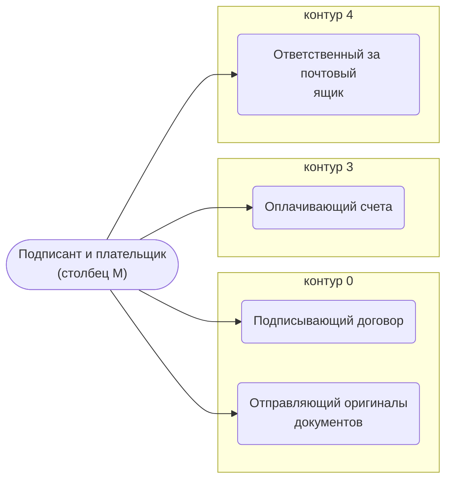

# Подписант и плательщик (столбец M)

Оплачивает счета и доплаты, подписывает договор с заказчиком через ЭДО.

- **Контур:** 3
- **Столбец регламента:** M
- **Источник:** регламент; ответы
- **Почему выделили:** В регламенте отдельный столбец; его шаги — только оплата и подпись.
- **Догадка, не подтверждено:** Директор (раунд 2, №4): столбец M сейчас — «тот, кто заполняет 5-3, 5-5 и следит за ходом выбранного». С регламентом это расходится — проверить.

## Обязанности, которые мы ей приписываем

- [Подписывающий договор](../../reg/oby/podpisanie.md) — Подписывает договор с заказчиком через ЭДО.
- [Отправляющий оригиналы документов](../../reg/oby/otpravka-originalov.md) — Отправляет заказчику подписанный оригинал договора и другие бумажные документы. *(вместе с: [Логист](../../reg/rol/logist.md))*
- [Оплачивающий счета](../../reg/oby/oplata.md) — Оплачивает счета и доплаты и возвращает платёжные поручения. *(вместе с: [Казначей](../../reg/rol/kaznachey.md))*
- [Ответственный за почтовый ящик](../../reg/oby/otvetstvennyy-za-yashchik.md) — Получив документ о несоответствии на свой ящик, передаёт его на регистрацию. *(вместе с: [Менеджер проекта](../../reg/rol/proekt.md), [Технический эксперт (ТС)](../../reg/rol/tekh.md), [Логист](../../reg/rol/logist.md))*

## Шаги процессов

| Процесс | № | Шаг | Обязанность |
|---|---|---|---|
| [Процесс. Контрактация](../../pro/r02-kontraktatsiya/index.md) | 15 | Подписание договора через ЭДО | [Подписывающий договор](../../reg/oby/podpisanie.md) |
| [Процесс. Контрактация](../../pro/r02-kontraktatsiya/index.md) | 17 | Направление подписанного оригинала договора заказчику. | [Отправляющий оригиналы документов](../../reg/oby/otpravka-originalov.md) |
| [Процесс. Закупка товара](../../pro/r04-zakupka-tovara/index.md) | 22 | Оплата полученных счетов и передача платежных поручений K | [Оплачивающий счета](../../reg/oby/oplata.md) |
| [Процесс. Поступление: контроль поставки, доплаты, доставка, приёмка](../../pro/r06-postuplenie/index.md) | 15 | Доплата полученных счетов и передача платежных поручений K | [Оплачивающий счета](../../reg/oby/oplata.md) |
| [Процесс. Устранение несоответствий](../../pro/r10-nesootvetstviya/index.md) | 16 | Вход в процесс: поступление документов о несоответствии продукции требованиям договора | [Ответственный за почтовый ящик](../../reg/oby/otvetstvennyy-za-yashchik.md) |
| [Процесс. Устранение несоответствий](../../pro/r10-nesootvetstviya/index.md) | 17 | Передача документа о несоответствии на регистрацию Координатору | [Ответственный за почтовый ящик](../../reg/oby/otvetstvennyy-za-yashchik.md) |

## Где должность названа прямо

| Процесс | № | Шаг | Как |
|---|---|---|---|
| [Процесс. Планирование и контроль исполнения](../../pro/r05-planirovanie-ispolneniya/index.md) | 0 | Разработка Плана исполнения и Рекомендаций, Контрольных точек, Инструктаж по исполнению | узнают о результате |
| [Процесс. Планирование и контроль исполнения](../../pro/r05-planirovanie-ispolneniya/index.md) | 0 | Управление изменениями выявлено несоответствие между договором и реальностью | узнают о результате |
