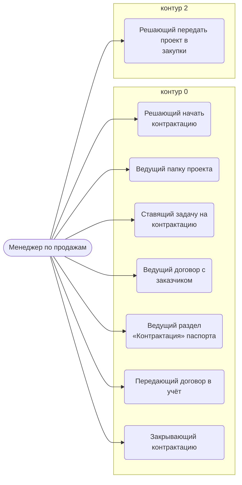
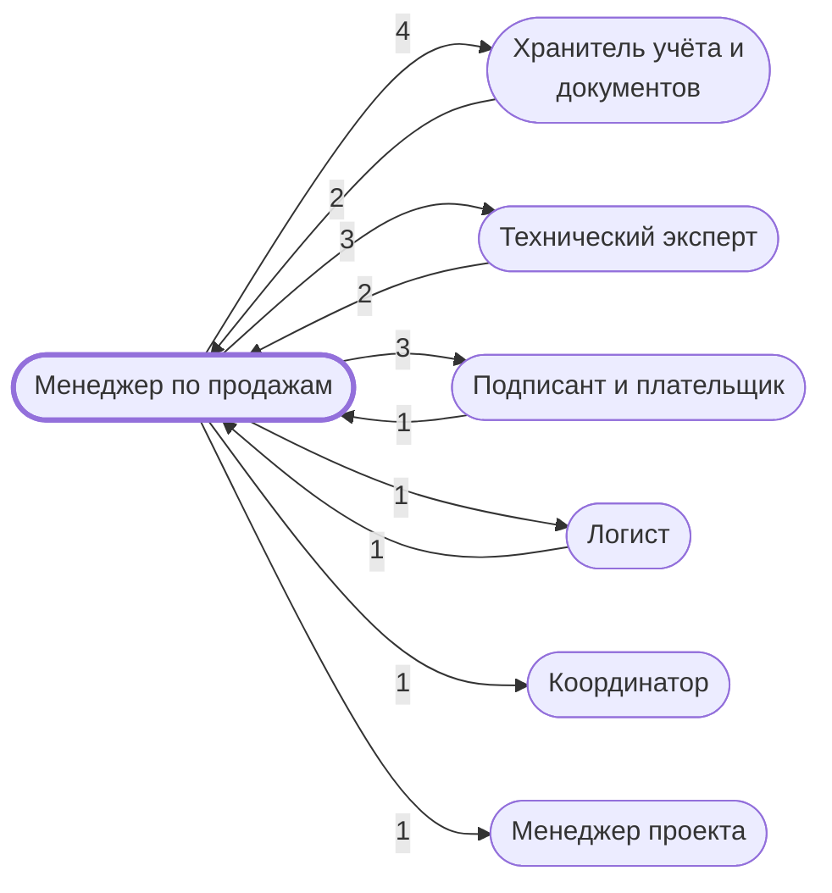

# Менеджер по продажам

До договора: ведёт папку проекта и заявку, заключает договор с заказчиком (контрактация).

- **Контур:** 0
- **Как ещё называют:** Менеджер (регламент, Контрактация); РОП — упомянут один раз через «или»
- **Столбец регламента:** H
- **Источник:** регламент; ответы
- **Почему выделили:** Директор (раунд 2, №5): две должности — менеджер по продажам до договора и менеджер проекта после. В «Структуре папок» папки проекта создаёт и наполняет «Менеджер по продажам».
- **Догадка, не подтверждено:** В регламенте оба менеджера — один столбец H, поэтому сверка с регламентом их не различает.

## Обязанности, которые мы ей приписываем

- [Решающий начать контрактацию](../../reg/oby/reshenie-kontraktatsiya.md) — По письму или протоколу заказчика решает заключать договор и ставит статус «Заключаем договор».
- [Ведущий папку проекта](../../reg/oby/papka-proekta.md) — Создаёт «Рабочие документы» и «Контрактация», открывает доступ исполнению, раскладывает документы заявки и договора.
- [Ставящий задачу на контрактацию](../../reg/oby/postanovka-kontraktatsii.md) — Ставит по шаблону задачу «Заключить договор»: папка, контакты заказчика, особые указания, чек-лист.
- [Ведущий договор с заказчиком](../../reg/oby/dogovor-s-zakazchikom.md) — Общается с заказчиком о заключении и подписании, получает проект договора, ставит задачи на его проверку, отправляет подписанный скан.
- [Ведущий раздел «Контрактация» паспорта](../../reg/oby/pasport-kontraktatsiya.md) — Записывает в паспорт проекта даты и сведения о договоре: протокол итогов, сроки подписания, когда пришёл проект договора.
- [Передающий договор в учёт](../../reg/oby/peredacha-v-uchet.md) — Ставит подзадачу внести номер и дату договора в 1С и таблицы и проверяет, что договор внесён.
- [Закрывающий контрактацию](../../reg/oby/zakrytie-kontraktatsii.md) — Ставит статус «Договор заключен», завершает задачу и сдаёт её Координатору.
- [Решающий передать проект в закупки](../../reg/oby/reshenie-peredachi.md) — Решает, что проект идёт в закупки.

## Шаги процессов

| Процесс | № | Шаг | Обязанность |
|---|---|---|---|
| [Процесс. Передача в контрактацию](../../pro/r01-peredacha-v-kontraktatsiyu/index.md) | 0 | Вход в процесс "Передача в Контрактацию" | [Решающий начать контрактацию](../../reg/oby/reshenie-kontraktatsiya.md) |
| [Процесс. Передача в контрактацию](../../pro/r01-peredacha-v-kontraktatsiyu/index.md) | 1 | Создание в папке Проекта подпапки "...Рабочие документы" и создание в ней папки "КОНТРАКТАЦИЯ". | [Ведущий папку проекта](../../reg/oby/papka-proekta.md) |
| [Процесс. Передача в контрактацию](../../pro/r01-peredacha-v-kontraktatsiyu/index.md) | 2 | Открытие доступа к папке "...рабочие Документы" отделению Исполнения | [Ведущий папку проекта](../../reg/oby/papka-proekta.md) |
| [Процесс. Передача в контрактацию](../../pro/r01-peredacha-v-kontraktatsiyu/index.md) | 3 | Размещение в папке "КОНТРАКТАЦИЯ" документов: | [Ведущий папку проекта](../../reg/oby/papka-proekta.md) |
| [Процесс. Передача в контрактацию](../../pro/r01-peredacha-v-kontraktatsiyu/index.md) | 4 | Постановка Задачи на Контрактацию | [Ставящий задачу на контрактацию](../../reg/oby/postanovka-kontraktatsii.md) |
| [Процесс. Контрактация](../../pro/r02-kontraktatsiya/index.md) | 5 | Взаимодействие с Заказчиком по вопросу ЗАКЛЮЧЕНИЯ договора | [Ведущий договор с заказчиком](../../reg/oby/dogovor-s-zakazchikom.md) |
| [Процесс. Контрактация](../../pro/r02-kontraktatsiya/index.md) | 6 | Заполнение раздела КОНТРАКТАЦИЯ на листе 0-0 Паспорт проекта | [Ведущий раздел «Контрактация» паспорта](../../reg/oby/pasport-kontraktatsiya.md) |
| [Процесс. Контрактация](../../pro/r02-kontraktatsiya/index.md) | 7 | Создание в папке Проекта подпапки "...Рабочие документы" папки "Договор". | [Ведущий папку проекта](../../reg/oby/papka-proekta.md) |
| [Процесс. Контрактация](../../pro/r02-kontraktatsiya/index.md) | 8 | Получение проекта договора от заказчика. (примечание: проект договора в данном контексте это в том числе редактируемая версия текста договора). | [Ведущий договор с заказчиком](../../reg/oby/dogovor-s-zakazchikom.md) |
| [Процесс. Контрактация](../../pro/r02-kontraktatsiya/index.md) | 9 | Постановка задачи на проверку (или заполнение, если к нам вошел договор в редактируемом формате) направленного проекта договора. | [Ведущий договор с заказчиком](../../reg/oby/dogovor-s-zakazchikom.md) |
| [Процесс. Контрактация](../../pro/r02-kontraktatsiya/index.md) | 11 | Постановка задачи на проверку ТЗ (или заполнение, если к нам вошел договор в редактируемом формате) направленного ТЗ и перечня документов которые нужно включить в счета или договоры (лист 3-3) | [Ведущий договор с заказчиком](../../reg/oby/dogovor-s-zakazchikom.md) |
| [Процесс. Контрактация](../../pro/r02-kontraktatsiya/index.md) | 13 | Взаимодействие с Заказчиком по вопросу ПОДПИСАНИЯ договора | [Ведущий договор с заказчиком](../../reg/oby/dogovor-s-zakazchikom.md) |
| [Процесс. Контрактация](../../pro/r02-kontraktatsiya/index.md) | 14 | Информирование M, о том, что надо подписать договор через ЭДО | [Ведущий договор с заказчиком](../../reg/oby/dogovor-s-zakazchikom.md) |
| [Процесс. Контрактация](../../pro/r02-kontraktatsiya/index.md) | 16 | Направление скан копии подписанного договора заказчику. | [Ведущий договор с заказчиком](../../reg/oby/dogovor-s-zakazchikom.md) |
| [Процесс. Контрактация](../../pro/r02-kontraktatsiya/index.md) | 18 | Передача в отдел Исполнения заключенного договора для внесения информации в 1с и табличные системы. | [Передающий договор в учёт](../../reg/oby/peredacha-v-uchet.md) |
| [Процесс. Контрактация](../../pro/r02-kontraktatsiya/index.md) | 19 | Закрытие этапа Контрактация | [Закрывающий контрактацию](../../reg/oby/zakrytie-kontraktatsii.md) |
| [Процесс. Контрактация](../../pro/r02-kontraktatsiya/index.md) | 20 | Приемка этапа Контрактации | [Закрывающий контрактацию](../../reg/oby/zakrytie-kontraktatsii.md) |
| [Процесс. Передача в закупки](../../pro/r03-peredacha-v-zakupki/index.md) | 0 | Вход в процесс "Передача в Закупки" | [Решающий передать проект в закупки](../../reg/oby/reshenie-peredachi.md) |

## С кем работает

Сколько раз работа переходит от должности к должности (ставит задачу, передаёт результат, следующий шаг) — по всем процессам.

## Где должность названа прямо

| Процесс | № | Шаг | Как |
|---|---|---|---|
| [Процесс. Контрактация](../../pro/r02-kontraktatsiya/index.md) | 10 | Заполнение/проверка проекта договора. | помогают |
