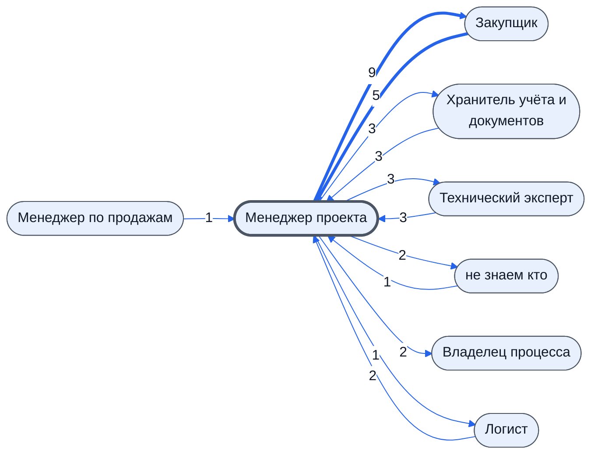

# Менеджер проекта

Согласует сделку и отклонения от задания. В отсутствие Технического эксперта согласует название товара.

- **Контур:** 0 — управление; ведёт проект после договора через все контуры
- **Как ещё называют:** Ответственный за сделку Менеджер (смарт-процесс); Руководитель проекта; Менеджер (регламент)
- **Столбец регламента:** H
- **Источник:** роли.docx; регламент; смарт-процесс; ответы
- **Почему выделили:** Во всех источниках есть человек, который принимает решения по проекту; в регламенте у столбца H больше всего шагов.
- **Где упоминается:** [Лист. 5-0 Передача в закупку](../../lis/k2-5-0-peredacha/index.md)

## Обязанности, которые мы ей приписываем

```mermaid
%%{init: {"theme": "base", "themeVariables": {"fontSize": "16px", "primaryColor": "#e8f0fe", "primaryTextColor": "#111827", "primaryBorderColor": "#4b5563", "lineColor": "#2563eb", "textColor": "#111827", "clusterBkg": "#fffbe6", "clusterBorder": "#9ca3af", "edgeLabelBackground": "#ffffff", "signalColor": "#2563eb", "signalTextColor": "#1d4ed8", "noteBkgColor": "#fff3b0", "noteTextColor": "#111827", "noteBorderColor": "#a16207", "actorBkg": "#e8f0fe", "actorTextColor": "#111827", "actorBorder": "#4b5563", "actorLineColor": "#9ca3af", "labelBoxBkgColor": "#e8f0fe", "labelTextColor": "#111827"}}}%%
flowchart LR
  r_proekt(["Менеджер проекта"])
  subgraph k_2["контур 2"]
    o_peredacha_v_zakupku("Передающий проект в<br/>закупку")
    o_list_5_0("Фиксирующий задание на<br/>закупку (лист 5-0)")
    o_proverka_komplektnosti("Проверяющий комплектность<br/>передачи в закупку")
    o_postanovka_zakupki("Ставящий задачу на закупку")
    o_kontrol_vybora("Отслеживающий выбор<br/>поставщиков")
    o_soglasovanie_otkloneniy("Согласующий сделку и<br/>отклонения")
    o_reshenie_sdelka("Решающий о сделке с<br/>поставщиком")
  end
  subgraph k_1["контур 1"]
    o_pasport_rascheta("Заполняющий паспорт<br/>расчёта")
    o_reshenie_ekspertiza("Решающий о тех. экспертизе")
    o_kommercheskaya_chast("Готовящий коммерческую<br/>часть КП")
  end
  subgraph k_4["контур 4"]
    o_plan_ispolneniya("Составляющий план<br/>исполнения")
    o_upravlenie_izmeneniyami("Управляющий изменениями")
    o_format_priemki("Назначающий формат приёмки")
    o_reshenie_problem("Решающий по проблемам<br/>поставки")
    o_reshenie_priemka("Решающий о приёмке")
    o_kontrol_ispolneniya("Отслеживающий исполнение<br/>договора")
    o_dozhim_zakazchika("Добивающийся приёмки и<br/>оплаты от заказчика")
    o_otvetstvennyy_za_yashchik("Ответственный за почтовый<br/>ящик")
    o_vedenie_nesootvetstviya("Ведущий устранение<br/>несоответствия")
  end
  subgraph k_3["контур 3"]
    o_isk("Инициирующий судебный иск")
  end
  r_proekt --> o_peredacha_v_zakupku
  r_proekt --> o_list_5_0
  r_proekt --> o_proverka_komplektnosti
  r_proekt --> o_postanovka_zakupki
  r_proekt --> o_pasport_rascheta
  r_proekt --> o_reshenie_ekspertiza
  r_proekt --> o_kommercheskaya_chast
  r_proekt --> o_kontrol_vybora
  r_proekt --> o_soglasovanie_otkloneniy
  r_proekt --> o_reshenie_sdelka
  r_proekt --> o_plan_ispolneniya
  r_proekt --> o_upravlenie_izmeneniyami
  r_proekt --> o_format_priemki
  r_proekt --> o_reshenie_problem
  r_proekt --> o_reshenie_priemka
  r_proekt --> o_kontrol_ispolneniya
  r_proekt --> o_dozhim_zakazchika
  r_proekt --> o_isk
  r_proekt --> o_otvetstvennyy_za_yashchik
  r_proekt --> o_vedenie_nesootvetstviya
```

- [Передающий проект в закупку](../../reg/oby/peredacha-v-zakupku.md) — Ставит и дополняет задачу «Передача в закупку» с подзадачами по шаблону.
- [Фиксирующий задание на закупку (лист 5-0)](../../reg/oby/list-5-0.md) — Заполняет лист 5-0 как в договоре: наименования, характеристики, изготовители, страны, документация.
- [Проверяющий комплектность передачи в закупку](../../reg/oby/proverka-komplektnosti.md) — Проверяет, хватает ли сведений в таблице и задаче для закупки и утверждена ли смета; пишет замечания в чат задачи.
- [Ставящий задачу на закупку](../../reg/oby/postanovka-zakupki.md) — Ставит задачу «Закупка» конкретному закупщику: цель (мониторинг или закупка), сроки; статус «Передано в Закупки»; при недопоставке — заново. *(вместе с: [Владелец процесса (руководитель исполнителя)](../../reg/rol/vladelets.md))*
- [Заполняющий паспорт расчёта](../../reg/oby/pasport-rascheta.md) — Заполняет обязательные поля паспорта в смарт-процессе «Расчет» — они уходят в таблицу расчёта.
- [Решающий о тех. экспертизе](../../reg/oby/reshenie-ekspertiza.md) — Решает, нужна ли техническая экспертиза расчёта.
- [Готовящий коммерческую часть КП](../../reg/oby/kommercheskaya-chast.md) — Анализирует выбор на листе 3-3, задаёт итоговую сумму и проверяет цены на листе 4-3.
- [Отслеживающий выбор поставщиков](../../reg/oby/kontrol-vybora.md) — Следит на листе 5-3 за комментариями по итогам общения и за новыми ценами; при необходимости решает заменить поставщика.
- [Согласующий сделку и отклонения](../../reg/oby/soglasovanie-otkloneniy.md) — Согласует сделку и отклонения от задания; без ТС — название товара.
- [Решающий о сделке с поставщиком](../../reg/oby/reshenie-sdelka.md) — Решает заключать сделку с выбранным поставщиком.
- [Составляющий план исполнения](../../reg/oby/plan-ispolneniya.md) — Разрабатывает план исполнения, рекомендации и контрольные точки, инструктирует участников.
- [Управляющий изменениями](../../reg/oby/upravlenie-izmeneniyami.md) — Решает, что делать, когда договор расходится с реальностью.
- [Назначающий формат приёмки](../../reg/oby/format-priemki.md) — Выбирает приёмку: удалённая, выездная, на складе комплектации или на терминале ТК.
- [Решающий по проблемам поставки](../../reg/oby/reshenie-problem.md) — Принимает решение по эскалированным проблемам.
- [Решающий о приёмке](../../reg/oby/reshenie-priemka.md) — По каждой позиции решает принять товар или отказаться, выслушав логиста и ТС.
- [Отслеживающий исполнение договора](../../reg/oby/kontrol-ispolneniya.md) — Следит за статусами доставки и приёмки на листе «7 Исполнение», контролирует логиста, принимает оперативные решения.
- [Добивающийся приёмки и оплаты от заказчика](../../reg/oby/dozhim-zakazchika.md) — Продавливает подписание УПД, следит за сроками приёмки, выясняет, когда заплатят по претензии.
- [Инициирующий судебный иск](../../reg/oby/isk.md) — Инициирует судебный иск к заказчику.
- [Ответственный за почтовый ящик](../../reg/oby/otvetstvennyy-za-yashchik.md) — Получив документ о несоответствии на свой ящик, передаёт его на регистрацию. *(вместе с: [Технический эксперт (ТС)](../../reg/rol/tekh.md), [Логист](../../reg/rol/logist.md), [Подписант и плательщик (столбец M)](../../reg/rol/podpisant.md))*
- [Ведущий устранение несоответствия](../../reg/oby/vedenie-nesootvetstviya.md) — Решает, как устранять, выдаёт поручения на устранение и на ответ, организует устранение, собирает объяснения, закрывает процесс.

## Шаги процессов

| Процесс | № | Шаг | Обязанность |
|---|---|---|---|
| [Процесс. Передача в закупки](../../pro/r03-peredacha-v-zakupki/index.md) | 1 | Постановка задачи на Передачу в закупки | [Передающий проект в закупку](../../reg/oby/peredacha-v-zakupku.md) |
| [Процесс. Передача в закупки](../../pro/r03-peredacha-v-zakupki/index.md) | 2 | Дополнить шаблоны подзадач | [Передающий проект в закупку](../../reg/oby/peredacha-v-zakupku.md) |
| [Процесс. Передача в закупки](../../pro/r03-peredacha-v-zakupki/index.md) | 3 | Выполнить подзадачу " Заполнить лист 5-0" | [Фиксирующий задание на закупку (лист 5-0)](../../reg/oby/list-5-0.md) |
| [Процесс. Передача в закупки](../../pro/r03-peredacha-v-zakupki/index.md) | 4 | Выполнить подзадачу "Проверить комплектность передачи проекта в закупку" | [Проверяющий комплектность передачи в закупку](../../reg/oby/proverka-komplektnosti.md) |
| [Процесс. Передача в закупки](../../pro/r03-peredacha-v-zakupki/index.md) | 5 | Выполнить подзадачу "Поставить задачу на закупку" | [Ставящий задачу на закупку](../../reg/oby/postanovka-zakupki.md) |
| [Процесс. Передача в закупки](../../pro/r03-peredacha-v-zakupki/index.md) | 7 | Возобновление Закупок по проекту (в случае невыполнения поставок контрагентами, необходимости дозакупить что-либо и т.д.) | [Ставящий задачу на закупку](../../reg/oby/postanovka-zakupki.md) |
| [Процесс. Закупка товара](../../pro/r04-zakupka-tovara/index.md) | 4 | Отслеживание комментариев по итогу общения с выбранными поставщиками на листе "5 Закупка товара". | [Отслеживающий выбор поставщиков](../../reg/oby/kontrol-vybora.md) |
| [Процесс. Закупка товара](../../pro/r04-zakupka-tovara/index.md) | 5 | Отслеживания результатов повторной рассылки на листе "3-3 Выбор поставщиков" В случае необходимости замены поставщиков, принятие решения по такой замене. | [Отслеживающий выбор поставщиков](../../reg/oby/kontrol-vybora.md) |
| [Процесс. Закупка товара](../../pro/r04-zakupka-tovara/index.md) | 10 | Решение о заключении сделки с выбранным поставщиком | [Решающий о сделке с поставщиком](../../reg/oby/reshenie-sdelka.md) |
| [Процесс. Планирование и контроль исполнения](../../pro/r05-planirovanie-ispolneniya/index.md) | 0 | Разработка Плана исполнения и Рекомендаций, Контрольных точек, Инструктаж по исполнению | [Составляющий план исполнения](../../reg/oby/plan-ispolneniya.md) |
| [Процесс. Планирование и контроль исполнения](../../pro/r05-planirovanie-ispolneniya/index.md) | 0 | Управление изменениями выявлено несоответствие между договором и реальностью | [Управляющий изменениями](../../reg/oby/upravlenie-izmeneniyami.md) |
| [Процесс. Поступление: контроль поставки, доплаты, доставка, приёмка](../../pro/r06-postuplenie/index.md) | 1 | Назначение формата приемок | [Назначающий формат приёмки](../../reg/oby/format-priemki.md) |
| [Процесс. Поступление: контроль поставки, доплаты, доставка, приёмка](../../pro/r06-postuplenie/index.md) | 8 | Принятие решение по эскалированным проблемам | [Решающий по проблемам поставки](../../reg/oby/reshenie-problem.md) |
| [Процесс. Поступление: контроль поставки, доплаты, доставка, приёмка](../../pro/r06-postuplenie/index.md) | 24 | Принятие решения о приемке или отказе от приемки | [Решающий о приёмке](../../reg/oby/reshenie-priemka.md) |
| [Процесс. Отгрузка](../../pro/r08-otgruzka/index.md) | 13 | Отслеживание текущих статусов доставки и приемки товара на листе "7 Исполнение" в таблице проекта или в сводной таблице проекта. Контроль за ходом деятельности логиста, в случае необходимости принятие - оперативных решений | [Отслеживающий исполнение договора](../../reg/oby/kontrol-ispolneniya.md) |
| [Процесс. Отгрузка](../../pro/r08-otgruzka/index.md) | 14 | Продавливание приемки товара (подписания УПД) | [Добивающийся приёмки и оплаты от заказчика](../../reg/oby/dozhim-zakazchika.md) |
| [Процесс. Устранение несоответствий](../../pro/r10-nesootvetstviya/index.md) | 16 | Вход в процесс: поступление документов о несоответствии продукции требованиям договора | [Ответственный за почтовый ящик](../../reg/oby/otvetstvennyy-za-yashchik.md) |
| [Процесс. Устранение несоответствий](../../pro/r10-nesootvetstviya/index.md) | 17 | Передача документа о несоответствии на регистрацию Координатору | [Ответственный за почтовый ящик](../../reg/oby/otvetstvennyy-za-yashchik.md) |
| [Процесс. Устранение несоответствий](../../pro/r10-nesootvetstviya/index.md) | 21 | Принятие решения по устранению несоответствий | [Ведущий устранение несоответствия](../../reg/oby/vedenie-nesootvetstviya.md) |
| [Процесс. Устранение несоответствий](../../pro/r10-nesootvetstviya/index.md) | 23 | Выдача поручения по устранению несоответствий и организация его выполнения | [Ведущий устранение несоответствия](../../reg/oby/vedenie-nesootvetstviya.md) |
| [Процесс. Устранение несоответствий](../../pro/r10-nesootvetstviya/index.md) | 24 | Выдача поручения по подготовке ответа на документ о несоответствии и организация его выполнения | [Ведущий устранение несоответствия](../../reg/oby/vedenie-nesootvetstviya.md) |
| [Процесс. Устранение несоответствий](../../pro/r10-nesootvetstviya/index.md) | 25 | Устранение несоответствий | [Ведущий устранение несоответствия](../../reg/oby/vedenie-nesootvetstviya.md) |
| [Процесс. Устранение несоответствий](../../pro/r10-nesootvetstviya/index.md) | 28 | Сбор объяснений по возникновению несоответствий и сбор предложений по предотвращению/снижению рисков возникновения подобных несоответствий | [Ведущий устранение несоответствия](../../reg/oby/vedenie-nesootvetstviya.md) |
| [Процесс. Устранение несоответствий](../../pro/r10-nesootvetstviya/index.md) | 29 | Закрытие процесса Устранение несоответствий | [Ведущий устранение несоответствия](../../reg/oby/vedenie-nesootvetstviya.md) |
| [Процесс. Контроль исполнения заказчиком](../../pro/r11-kontrol-zakazchika/index.md) | 30 | Отслеживание сроков приемки по проекту и принятие мер (например отправка письма о том, что считаем, что замечаний нет.) | [Добивающийся приёмки и оплаты от заказчика](../../reg/oby/dozhim-zakazchika.md) |
| [Процесс. Контроль исполнения заказчиком](../../pro/r11-kontrol-zakazchika/index.md) | 36 | Выяснение вопросов по претензии (когда заплатят деньги) | [Добивающийся приёмки и оплаты от заказчика](../../reg/oby/dozhim-zakazchika.md) |
| [Процесс. Контроль исполнения заказчиком](../../pro/r11-kontrol-zakazchika/index.md) | 37 | Инициирование Судебного Иска | [Инициирующий судебный иск](../../reg/oby/isk.md) |

## С кем работает

Сколько раз работа переходит от должности к должности (ставит задачу, передаёт результат, следующий шаг) — по всем процессам.

## Где должность названа прямо

| Процесс | № | Шаг | Как |
|---|---|---|---|
| [Процесс. Закупка товара](../../pro/r04-zakupka-tovara/index.md) | 18 | Информирование в задаче K о том, что размещены новые Счета и договора | узнают о результате |
| [Процесс. Закупка товара](../../pro/r04-zakupka-tovara/index.md) | 25 | Закрытие этапа Закупки | помогают |
| [Процесс. Поступление: контроль поставки, доплаты, доставка, приёмка](../../pro/r06-postuplenie/index.md) | 21 | Составление фотоотчета | узнают о результате |
| [Процесс. Поступление: контроль поставки, доплаты, доставка, приёмка](../../pro/r06-postuplenie/index.md) | 22 | Приемка товара по количеству | узнают о результате |
| [Процесс. Поступление: контроль поставки, доплаты, доставка, приёмка](../../pro/r06-postuplenie/index.md) | 23 | Приемка товара по качеству | узнают о результате |
| [Процесс. Подготовка к отгрузке](../../pro/r07-podgotovka-k-otgruzke/index.md) | 6 | Проверка комплектности отгружаемого товара( в том числе документации) и соответствие отгрузочным документам | узнают о результате |
| [Процесс. Подготовка к отгрузке](../../pro/r07-podgotovka-k-otgruzke/index.md) | 7 | Составление ведомости передаваемых технических документов на отгружаемый товар | узнают о результате |
| [Процесс. Устранение несоответствий](../../pro/r10-nesootvetstviya/index.md) | 27 | Обеспечение отправки подготовленного ответа | узнают о результате |
