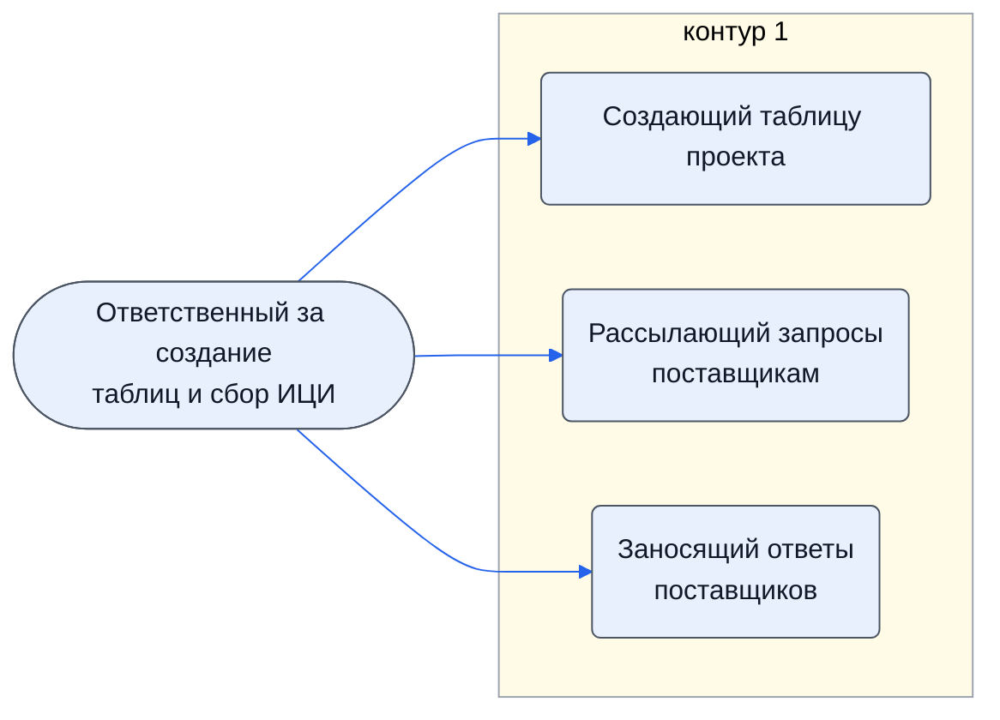

# Ответственный за создание таблиц и сбор ИЦИ

Создаёт таблицу проекта и запускает триггеры, находит поставщиков и рассылает запросы, по ответам заполняет список предложений — листы групп 1 и 2.

- **Контур:** 1 — расчёт, листы 1-x и 2-x
- **Как ещё называют:** Специалист по выполнению расчёта (3.1.3)
- **Источник:** смарт-процесс; 3.1.2; ответы
- **Почему выделили:** Директор (раунд 2, №11): в контуре 1 работают в паре с экспертом — один находит поставщиков и шлёт письма, по ответам заполняет предложения; эксперт проверяет поставщиков и предложения.
- **Где упоминается:** [Инструкция. Авторизация скриптов](../../tio/skr-avtorizatsiya/index.md), [Инструкция. Запуск триггеров](../../tio/skr-zapusk-triggerov/index.md)

## Обязанности, которые мы ей приписываем

- [Создающий таблицу проекта](../../reg/oby/sozdanie-tablitsy.md) — Создаёт таблицу из чистой копии от аккаунта таблиц, связывает со смарт-процессом, авторизует скрипты и один раз запускает триггеры.
- [Рассылающий запросы поставщикам](../../reg/oby/rassylka-zaprosov.md) — Находит поставщиков, группирует товары, рассылает письма; добирает адреса, если цен нет или их меньше трёх.
- [Заносящий ответы поставщиков](../../reg/oby/zanesenie-otvetov.md) — По ответам поставщиков заполняет список предложений на листе 1-1: цены, сроки, модели.

