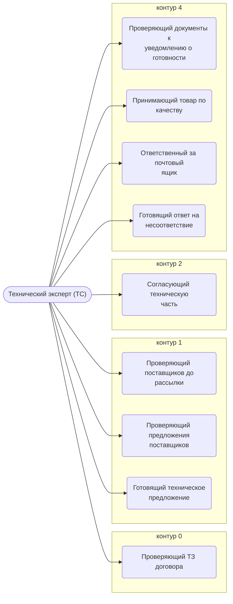

# Технический эксперт (ТС)

Согласует техническую часть: ТЗ, договор, спецификацию, Изготовителя, состав документации. Проверяет документы и фотоотчёт к уведомлению о готовности. Согласует отклонение названия товара от задания.

- **Контур:** 1 — расчёт, листы 3-x и 4-x; в закупке и приёмке — согласует
- **Как ещё называют:** Ответственный за расчёт и тех. часть (смарт-процесс); Технический специалист; Специалист по подбору оборудования; Инженер; Эксперт; Специалист по расчёту (3.1.2)
- **Столбец регламента:** I
- **Источник:** роли.docx; регламент; смарт-процесс; лист 3-2; ответы
- **Почему выделили:** Директор (раунд 1): ТС, инженер и специалист по подбору оборудования — одна роль; «специалист по расчёту» ближе к эксперту, листы групп 3 и 4.

## Обязанности, которые мы ей приписываем

- [Проверяющий ТЗ договора](../../reg/oby/proverka-tz.md) — Сверяет наименования, характеристики и ТЗ договора с нашим ТП; даёт заключение в задаче.
- [Проверяющий поставщиков до рассылки](../../reg/oby/proverka-postavshchikov.md) — Проверяет, что у найденных поставщиков есть такие товары, и согласует список адресов.
- [Проверяющий предложения поставщиков](../../reg/oby/ekspertiza-predlozheniy.md) — На листе 3-2 проверяет название и изготовителя, пишет комментарий и выбирает решение: основной, резерв, уточнить, условно, нет.
- [Готовящий техническое предложение](../../reg/oby/tp.md) — Техническая часть листа 4-3 и файлы технического предложения.
- [Согласующий техническую часть](../../reg/oby/teh-soglasovanie.md) — Рассматривает предложения, счета, договоры, ТЗ, изготовителя и состав документации в технической части.
- [Проверяющий документы к уведомлению о готовности](../../reg/oby/teh-gotovnost.md) — Проверяет документы и фотоотчёт к уведомлению о готовности.
- [Принимающий товар по качеству](../../reg/oby/priemka-kachestvo.md) — Проверяет маркировку, комплектацию, изготовителя и комплект технической документации.
- [Ответственный за почтовый ящик](../../reg/oby/otvetstvennyy-za-yashchik.md) — Получив документ о несоответствии на свой ящик, передаёт его на регистрацию. *(вместе с: [Менеджер проекта](../../reg/rol/proekt.md), [Логист](../../reg/rol/logist.md), [Подписант и плательщик (столбец M)](../../reg/rol/podpisant.md))*
- [Готовящий ответ на несоответствие](../../reg/oby/otvet-nesootvetstvie.md) — Готовит предложения по ответу, согласует и отправляет ответ.

## Шаги процессов

| Процесс | № | Шаг | Обязанность |
|---|---|---|---|
| [Процесс. Контрактация](../../pro/r02-kontraktatsiya/index.md) | 12 | Заполнение/проверка ТЗ | [Проверяющий ТЗ договора](../../reg/oby/proverka-tz.md) |
| [Процесс. Закупка товара](../../pro/r04-zakupka-tovara/index.md) | 9 | Рассмотрение предложений поставщиков в технической части | [Согласующий техническую часть](../../reg/oby/teh-soglasovanie.md) |
| [Процесс. Поступление: контроль поставки, доплаты, доставка, приёмка](../../pro/r06-postuplenie/index.md) | 23 | Приемка товара по качеству | [Принимающий товар по качеству](../../reg/oby/priemka-kachestvo.md) |
| [Процесс. Устранение несоответствий](../../pro/r10-nesootvetstviya/index.md) | 16 | Вход в процесс: поступление документов о несоответствии продукции требованиям договора | [Ответственный за почтовый ящик](../../reg/oby/otvetstvennyy-za-yashchik.md) |
| [Процесс. Устранение несоответствий](../../pro/r10-nesootvetstviya/index.md) | 17 | Передача документа о несоответствии на регистрацию Координатору | [Ответственный за почтовый ящик](../../reg/oby/otvetstvennyy-za-yashchik.md) |
| [Процесс. Устранение несоответствий](../../pro/r10-nesootvetstviya/index.md) | 26 | Подготовка предложений по ответу и согласование с заинтересованными сторонами | [Готовящий ответ на несоответствие](../../reg/oby/otvet-nesootvetstvie.md) |
| [Процесс. Устранение несоответствий](../../pro/r10-nesootvetstviya/index.md) | 27 | Обеспечение отправки подготовленного ответа | [Готовящий ответ на несоответствие](../../reg/oby/otvet-nesootvetstvie.md) |

## Где должность названа прямо

| Процесс | № | Шаг | Как |
|---|---|---|---|
| [Процесс. Планирование и контроль исполнения](../../pro/r05-planirovanie-ispolneniya/index.md) | 0 | Разработка Плана исполнения и Рекомендаций, Контрольных точек, Инструктаж по исполнению | узнают о результате |
| [Процесс. Планирование и контроль исполнения](../../pro/r05-planirovanie-ispolneniya/index.md) | 0 | Управление изменениями выявлено несоответствие между договором и реальностью | узнают о результате |
| [Процесс. Поступление: контроль поставки, доплаты, доставка, приёмка](../../pro/r06-postuplenie/index.md) | 1 | Назначение формата приемок | узнают о результате |
| [Процесс. Поступление: контроль поставки, доплаты, доставка, приёмка](../../pro/r06-postuplenie/index.md) | 21 | Составление фотоотчета | узнают о результате |
| [Процесс. Поступление: контроль поставки, доплаты, доставка, приёмка](../../pro/r06-postuplenie/index.md) | 22 | Приемка товара по количеству | узнают о результате |
| [Процесс. Поступление: контроль поставки, доплаты, доставка, приёмка](../../pro/r06-postuplenie/index.md) | 24 | Принятие решения о приемке или отказе от приемки | узнают о результате |
| [Процесс. Устранение несоответствий](../../pro/r10-nesootvetstviya/index.md) | 25 | Устранение несоответствий | помогают |
| [Процесс. Устранение несоответствий](../../pro/r10-nesootvetstviya/index.md) | 28 | Сбор объяснений по возникновению несоответствий и сбор предложений по предотвращению/снижению рисков возникновения подобных несоответствий | помогают |
