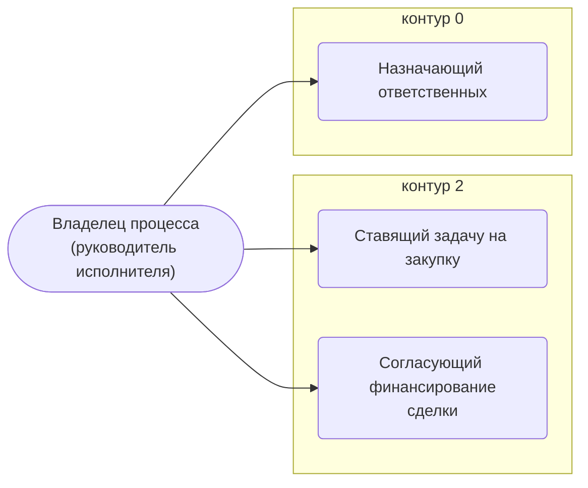

# Владелец процесса (руководитель исполнителя)

Ставит задачу «Закупить». Согласует сделку, в том числе наличие финансирования; назначает ответственных за экспорт и судебную работу.

- **Контур:** 0
- **Как ещё называют:** Владелец процесса закупок (роли.docx); Руководитель исполнителя (смарт-процесс)
- **Столбец регламента:** N
- **Источник:** роли.docx; регламент; смарт-процесс; ответы
- **Почему выделили:** Директор (раунд 2, №6): руководитель исполнителя и владелец процесса — один человек.

## Обязанности, которые мы ей приписываем

- [Ставящий задачу на закупку](../../reg/oby/postanovka-zakupki.md) — Ставит задачу «Закупка» конкретному закупщику: цель (мониторинг или закупка), сроки; статус «Передано в Закупки»; при недопоставке — заново. *(вместе с: [Менеджер проекта](../../reg/rol/proekt.md))*
- [Согласующий финансирование сделки](../../reg/oby/soglasovanie-finansirovaniya.md) — Согласует сделку, в том числе наличие финансирования.
- [Назначающий ответственных](../../reg/oby/naznachenie-otvetstvennyh.md) — Назначает ответственного за оформление экспорта и за судебно-исковую работу, решает, как вести суд.

## Шаги процессов

| Процесс | № | Шаг | Обязанность |
|---|---|---|---|
| [Процесс. Передача в закупки](../../pro/r03-peredacha-v-zakupki/index.md) | 5 | Выполнить подзадачу "Поставить задачу на закупку" | [Ставящий задачу на закупку](../../reg/oby/postanovka-zakupki.md) |
| [Процесс. Передача в закупки](../../pro/r03-peredacha-v-zakupki/index.md) | 7 | Возобновление Закупок по проекту (в случае невыполнения поставок контрагентами, необходимости дозакупить что-либо и т.д.) | [Ставящий задачу на закупку](../../reg/oby/postanovka-zakupki.md) |
| [Процесс. Оформление экспорта](../../pro/r09-oformlenie-eksporta/index.md) | 15 | Назначение ответственного за оформление Экспорта | [Назначающий ответственных](../../reg/oby/naznachenie-otvetstvennyh.md) |
| [Процесс. Контроль исполнения заказчиком](../../pro/r11-kontrol-zakazchika/index.md) | 38 | Планирование судебно исковой работы. | [Назначающий ответственных](../../reg/oby/naznachenie-otvetstvennyh.md) |

## С кем работает

Сколько раз работа переходит от должности к должности (ставит задачу, передаёт результат, следующий шаг) — по всем процессам.

## Где должность названа прямо

| Процесс | № | Шаг | Как |
|---|---|---|---|
| [Процесс. Планирование и контроль исполнения](../../pro/r05-planirovanie-ispolneniya/index.md) | 0 | Разработка Плана исполнения и Рекомендаций, Контрольных точек, Инструктаж по исполнению | узнают о результате |
| [Процесс. Планирование и контроль исполнения](../../pro/r05-planirovanie-ispolneniya/index.md) | 0 | Управление изменениями выявлено несоответствие между договором и реальностью | узнают о результате |
| [Процесс. Поступление: контроль поставки, доплаты, доставка, приёмка](../../pro/r06-postuplenie/index.md) | 10 | Проверка готовности к отгрузке | узнают о результате |
