# Закупщик (специалист по закупке)

Ведёт задачу «Закупить»: ищет Поставщика, проверяет контрагента, оформляет счёт или договор, проверяет их на соответствие заданию и регламенту.

- **Контур:** 2 — закупка, листы 5-x; часть шагов в исполнении
- **Как ещё называют:** Специалист по снабжению (Закупщик); Снабженец; Ответственный по закупке
- **Столбец регламента:** J
- **Источник:** роли.docx; регламент; ответы
- **Почему выделили:** В регламенте — владелец процесса «Закупка товара».
- **Догадка, не подтверждено:** Директор (раунд 2, №8): в конце закупки сотрудник контура 2 принимает задачу по оплате у K, а логист принимает задачу по закупке у него — значит, сотрудник контура 2 — закупщик.
- **Где упоминается:** [Лист. 5-0 Передача в закупку](../../lis/k2-5-0-peredacha/index.md), [Лист. 5-3 Выбор поставщиков Закупки](../../lis/k2-5-3-vybor-postavshchikov/index.md), [Лист. 5-4 Изменения в товарах](../../lis/k2-5-4-izmeneniya/index.md), [Инструкция по разделению товаров в таблице расчёта](../../tio/tov-razdelenie/index.md)

## Обязанности, которые мы ей приписываем

```mermaid
flowchart LR
  r_zakupka(["Закупщик (специалист по<br/>закупке)"])
  subgraph k_2["контур 2"]
    o_prinyatie_zakupki("Принимающий задачу на<br/>закупку")
    o_papka_zakupki("Ведущий папку закупки")
    o_povtornaya_rassylka("Рассылающий повторные<br/>запросы")
    o_vybor_postavshchika("Готовящий выбор поставщика")
    o_proverka_kontragenta("Проверяющий контрагента")
    o_postanovka_teh_soglasovaniya("Ставящий задачи на<br/>техническое согласование")
    o_dogovor_postavki("Готовящий договор поставки")
    o_poluchenie_schetov("Добывающий счета и<br/>договоры")
    o_vedenie_sdelok("Ведущий лист оформления<br/>сделок")
    o_soglasovanie_dokumentov("Проводящий согласование<br/>документов сделки")
    o_v_oplatu("Передающий согласованное в<br/>оплату")
    o_postanovka_oplaty("Ставящий задачу на оплату")
    o_zakrytie_zakupki("Закрывающий закупку")
  end
  subgraph k_4["контур 4"]
    o_otpravka_dogovorov_postavshchikam("Отправляющий поставщикам<br/>наши подписанные договоры")
    o_plan_sroki("Определяющий плановые<br/>сроки поставки")
    o_eskalatsiya("Эскалирующий задержки<br/>поставки")
    o_pretenzii_postavshchikam("Готовящий претензии<br/>поставщикам")
    o_gotovnost_otgruzki("Проверяющий готовность к<br/>отгрузке")
    o_tehdokumentatsiya("Собирающий техническую<br/>документацию")
    o_upd_postavshchika("Предъявляющий к приёмке<br/>УПД поставщика")
    o_motivirovannyy_otkaz("Направляющий<br/>мотивированный отказ")
  end
  r_zakupka --> o_prinyatie_zakupki
  r_zakupka --> o_papka_zakupki
  r_zakupka --> o_povtornaya_rassylka
  r_zakupka --> o_vybor_postavshchika
  r_zakupka --> o_proverka_kontragenta
  r_zakupka --> o_postanovka_teh_soglasovaniya
  r_zakupka --> o_dogovor_postavki
  r_zakupka --> o_poluchenie_schetov
  r_zakupka --> o_vedenie_sdelok
  r_zakupka --> o_soglasovanie_dokumentov
  r_zakupka --> o_v_oplatu
  r_zakupka --> o_postanovka_oplaty
  r_zakupka --> o_zakrytie_zakupki
  r_zakupka --> o_otpravka_dogovorov_postavshchikam
  r_zakupka --> o_plan_sroki
  r_zakupka --> o_eskalatsiya
  r_zakupka --> o_pretenzii_postavshchikam
  r_zakupka --> o_gotovnost_otgruzki
  r_zakupka --> o_tehdokumentatsiya
  r_zakupka --> o_upd_postavshchika
  r_zakupka --> o_motivirovannyy_otkaz
```

- [Принимающий задачу на закупку](../../reg/oby/prinyatie-zakupki.md) — Знакомится с задачей на закупку, проверяет достаточность сведений, решает вопросы и принимает в работу.
- [Ведущий папку закупки](../../reg/oby/papka-zakupki.md) — Создаёт «Закупки» с подпапками «Счета», «Договоры», «В оплату»; статус «Исполнение: Закупаем товары».
- [Рассылающий повторные запросы](../../reg/oby/povtornaya-rassylka.md) — Повторная рассылка (лист 5-2) и сбор предложений (лист 5-1), обязательно с наименованием товара.
- [Готовящий выбор поставщика](../../reg/oby/vybor-postavshchika.md) — Находит предложения с лучшими условиями (торг, кредит, сроки) и предлагает окончательный выбор на листе 5-3.
- [Проверяющий контрагента](../../reg/oby/proverka-kontragenta.md) — Проверяет выбранных поставщиков на добросовестность.
- [Ставящий задачи на техническое согласование](../../reg/oby/postanovka-teh-soglasovaniya.md) — Ставит ТС подзадачи: проверить выбранные предложения, согласовать счета и договоры; ведёт цепочку «задача — заключение».
- [Готовящий договор поставки](../../reg/oby/dogovor-postavki.md) — Готовит договор с поставщиком при закупке свыше 100 000 руб.
- [Добывающий счета и договоры](../../reg/oby/poluchenie-schetov.md) — Получает от поставщиков подписанные договоры или счета, оформленные по нашим требованиям.
- [Ведущий лист оформления сделок](../../reg/oby/vedenie-sdelok.md) — Отмечает ход оформления сделок с поставщиками на листе 5-5.
- [Проводящий согласование документов сделки](../../reg/oby/soglasovanie-dokumentov.md) — Собирает согласования счетов и договоров от ТС, менеджера и владельца процесса и сверяет с договором заказчика.
- [Передающий согласованное в оплату](../../reg/oby/v-oplatu.md) — Кладёт согласованные счета и договоры в «В оплату», ставит статус «Счет готов к оплате» / «Договор готов к оплате».
- [Ставящий задачу на оплату](../../reg/oby/postanovka-oplaty.md) — Ставит задачу «Оплатить счета» на проверку, оплату и заказы в 1С; сообщает в ней о новых счетах.
- [Закрывающий закупку](../../reg/oby/zakrytie-zakupki.md) — Когда по всем счетам есть платёжные поручения — закрывает этап, принимает задачу по оплате и передаёт задачу по закупке логисту.
- [Отправляющий поставщикам наши подписанные договоры](../../reg/oby/otpravka-dogovorov-postavshchikam.md) — Отправляет поставщикам договоры поставки, подписанные с нашей стороны.
- [Определяющий плановые сроки поставки](../../reg/oby/plan-sroki.md) — Определяет плановые сроки поставки. *(вместе с: [Логист](../../reg/rol/logist.md))*
- [Эскалирующий задержки поставки](../../reg/oby/eskalatsiya.md) — Сообщает менеджеру о затягивании сроков поставки.
- [Готовящий претензии поставщикам](../../reg/oby/pretenzii-postavshchikam.md) — Готовит и направляет претензии при задержке, некачественном товаре, недопоставке.
- [Проверяющий готовность к отгрузке](../../reg/oby/gotovnost-otgruzki.md) — Проверяет готовность поставщика к отгрузке и сообщает, что она подтверждена.
- [Собирающий техническую документацию](../../reg/oby/tehdokumentatsiya.md) — Получает от поставщиков технические документы на товар и кладёт их в папку проекта.
- [Предъявляющий к приёмке УПД поставщика](../../reg/oby/upd-postavshchika.md) — Выкладывает УПД или ТОРГ-12 в задачу «Приемка» и папку «На приемке», ставит срок приёмки. *(вместе с: [Логист](../../reg/rol/logist.md))*
- [Направляющий мотивированный отказ](../../reg/oby/motivirovannyy-otkaz.md) — Составляет и направляет поставщику мотивированный отказ от приёмки.

## Шаги процессов

| Процесс | № | Шаг | Обязанность |
|---|---|---|---|
| [Процесс. Передача в закупки](../../pro/r03-peredacha-v-zakupki/index.md) | 6 | Выполнить подзадачу "Принять задачу на закупку" | [Принимающий задачу на закупку](../../reg/oby/prinyatie-zakupki.md) |
| [Процесс. Закупка товара](../../pro/r04-zakupka-tovara/index.md) | 0 | Вход в процесс- Поставлена задача на закупку по проекту. №Проекта -Закзачик-предмет: Закупить товары" (или принятие этой задачи?!) | [Принимающий задачу на закупку](../../reg/oby/prinyatie-zakupki.md) |
| [Процесс. Закупка товара](../../pro/r04-zakupka-tovara/index.md) | 1 | Создание в папке "...Рабочие документы" подпапки "Закупки" | [Ведущий папку закупки](../../reg/oby/papka-zakupki.md) |
| [Процесс. Закупка товара](../../pro/r04-zakupka-tovara/index.md) | 2 | Создание в папке "... Закупки" подпапок "Счета", "Договоры" и "В оплату" | [Ведущий папку закупки](../../reg/oby/papka-zakupki.md) |
| [Процесс. Закупка товара](../../pro/r04-zakupka-tovara/index.md) | 3 | Повторная рассылка и заполнение внешней таблицы | [Рассылающий повторные запросы](../../reg/oby/povtornaya-rassylka.md) |
| [Процесс. Закупка товара](../../pro/r04-zakupka-tovara/index.md) | 6 | Определение предложений с лучшими условиями и подготовка предложения по Окончательному выбору поставщика. | [Готовящий выбор поставщика](../../reg/oby/vybor-postavshchika.md) |
| [Процесс. Закупка товара](../../pro/r04-zakupka-tovara/index.md) | 7 | Проверка выбранных поставщиков на добросовестность | [Проверяющий контрагента](../../reg/oby/proverka-kontragenta.md) |
| [Процесс. Закупка товара](../../pro/r04-zakupka-tovara/index.md) | 8 | Постановка задачи на проверку выбранных предложений ТС | [Ставящий задачи на техническое согласование](../../reg/oby/postanovka-teh-soglasovaniya.md) |
| [Процесс. Закупка товара](../../pro/r04-zakupka-tovara/index.md) | 11 | Подготовка договора поставки с поставщиком | [Готовящий договор поставки](../../reg/oby/dogovor-postavki.md) |
| [Процесс. Закупка товара](../../pro/r04-zakupka-tovara/index.md) | 12 | Получение подписанных договоров или оформленных по нашим требованиям счетов от выбранных Поставщиков | [Добывающий счета и договоры](../../reg/oby/poluchenie-schetov.md) |
| [Процесс. Закупка товара](../../pro/r04-zakupka-tovara/index.md) | 13 | Ведение Листа 5 (Таблица закупки внешняя) ( 5-4 в будущем) | [Ведущий лист оформления сделок](../../reg/oby/vedenie-sdelok.md) |
| [Процесс. Закупка товара](../../pro/r04-zakupka-tovara/index.md) | 14 | Постановка Задачи на согласование счетов/договоров в технической части | [Ставящий задачи на техническое согласование](../../reg/oby/postanovka-teh-soglasovaniya.md) |
| [Процесс. Закупка товара](../../pro/r04-zakupka-tovara/index.md) | 15 | Рассмотрение и согласование счетов и договоров и других документов в технической части (в том числе путем подготовки ТЗ для договора с поставщиком) | [Проводящий согласование документов сделки](../../reg/oby/soglasovanie-dokumentov.md) |
| [Процесс. Закупка товара](../../pro/r04-zakupka-tovara/index.md) | 16 | Размещение в папке "в оплату" согласованных с ТС счетов и договоров для оплаты | [Передающий согласованное в оплату](../../reg/oby/v-oplatu.md) |
| [Процесс. Закупка товара](../../pro/r04-zakupka-tovara/index.md) | 17 | Постановка Задачи K на проверку и оплату счетов и договоров, созданию в 1с Заказа покупателя и заказов поставщикам | [Ставящий задачу на оплату](../../reg/oby/postanovka-oplaty.md) |
| [Процесс. Закупка товара](../../pro/r04-zakupka-tovara/index.md) | 18 | Информирование в задаче K о том, что размещены новые Счета и договора | [Ставящий задачу на оплату](../../reg/oby/postanovka-oplaty.md) |
| [Процесс. Закупка товара](../../pro/r04-zakupka-tovara/index.md) | 25 | Закрытие этапа Закупки | [Закрывающий закупку](../../reg/oby/zakrytie-zakupki.md) |
| [Процесс. Поступление: контроль поставки, доплаты, доставка, приёмка](../../pro/r06-postuplenie/index.md) | 4 | Отправка поставщикам подписанных с нашей стороны договоров поставки | [Отправляющий поставщикам наши подписанные договоры](../../reg/oby/otpravka-dogovorov-postavshchikam.md) |
| [Процесс. Поступление: контроль поставки, доплаты, доставка, приёмка](../../pro/r06-postuplenie/index.md) | 5 | Определить плановые сроки поставки | [Определяющий плановые сроки поставки](../../reg/oby/plan-sroki.md) |
| [Процесс. Поступление: контроль поставки, доплаты, доставка, приёмка](../../pro/r06-postuplenie/index.md) | 7 | Эскалация проблемы в случае затягивания сроков | [Эскалирующий задержки поставки](../../reg/oby/eskalatsiya.md) |
| [Процесс. Поступление: контроль поставки, доплаты, доставка, приёмка](../../pro/r06-postuplenie/index.md) | 9 | Подготовка и направление претензии поставщикам при задержке срока поставки, поставке некачественного товара, недопоставке и тд | [Готовящий претензии поставщикам](../../reg/oby/pretenzii-postavshchikam.md) |
| [Процесс. Поступление: контроль поставки, доплаты, доставка, приёмка](../../pro/r06-postuplenie/index.md) | 10 | Проверка готовности к отгрузке | [Проверяющий готовность к отгрузке](../../reg/oby/gotovnost-otgruzki.md) |
| [Процесс. Поступление: контроль поставки, доплаты, доставка, приёмка](../../pro/r06-postuplenie/index.md) | 11 | Взаимодействие с поставщиками по вопросу получения технических документов на товар; Размещение в папке проекта "Техническая документация на товар" всех документов, полученных от поставщиков | [Собирающий техническую документацию](../../reg/oby/tehdokumentatsiya.md) |
| [Процесс. Поступление: контроль поставки, доплаты, доставка, приёмка](../../pro/r06-postuplenie/index.md) | 12 | Информирование о том, что готовность к отгрузке подтверждена | [Проверяющий готовность к отгрузке](../../reg/oby/gotovnost-otgruzki.md) |
| [Процесс. Поступление: контроль поставки, доплаты, доставка, приёмка](../../pro/r06-postuplenie/index.md) | 20 | Предъявление к приемке УПД или ТОРГ-12 от поставщика | [Предъявляющий к приёмке УПД поставщика](../../reg/oby/upd-postavshchika.md) |
| [Процесс. Поступление: контроль поставки, доплаты, доставка, приёмка](../../pro/r06-postuplenie/index.md) | 25 | Составление и направление мотивированного отказа | [Направляющий мотивированный отказ](../../reg/oby/motivirovannyy-otkaz.md) |

## Где должность названа прямо

| Процесс | № | Шаг | Как |
|---|---|---|---|
| [Процесс. Планирование и контроль исполнения](../../pro/r05-planirovanie-ispolneniya/index.md) | 0 | Разработка Плана исполнения и Рекомендаций, Контрольных точек, Инструктаж по исполнению | узнают о результате |
| [Процесс. Планирование и контроль исполнения](../../pro/r05-planirovanie-ispolneniya/index.md) | 0 | Управление изменениями выявлено несоответствие между договором и реальностью | узнают о результате |
| [Процесс. Поступление: контроль поставки, доплаты, доставка, приёмка](../../pro/r06-postuplenie/index.md) | 1 | Назначение формата приемок | узнают о результате |
| [Процесс. Поступление: контроль поставки, доплаты, доставка, приёмка](../../pro/r06-postuplenie/index.md) | 17 | Определения способа доставки и исполнителя | согласуют |
| [Процесс. Поступление: контроль поставки, доплаты, доставка, приёмка](../../pro/r06-postuplenie/index.md) | 21 | Составление фотоотчета | узнают о результате |
| [Процесс. Поступление: контроль поставки, доплаты, доставка, приёмка](../../pro/r06-postuplenie/index.md) | 22 | Приемка товара по количеству | узнают о результате |
| [Процесс. Поступление: контроль поставки, доплаты, доставка, приёмка](../../pro/r06-postuplenie/index.md) | 23 | Приемка товара по качеству | узнают о результате |
| [Процесс. Поступление: контроль поставки, доплаты, доставка, приёмка](../../pro/r06-postuplenie/index.md) | 24 | Принятие решения о приемке или отказе от приемки | узнают о результате |
| [Процесс. Устранение несоответствий](../../pro/r10-nesootvetstviya/index.md) | 25 | Устранение несоответствий | помогают |
| [Процесс. Устранение несоответствий](../../pro/r10-nesootvetstviya/index.md) | 26 | Подготовка предложений по ответу и согласование с заинтересованными сторонами | согласуют |
| [Процесс. Устранение несоответствий](../../pro/r10-nesootvetstviya/index.md) | 28 | Сбор объяснений по возникновению несоответствий и сбор предложений по предотвращению/снижению рисков возникновения подобных несоответствий | помогают |
