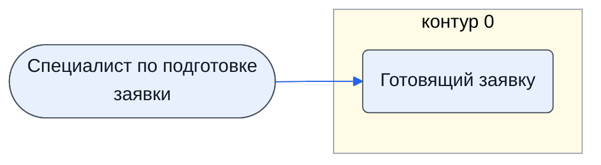

# Специалист по подготовке заявки

Контур 0: получает итоговый файл листа 4-3 и готовит по нему заявку на процедуру.

- **Контур:** 0
- **Источник:** 3.1.6; ответы
- **Почему выделили:** Директор (раунд 2, №9): заводить.

## Обязанности, которые мы ей приписываем

- [Готовящий заявку](../../reg/oby/zayavka.md) — По итоговому файлу листа 4-3 готовит заявку на процедуру.

