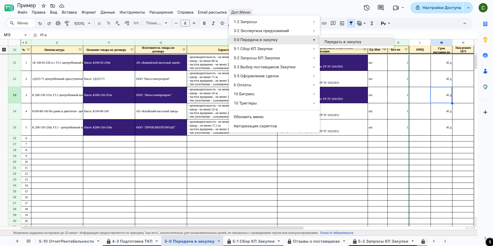

# Лист «5-0 Передача в закупку»

**Назначение**

Лист — **зеркало договора поставки с заказчиком**: перечень товаров в том виде, как он записан в договоре и спецификации. Под этот договор формируется всё исполнение. Договоры с поставщиками, у которых товары закупаем мы, — на листе **[[lis.k2-5-5-sdelki:kratko]]**. Это отправная точка для исполнения — как приказ от менеджера проекта.

**Кто работает:** [[rol.proekt]] — проверяет, что товары заполнены в соответствии с договором и спецификацией, и фиксирует лист. [[rol.zakupka]] этот лист не трогает: изменения он планирует на листе **[[lis.k2-5-4-izmeneniya:kratko]]**, а подтверждает на листе **[[lis.k2-5-3-vybor-postavshchikov:kratko]]**.

Устройство листа — размер, столбцы, формулы, связи с другими листами — собрано из таблицы в конце страницы.

## Как заполняется

- Лист предзаполняется сам: данные приходят с листа **1-1 Сбор КП** через лист **1-0 Товары**.
- Менеджер проекта проверяет товары и **фиксирует значения**: вставкой только значений (Ctrl + Shift + V) либо через меню `Доп.Меню` → `5-0 Передача в закупку` → `Передать в закупку`.
- **После фиксации лист не изменяется** — он должен оставаться таким, как в договоре.
- `ID_Товара`, `№` и `Номенклатура` у каждого товара должны быть уникальными. Если товары называются одинаково — добавьте в скобках или иначе отличительный признак.

###### **Внешний вид / Фото**

**Текст на фото:**

* Доп.Меню
* 5-0 Передача в закупку
* Передать в закупку

## Полный перечень столбцов

РазличиеМужду, ID_Товара, №, Номенклатура, Название товара по договору, Изготовитель товара по договору, Характеристики, Состав поставляемой с продукцией технической документации, Ед. Изм, Кол-во, НМЦ, Срок поставки по договору, Нац режим 1875, Код ОКПД 2.

## Столбец B «РазличиеМужду»

Показывает, в каких полях товар на этом листе отличается от листа **[[lis.k2-5-1-sbor-kp:kratko]]**; отличающиеся ячейки подсвечиваются условным форматированием.

## Осталось сделать

- Подписать снимки

