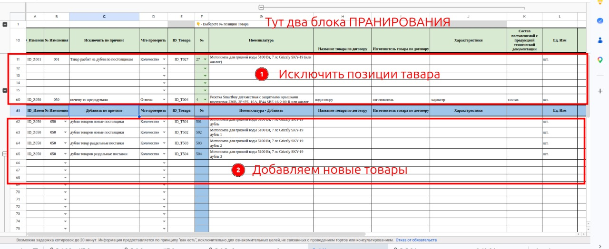
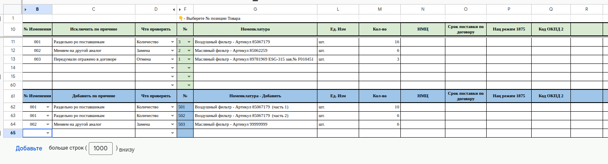

# Лист «5-4 Изменения в товарах»

**Назначение**

Лист для **планирования изменений в списке товаров**: добавление новых товаров, отмена, замена, разделение, объединение нескольких в один и другое, что может понадобиться.

**Кто работает:** [[rol.zakupka]]. Во всём контуре 2 менеджер один.

Устройство листа — размер, столбцы, формулы, связи с другими листами — собрано из таблицы в конце страницы.

## Два блока

| Блок | Строки | Что редактируем | Что заполняется само |
|---|---|---|---|
| 1. Исключить позиции товара | 11–60 | B, C, D, F | остальные столбцы товара — по номеру позиции в F |
| 2. Добавляем новые товары | 62–112 | B, C, D, G–Q | E и F — формулой |

- **C** — причина изменения; она попадёт на лист **[[lis.k2-5-3-vybor-postavshchikov:kratko]]**. В верхнем блоке столбец называется «Исключить по причине», в нижнем — «Добавить по причине».
- **D «Что проверить»** — короткая заметка, что проверить после изменения: «Количество», «Замена», «Слияние», «Отмена», «Добавление».

Пример заполнения:

**Текст на фото:**

* 001 «Раздельно по поставщикам»: позиция 3 исключена, взамен добавлены 501 и 502 — две части.
* 002 «Меняем на другой аналог»: позиция 2 исключена, взамен добавлена 503.
* 003 «Передумали, отражено в договоре»: позиция 1 отменена, взамен ничего.
* **№ Изменения** связывает исключённую позицию с новыми.
* Не хватает строк — внизу листа «Добавьте больше строк».

Как работать с блоками:

- [[um.tov-k2-5-4-isklyuchit]]
- [[um.tov-k2-5-4-dobavit]]

## Что нельзя трогать

Столбцы **A** и **E** — в них важные формулы.

## Полный перечень столбцов

со слов: ID_Изменения, № Изменения, Исключить по причине, Что проверить, ID_Товара, №, Номенклатура, Название товара по договору, Изготовитель товара по договору, Характеристики, Состав поставляемой с продукцией технической документации, Ед. Изм, Кол-во, НМЦ, Срок поставки по договору, Нац режим 1875, Код ОКПД 2.

## Осталось сделать

- Снимки заменить (пометка директора).
