<!-- LTeX: language=ru-RU -->
<!-- 3.1.2 Инструкция по работе с таблицами для специалиста по расчету -->

# Инструкция по работе с таблицами для специалиста по расчету

## Оглавление
**Навигация / Путь в системе**

* Ссылка на этот документ:  [https://docs.google.com/document/d/11eTuSaQf7HREOITpHmTdXXPwOpzwD9rvnOdQXezd_PU/edit](https://docs.google.com/document/d/11eTuSaQf7HREOITpHmTdXXPwOpzwD9rvnOdQXezd_PU/edit)
* Ссылка на чистую таблицу:  [https://docs.google.com/spreadsheets/d/1FCJJs6AUgq90yVyvy3RWEiuv17h1scgKM2kuBFbdt9w/edit](https://docs.google.com/spreadsheets/d/1FCJJs6AUgq90yVyvy3RWEiuv17h1scgKM2kuBFbdt9w/edit)
* Ссылка на папку "Почтовые вложение": [https://drive.google.com/drive/folders/1LZ9dF6iXZrH8YC-Z6xX5T2zAABhUGTGr](https://drive.google.com/drive/folders/1LZ9dF6iXZrH8YC-Z6xX5T2zAABhUGTGr)

* [Задача. Подготовка рабочей таблицы](#zadacha-podgotovka-rabochey-tablitsy)
    - [Шаг. Подготовка рабочей таблицы](#shag-podgotovka-rabochey-tablitsy)
* [Задача. Группировка товаров, подготовка запросов, рассылка писем](#zadacha-gruppirovka-tovarov-podgotovka-zaprosov-rassylka-pisem)
    - [Шаг. Разбейте товары на группы.](#шаг-разбейте-товары-на-группы)
    - [Шаг. Добавьте файлы.](#шаг-добавьте-файлы)
    - [Шаг. Добавьте ключевые фразы.](#шаг-добавьте-ключевые-фразы)
    - [Шаг. Найдите и добавьте емайлы поставщиков.](#шаг-найдите-и-добавьте-емайлы-поставщиков)
    - [Шаг. Отправьте письма.](#шаг-отправьте-письма)
* [Задача. Занесение ответов поставщиков](#zadacha-zanesenie-otvetov-postavshchikov)
    - [Шаг. Занесение ответов поставщиков](#shag-zanesenie-otvetov-postavshchikov)

**Основные пользователи**

* `Ответственный за расчет и тех. часть`
* `spreadsheet@haiverk.ru`

**Этапы CRM** 

* Воронка "Сделка":
    * Расчет

* Воронка смарт-процесса "Расчет":
    * Создать таблицу рассылки
    * Согласовать запросы
    * Разослать письма
    * Есть товары у которых нет цен
    * Есть товары у которых меньше 3х цен
    * Принять решение о необходимости экспертизы
    * Тех экспертиза проекта
    * Подготовка ТП
    * Завершить

**Описание**
Эта инструкции содержит пошаговое руководство по созданию рабочей таблицы расчетов (таблицы проекта) , заполнение таблицы списком товаров, подготовки и рассылки писем и сбору цен на товары.

## Знания / Умения / Инструкции

[[zna.nmts]]
  
[[zna.tsveta-adresov]]

[[um.tolko-znacheniya]]

[[um.chisla-bez-probelov]]

[[tio.gruppirovka]]

[[tio.avtorizatsiya-skriptov]]

[[tio.zapusk-triggerov]]

[[tio.udalenie-strok]]

**[[tio.tseny-sroki-modeli|Инструкция. Цены, сроки и модели от поставщиков]]**  [https://docs.google.com/document/d/1XvLi5IGTJbZZ6XMghYIRLDy0VippLyv_4BN2myZpcU8/edit?tab=t.0#bookmark=kix.hriv81aty0f5](https://docs.google.com/document/d/1XvLi5IGTJbZZ6XMghYIRLDy0VippLyv_4BN2myZpcU8/edit?tab=t.0#bookmark=kix.hriv81aty0f5)

**[[tio.kratkoe-opisanie|Инструкция. Краткое описание по работе с таблицей проекта]]** [https://docs.google.com/document/d/1XvLi5IGTJbZZ6XMghYIRLDy0VippLyv_4BN2myZpcU8/edit](https://docs.google.com/document/d/1XvLi5IGTJbZZ6XMghYIRLDy0VippLyv_4BN2myZpcU8/edit)

---

## Задачи

### [Задача. Подготовка рабочей таблицы]{#zadacha-podgotovka-rabochey-tablitsy}

**Навигация / Путь в системе / Ресурсы**

* ***Ссылка на чистую таблицу***:  [https://docs.google.com/spreadsheets/d/1FCJJs6AUgq90yVyvy3RWEiuv17h1scgKM2kuBFbdt9w/edit](https://docs.google.com/spreadsheets/d/1FCJJs6AUgq90yVyvy3RWEiuv17h1scgKM2kuBFbdt9w/edit)

* Битрикс -> CRM -> Смарт-процесса "Расчет" 
    * Ссылка на Смарт-процесс "Расчет"
    * ***Название сделки*** или название  Смарт-процесса "Расчет" 
    * ***Файлы тендера*** из Смарт-процесса "Расчет" поле 'Файлы тендера'
    * ***Таблица расчета*** из Смарт-процесса "Расчет" поле 'Ссылка на таблицу расчета' или создайте по этой инструкции

**Основные пользователи**

* ***`spreadsheet@haiverk.ru`***

**Этап CRM** 

* Воронка смарт-процесса "Расчет":
    * Создать таблицу рассылки

     

#### **Описание**

В задаче ***Ответственному специалисту*** необходимо от имени аккаунта ***`spreadsheet@haiverk.ru`*** создать таблицу расчета, запустить скрипты и заполнить лист  **1-1 Сбор КП** списком товаров.  ссылку на созданную таблицу сохранить в CRM.

#### **Шаги**
**[Шаг. Подготовка рабочей таблицы]{#shag-podgotovka-rabochey-tablitsy}**

1. Создать таблицу
    1. Зайдите в аккаунт ***`spreadsheet@haiverk.ru`***	
    1. Откройте таблицу по ссылке: [https://docs.google.com/spreadsheets/d/1FCJJs6AUgq90yVyvy3RWEiuv17h1scgKM2kuBFbdt9w/edit](https://docs.google.com/spreadsheets/d/1FCJJs6AUgq90yVyvy3RWEiuv17h1scgKM2kuBFbdt9w/edit)
    1. Создайте копию таблицу.
        1. В название новой таблицы скопированные название сделки из битрикс.
        1. **ОБЯЗАТЕЛЬНО** отметьте галочку "Скопировать настройки доступа".
        1. нажать ок.

    1. Убедиться что открылась новая таблица, 
        1. проверить URL  
        1. проверить название таблицы   

1. Сохраните ссылку новой таблице в Битрикс -> CRM -> Смарт-процесса "Расчет" -> поле **"Ссылка на таблицу расчета"**

1. Авторизуйте Скрипты [[tio.avtorizatsiya-skriptov|(инструкция)]]

1. Запустите скрипты  [[tio.zapusk-triggerov|(инструкция)]]

1. Заполните в ***Таблица расчета*** на листе  **1-1 Сбор КП** поля 'Номенклатура', 'Характеристики', 'Ед. Изм', 'Кол-во', 'НМЦ' 'Нац режим 1875', 'Код ОКПД 2'.
   
    1. **ВНИМАНИЕ** при копировании вставляете только значения
    1. **ВНИМАНИЕ** проверяйте числовые значения
    1. В ***Файлы тендера***  найдите в спецификации оборудования 'название товара', 'единицы измерения', и 'кол-во' и другие поля скопируете  их значения в соответствующие столбцы на листе **1-1 Сбор КП** 
    1. 'Номенклатура' - [[um.tolko-znacheniya|*вставляете только значения*]]
    1. 'Характеристики' - [[um.tolko-znacheniya|*вставляете только значения*]]
    1. 'Ед. Изм' - [[um.tolko-znacheniya|*вставляете только значения*]]
    1. 'Нац режим 1875' - [[um.tolko-znacheniya|*вставляете только значения*]]
    1. 'Код ОКПД 2' - [[um.tolko-znacheniya|*вставляете только значения*]]
    1. 'Кол-во' - [[um.tolko-znacheniya|*вставляете только значения*]], [[um.chisla-bez-probelov|*убедитесь, что это числа без пробелов*]]
    1. 'НМЦ' - [[um.tolko-znacheniya|*вставляете только значения*]], [[um.chisla-bez-probelov|*убедитесь, что это числа без пробелов*]]

1. Также, в целях проверки корректности внесения позиционного НМЦ, требуется на лист ***0-Паспорт проекта*** Внести НМЦ договора в соответствующую ячейку. "НМЦ"  и "Валюта НМЦ".  Примечание: часть данных листа ***0-Паспорт проекта*** заполняется автоматически по давным из ***Смарт-процесса "Расчет"***

1. Проверка Заполнения  **ВНИМАНИЕ**

    - Проверьте что 'Кол-во' и  'НМЦ' являются числовыми значениями.
    - Проверьте равенство сумм  ***НМЦ договора (1)*** указанному в Извещении и расчетному (итого) значению 'НМЦ' из таблицы, которое формируется внизу столбца в котором внесены ***НМЦ за единицу товара***(2) .Если эти значения не равны, то это говорит о том, что есть какая-то ошибка. Зачастую такая ошибка возникает из-за того, что порядок товаров в Извещении отличается от порядка товаров, который прописан в ТЗ. Если эти значения не равны, то требуется перепроверка правильности внесения позиционных НМЦ к каждой позиции (каждого товара). 

1. Удалите лишние строки  [[tio.udalenie-strok|(инструкция)]]

###### **Внешний вид / Фото**

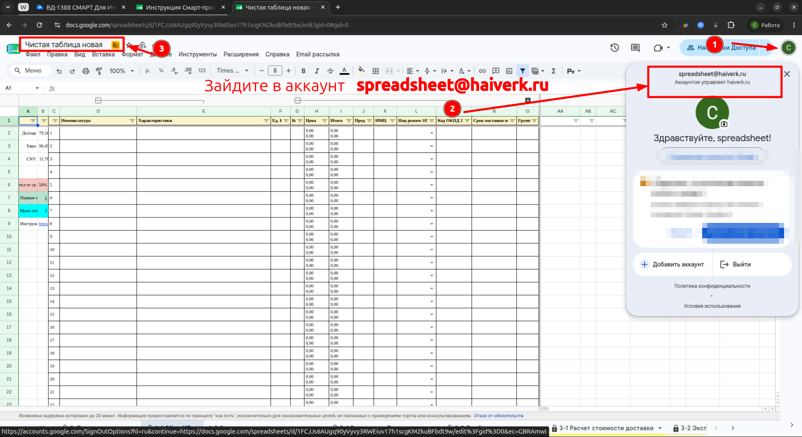 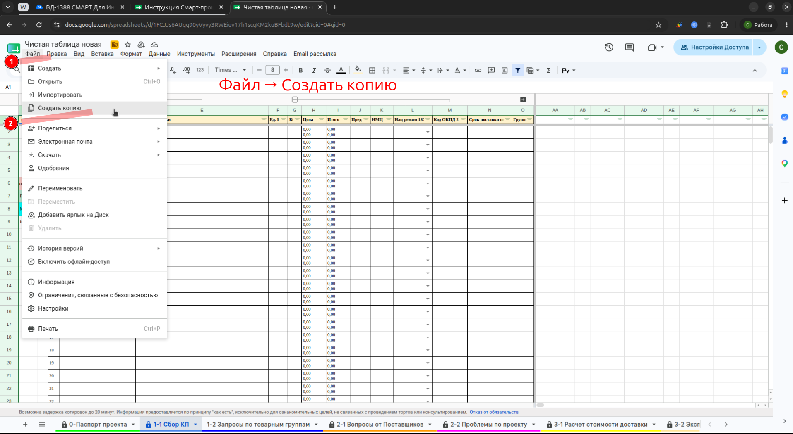 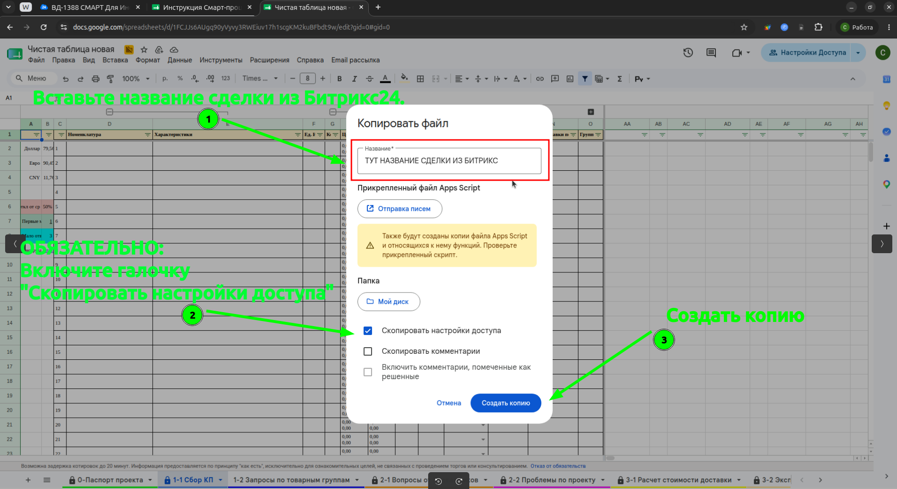 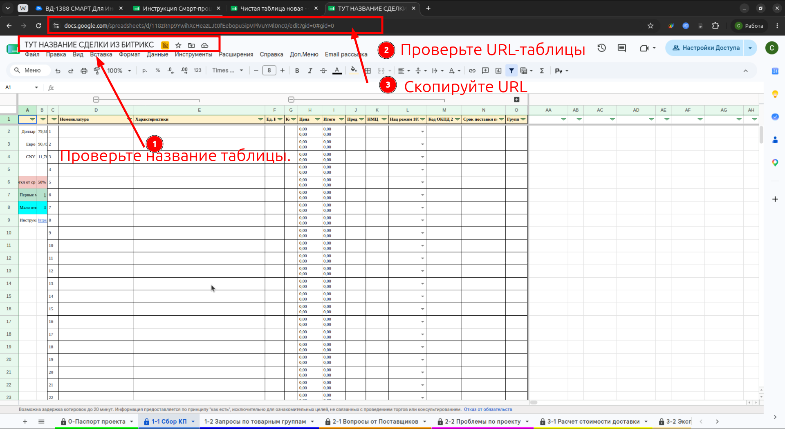 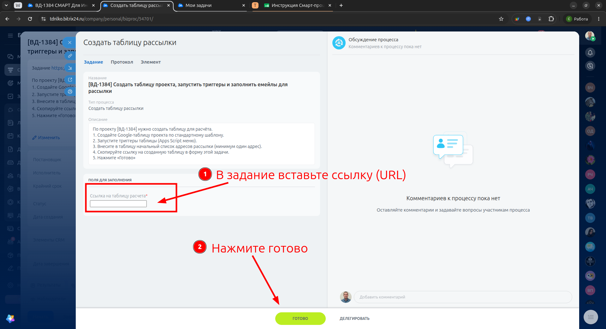 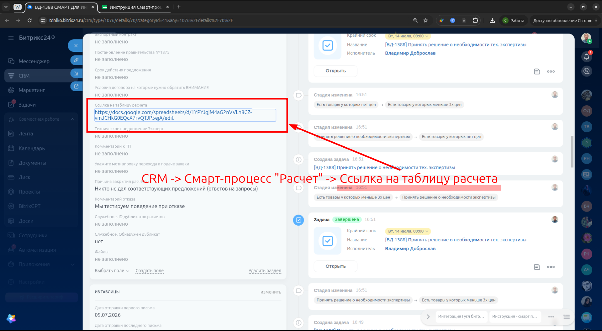 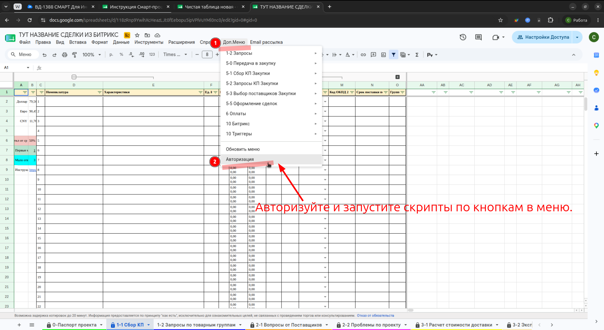 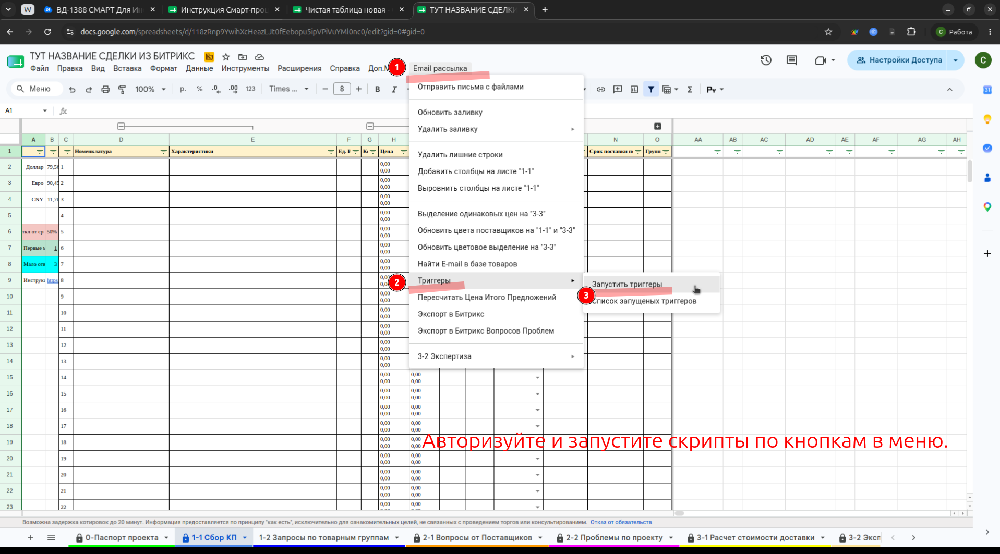 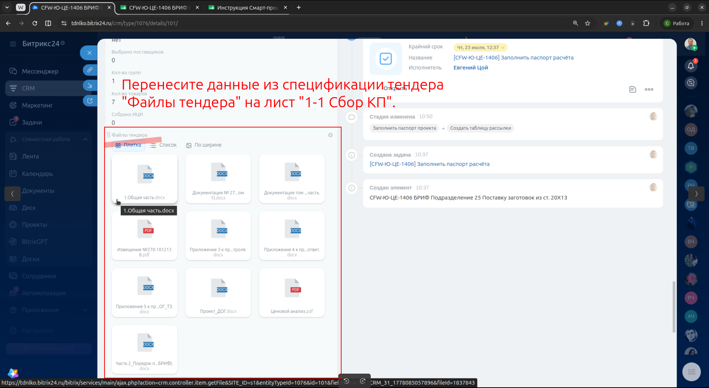 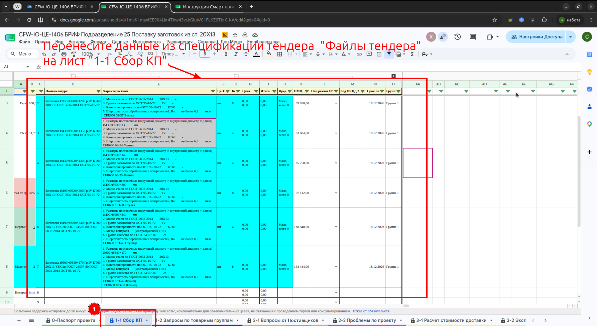 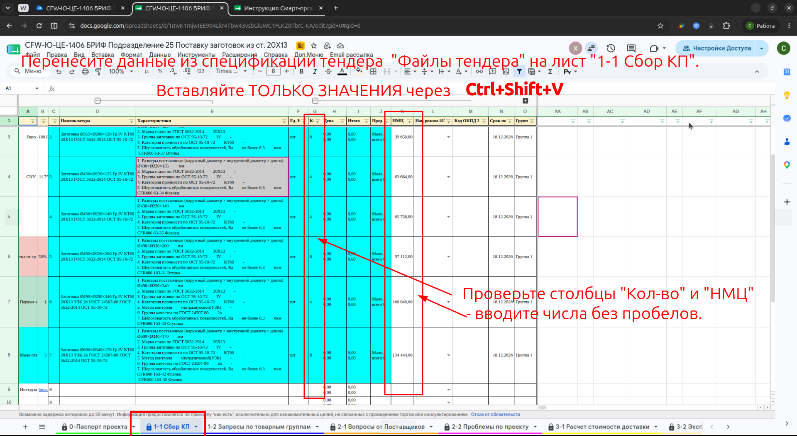 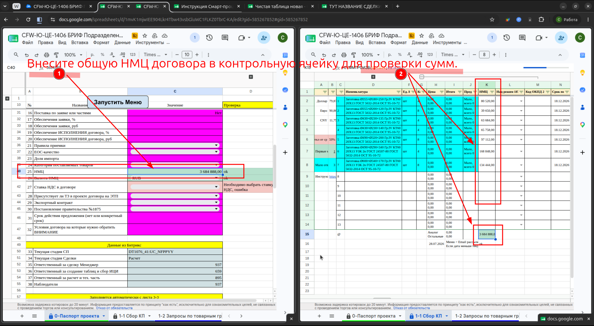 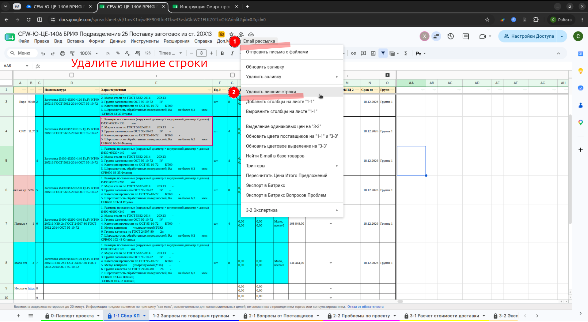

**Текст на фото:** 

* Зайдите в аккаунт spreadsheet@haiverk.ru
* Файл -> Создать копию
* Вставьте название сделки из Битрикс24.
* ОБЯЗАТЕЛЬНО: Включите галочку "Скопировать настройки доступа".
* Проверьте URL-таблицы
* Проверьте название таблицы.
* Скопируйте URL
* Вставьте URL
* CRM -> Смарт-процесс "Расчет" -> Ссылка на таблицу расчета.
* Авторизуйте и запустите скрипты по кнопкам в меню.
* Перенесите данные из спецификации тендера  "Файлы тендера" на лист "1-1 Сбор КП".
* Вставляйте ТОЛЬКО ЗНАЧЕНИЯ через Ctrl+Shift+V.
* Проверьте столбцы «Кол-во» и «НМЦ» — вводите числа без пробелов.
* Внесите общую НМЦ договора в контрольную ячейку для проверки сумм.
* Удалите лишние строки

---

### [Задача. Группировка товаров, подготовка запросов, рассылка писем]{#zadacha-gruppirovka-tovarov-podgotovka-zaprosov-rassylka-pisem}

**Навигация / Путь в системе / Ресурсы**

* ***Папка "Почтовые вложение"*** [https://drive.google.com/drive/folders/1LZ9dF6iXZrH8YC-Z6xX5T2zAABhUGTGr](https://drive.google.com/drive/folders/1LZ9dF6iXZrH8YC-Z6xX5T2zAABhUGTGr)

* Битрикс -> CRM -> Смарт-процесса "Расчет" 
    * Ссылка на ***Смарт-процесс "Расчет***"
    * ***Файлы тендера*** из Смарт-процесса "Расчет" поле 'Файлы тендера'
    * ***Спецификации товаров*** из Смарт-процесса "Расчет" поле 'Спецификации товаров'
    * ***Таблица расчета*** из Смарт-процесса "Расчет" поле 'Ссылка на таблицу расчета' 

* ***1-2 Запросы по товарным группам*** лист из ***Таблица расчета*** 
* ***1-1 Сбор КП*** лист из ***Таблица расчета*** 
* **Аккаунт для рассылки писем** это может быть как один аккаунт так и группа из нескольких аккаунтов.
* **Подпись письма ФИО и номер телефон** для раздела обратная связь в отправляемом письме.

**Основные пользователи**
* `Ответственный за расчет и тех. часть`

**Этап CRM** 
* Воронка смарт-процесса "Расчет":
    * Создать таблицу рассылки
    * Согласовать запросы
    * Разослать письма
    * Есть товары у которых нет цен
    * Есть товары у которых меньше 3х цен
  
#### **Описание**
Специалисту, `Ответственный за расчет и тех. часть`, необходимо выполнить плоскую группировку позиций из перечня товаров по профильным категориям. Основная цель классификации — исключить нецелевую рассылку запросов и оптимизировать коммуникацию: поставщики должны получать письма строго в соответствии со своей рыночной специализацией и техническими возможностями. Логика распределения базируется на гибких критериях: функциональном типе оборудования, бренде производителя, ключевых словах в наименовании и специальных требованиях в характеристиках.

Специалисту, `Ответственный за расчет и тех. часть`, необходимо выполнить подготовку и централизованное размещение технических материалов (чертежей, эскизов, спецификаций или фото), дополняющих информацию о товарах с целью отправки графической информации и указания точных требований к товару. Необходимо **строго** проверить наличие упоминаний конечного заказчика и удалить их.»

Перед поиском поставщиков необходимо подготовить **Ключ фразы**, которые помогут найти поставщиков этой группы товаров. Ключевые фразы нужны в качестве "зацепки" для автоматического поиска email-адресов в базе товаров и поиска поставщиков в интернете.

Также необходимо сформировать качественный список контактов (емайлов) для каждой товарной группы, используя поисковые системы и официальные сайты производителей. Главная цель - найти прямые контакты заводов-изготовителей для получения минимальной цены, а также их официальных дилеров в Московском регионе для гарантии быстрых сроков поставки. Поиск ведется "потоком": система сама соберет разные товарные группы для одного поставщика в одно письмо и удалит дубликаты адресов, поэтому достаточно собрать максимум целевых контактов без ручной фильтрации каждого емайла.

При возникновение необходимости до отправить письма новым поставщикам или добавить поставщика еще в другие группы товаров, то нужно повторно проделать шаги:  

- [**Шаг. Добавьте ключевые фразы.**](#шаг-добавьте-ключевые-фразы) (опционально)
- [**Шаг. Найдите и добавьте емайлы поставщиков.**](#шаг-найдите-и-добавьте-емайлы-поставщиков)
- [**Шаг. Отправьте письма.**](#шаг-отправьте-письма)

#### **Шаги**

##### [Шаг. Разбейте товары на группы.]{#шаг-разбейте-товары-на-группы}

1. Копируем номера позиции товаров столбец "№" с листа * ***1-2 Запросы по товарным группам*** на лист ***1-1 Сбор КП***  в столбец "№" начиная со строки 12 [[um.tolko-znacheniya|*вставляете только значения*]]
1. **ВНИМАНИЕ** избегайте перестановки строки 11 и вставке выше нее строк
1. Группы товаров формируется по принципу чередованием заполненных и пустых строк по столбцу "Номенклатура", то есть разделителем групп являются две и более строк с пустыми столбцами "Номенклатура"  
1. Сгруппируйте товары по одному из методов описанных в [[tio.gruppirovka|Инструкция. Группировка товаров]] 
1. Проверьте на листе ***1-1 Сбор КП*** в столбце "Группа" наличие группы у каждого товара, если ее нет, то добавьте товар в группу согласно инструкции.

###### **Внешний вид / Фото**

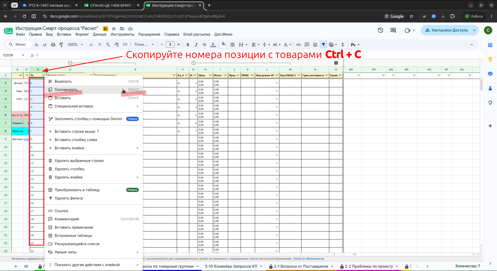 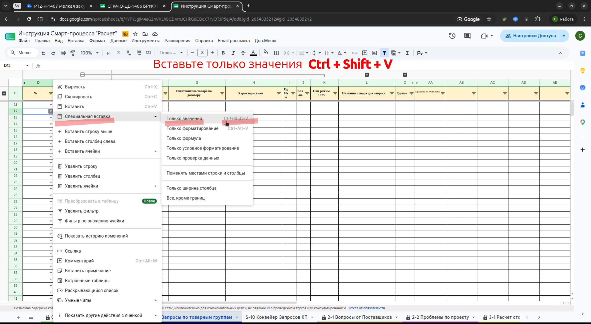 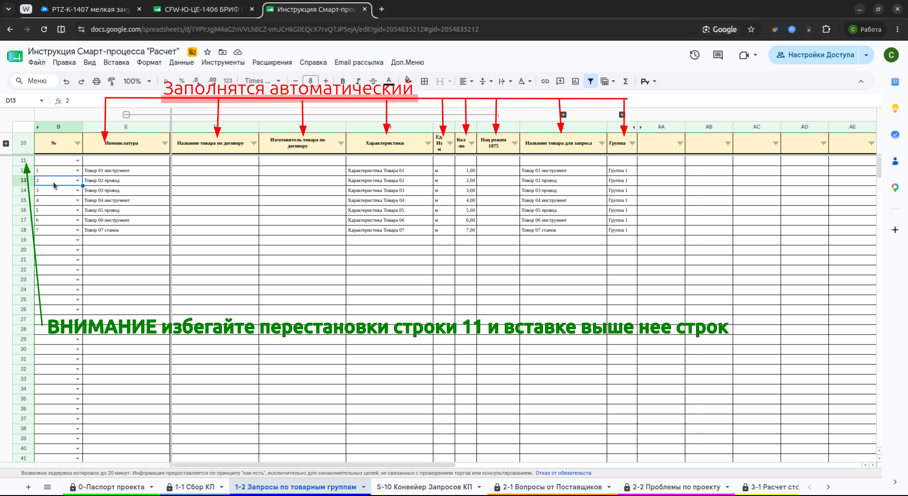 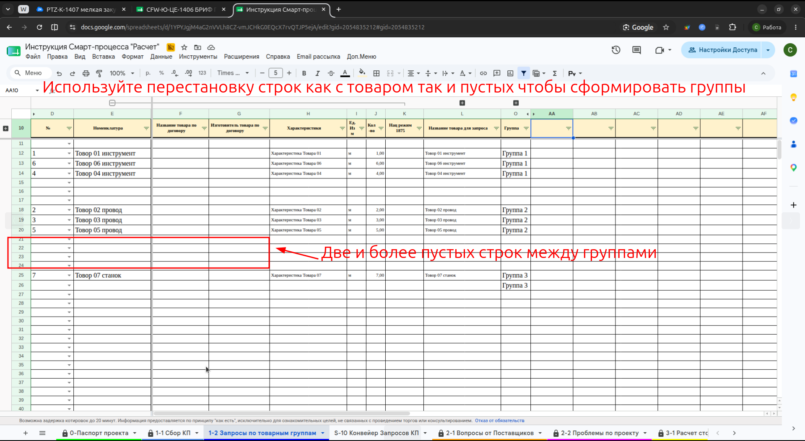 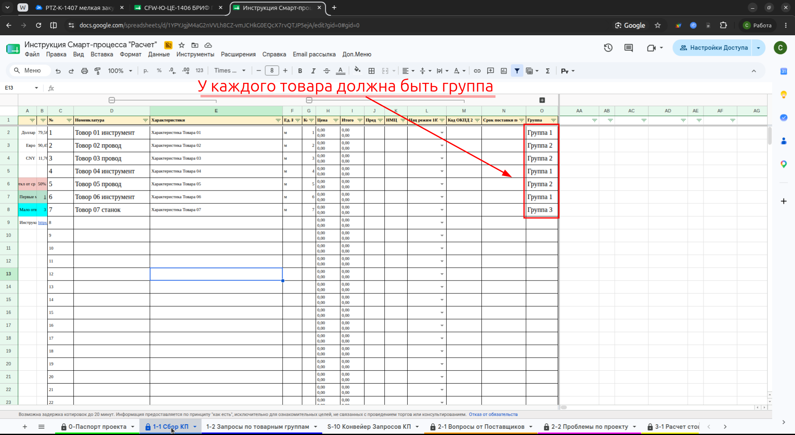

**Текст на фото:** 

* Скопируйте номера позиции Ctrl+С
* Вставьте только значения  Ctrl+Shift+V
* Заполнятся автоматически
* ВНИМАНИЕ избегайте перестановки строки 11 и вставке выше нее строк
* Используйте перестановку строк как с товаром так и пустых чтобы сформировать группы 
* Две и более пустых строк между группами  
* У каждого товара должна быть группа.

##### [Шаг. Добавьте файлы.]{#шаг-добавьте-файлы}

1. Если дополнительно с товаром мы хотим отправить файл (например чертеж изделия или фото изделия или еще что то) то необходимо:  
1. Проверить файлы на отсутствие данных указывающие на конечного заказчика если такие данные есть то удалите их или закрасьте.
1. **ВНИМАНИЕ**  НЕ ДОПУСКАЕТСЯ ОТПРАВКА ФАЙЛОВ УКАЗЫВАЮЩИХ НА КОНЕЧНОГО ЗАКАЗЧИКА 
1. Создайте в ***Папка "Почтовые вложение"*** [https://drive.google.com/drive/folders/1LZ9dF6iXZrH8YC-Z6xX5T2zAABhUGTGr](https://drive.google.com/drive/folders/1LZ9dF6iXZrH8YC-Z6xX5T2zAABhUGTGr) подпапку с номером проекта или названием проекта (таким же номером как и ***Таблица расчета***)
1. Для созданной подпапки проекта открыть доступ на чтение для всех. Файлы созданной подпапки получат этот уровень доступа автоматический.
1. Загрузить туда нужные файлы.
1. **ДЛЯ КАЖДОГО ФАЙЛА ПО ОТДЕЛЬНОСТИ**  
    1. Убедитесь, что есть доступ на чтение.
    1. Копируем ссылку на документ.
    1. Вставляем в таблицу ***Таблица расчета*** на лист ***1-2 Запросы по товарным группам*** в столбец "Файлы" в строку товара которой относится файл.
    1. Если файлов несколько, то вставляем в одну ячейку несколько ссылок, каждая ссылка с новой строки

###### **Внешний вид / Фото**

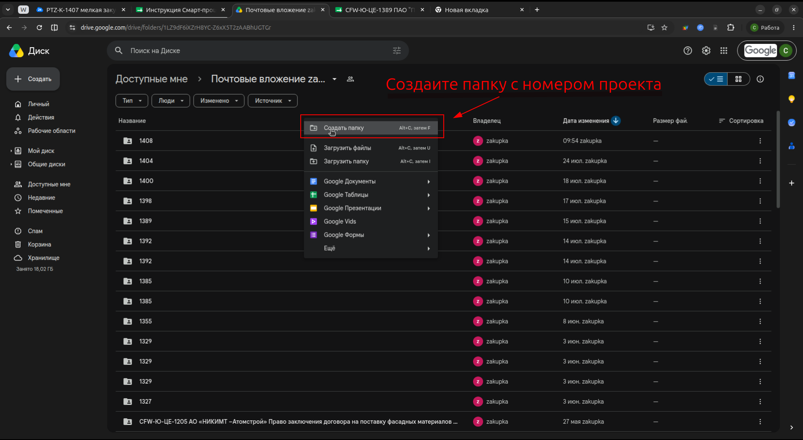 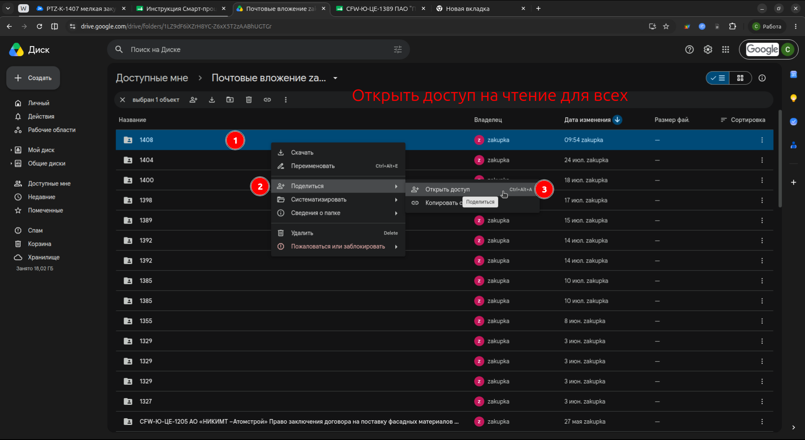 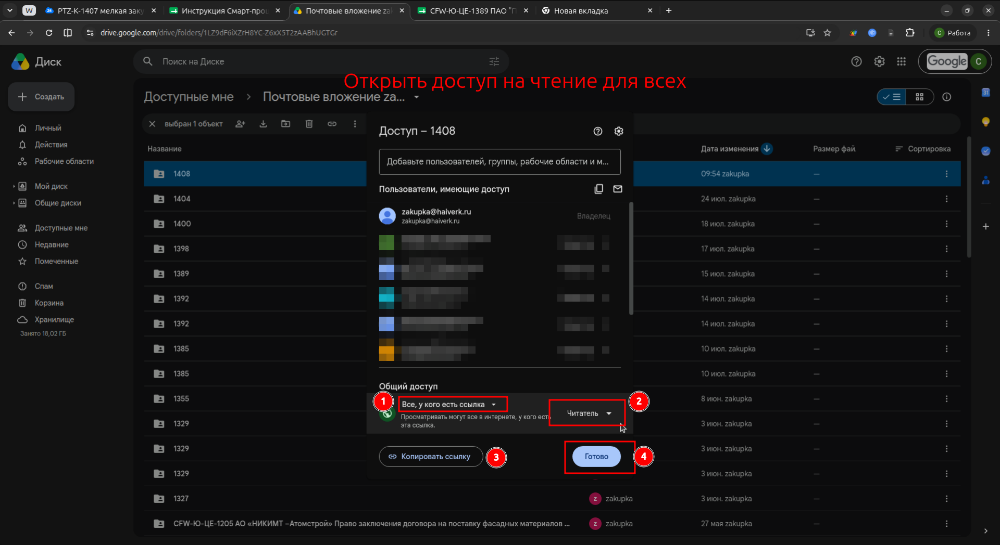 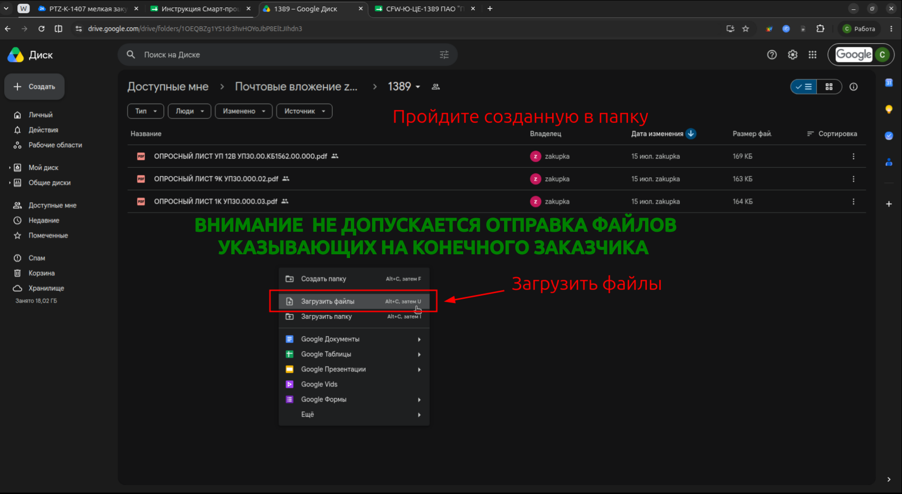 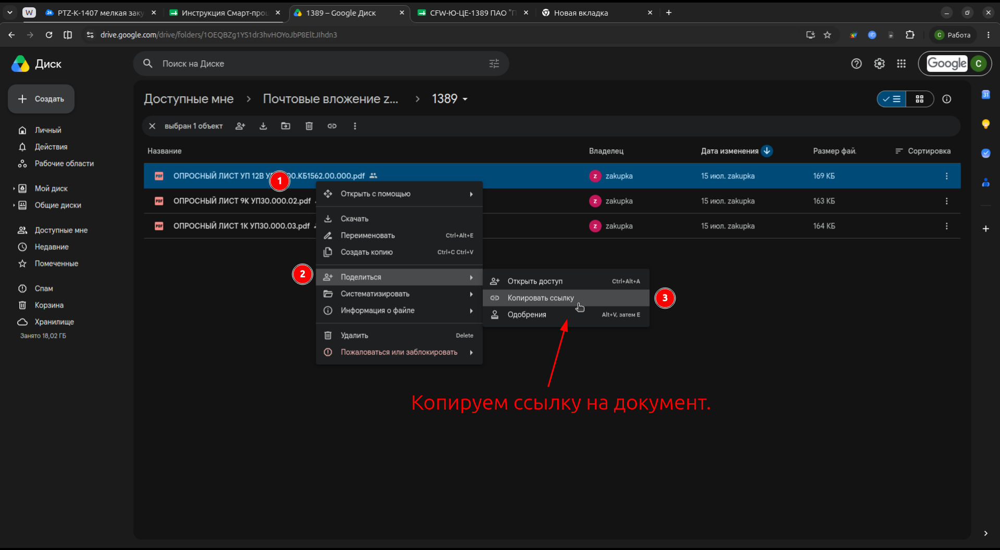 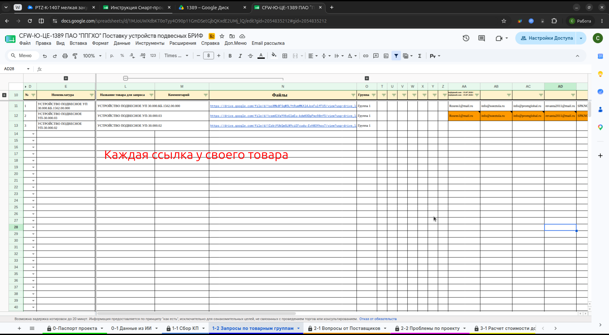

**Текст на фото:** 

* ВНИМАНИЕ  НЕ ДОПУСКАЕТСЯ ОТПРАВКА ФАЙЛОВ УКАЗЫВАЮЩИХ НА КОНЕЧНОГО ЗАКАЗЧИКА 
* Создайте папку с номером проекта
* Открыть доступ на чтение для всех
* Пройдите созданную в папку
* Загрузить файлы
* Доступ на чтение
* Копируем ссылку на документ.
* Каждая ссылка у своего товара.
* Каждая ссылка с новой строки.

##### [Шаг. Добавьте ключевые фразы.]{#шаг-добавьте-ключевые-фразы}

1. **Поиск и добавление производителя**
    * Если в названии товара нет бренда, найдите точный завод-изготовитель в интернете.
    * Добавьте название производителя в качестве дополнительной ключевой фразы.

2. **Правило для товаров без жесткого бренда**
    * Если у товара может быть несколько разных производителей (например, *стандартный выключатель*), дополнительной ключевой фразы укажите **название всей товарной группы**.

3. **Правило для сложных названий и шифров**
    * Если у товара сложное техническое наименование или сухой заводской шифр, добавьте в качестве ключевой фразы его **функциональную характеристику**.
    * Пишите слова так, как люди обычно ищут этот товар в поисковиках (например: **осевой вентилятор**, **торцевое уплотнение**).

4. **Использование интернета**
    * Все дополнительные ключевые фразы, коммерческие синонимы и недостающие бренды ищите в открытых источниках в интернета.

5. Добавьте ключевые фразы в строке товара в столбцы "Ключ фразы 1", "Ключ фразы 2", "Ключ фразы 3" можно несколько фраз в одну ячейку, "Ключ фраза" действует на всю свою группу в которой товар. и не действует на соседние группы.

###### **Внешний вид / Фото**
    
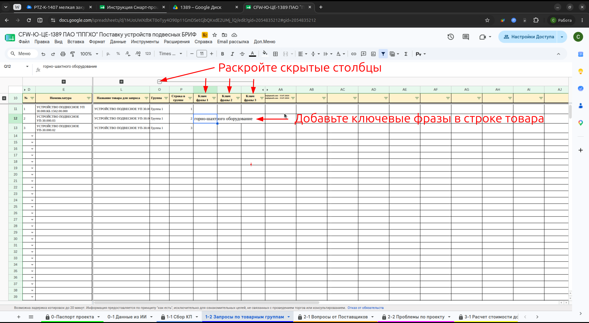

**Текст на фото:** 

* Раскройте скрытые столбцы
* Добавьте ключевые фразы в строке товара

##### [Шаг. Найдите и добавьте емайлы поставщиков.]{#шаг-найдите-и-добавьте-емайлы-поставщиков}

1. **Подготовка поисковой системы (Обход блокировок и гео-привязки)**
    * **ВНИМАНИЕ** Обязательно установите в настройках поиска Яндекса регион **"Москва"**. 
    * Для получения максимально полной и несмещенной выдачи рекомендуется использовать **прокси-сервер**.
1. **Правила внесения контактов в Таблицу расчета**
    * Все найденные email-адреса вносятся на лист **"1-2 Запросы по товарным группам"**.
    * Адреса вставляются строго в **первую (верхнюю) строку** каждой сформированной группы товаров.
    * Заполнение начинается строго со **столбца AA** и продолжается вправо по строке.
    * *Примечание: Если в ячейку случайно внесены дубликаты, система автоматически очистит их, оставив уникальные адреса в следующей строке.*
1. **Приоритет поиска №1: Заводы-изготовители и дилеры**
    * В первую очередь найдите сайт непосредственного производителя товара.
    * **Обязательно** внесите email-адрес самого завода-изготовителя (независимо от того, в каком городе или регионе он физически находится).
    * Зайдите в разделы сайта *"Контакты" / "Где купить" / "Дистрибьюторы" / "Партнеры"*. Найдите и внесите email-адреса нескольких **официальных дилеров** (в приоритете — компании, расположенные в Москве или Московской области).
1. **Приоритет поиска №2: Поставщики по названию товара**
    * Проведите поиск в Яндексе по названию товара или подготовленным ключевым фразам.
    * Скопируйте email-адреса найденных независимых поставщиков.
    * **Не тратьте время на сверку**: если этот email уже был добавлен вами ранее в другие ячейки, вносите его снова. Система автоматизации самостоятельно удалит дубликаты при отправке.
1. **Правило сквозных поставщиков (Много номенклатурные компании)**
    * Если вы знаете, что крупный поставщик и закрывает сразу несколько ваших товарных групп — смело **вносите его email в первую строку каждой из этих групп**. 
    * Система сама сообразит, что это один адресат, объединит все позиции в **одно общее письмо** и отправит его поставщику.

###### **Внешний вид / Фото**

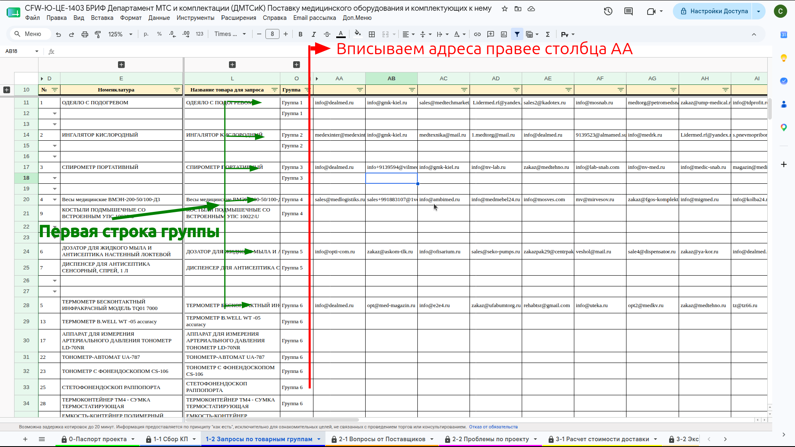 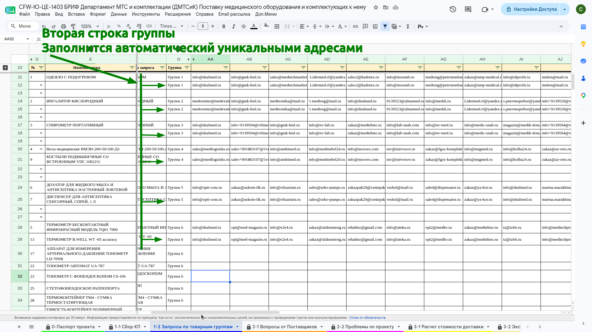 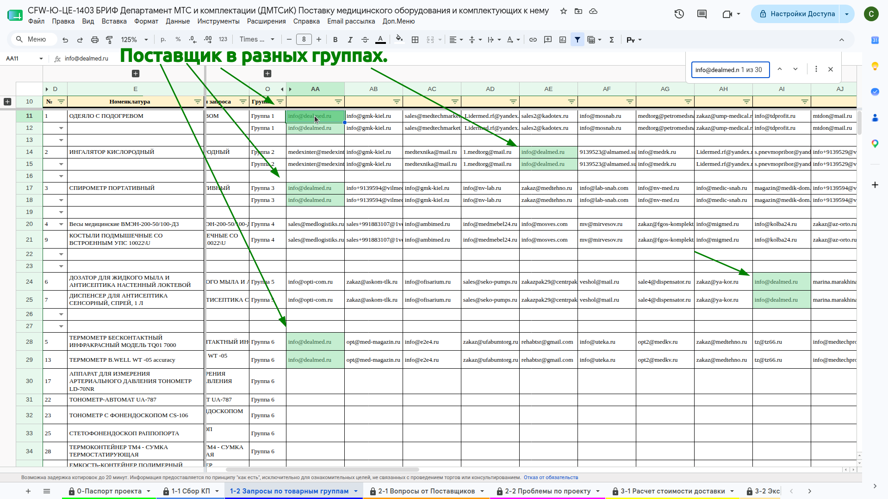

**Текст на фото:** 

* Вписываем адреса правее столбца AA
* Первая строка группы
* Вторая строка группы
* Заполнится автоматически уникальными адресами
* Поставщик в разных группах

##### [Шаг. Отправьте письма.]{#шаг-отправьте-письма}  

1. **ВНИМАНИЕ:** Не начинайте отправку без предварительного согласования!

1. Подготовка и согласование
    Перед отправкой обязательно согласуйте с `Ответственный за расчет и тех. Часть` или `Ответственный за сделку Менеджер`:
    * **Получателей и файлы:** выбранные email-адреса и прикрепленные документы.
    * **Аккаунт для рассылки:** от этого зависят реквизиты компании в письме.
    * **Контакты в подписи:** ФИО и номер телефона для обратной связи.

1. Отправка из Таблицы расчета
    1. **Перейдите** в согласованный аккаунт для рассылки.
    1. **Авторизуйте** скрипты по [[tio.avtorizatsiya-skriptov|инструкции]].
    1. **Проверьте подпись:** `Доп.Меню` -> `1-2 Запросы` -> `Проверить подпись`.
        * *Если подпись не подходит:* смените её через `Доп.Меню` -> `1-2 Запросы` -> `Сменить подпись`.
    1. **Запустите отправку:** `Доп.Меню` -> `1-2 Запросы` -> `Отправка писем`.
    1. **Подтвердите** email и подпись во всплывающем окне.
    1. **Проверьте результат:** `Доп.Меню` -> `1-2 Запросы` -> `Посчитать кол-во отправленных писем`. 
        * *Контроль:* Итоговое количество отобразится в **строке 10**
        * Если письма отправлены корректно, то соответствующие емейлы поставщиков окрашены в оранжевый цвет и при наведение курсора должна выводиться заметка с результатом отправки, временем отправки, адресом отправителя и адресом получателя

###### **Внешний вид / Фото**

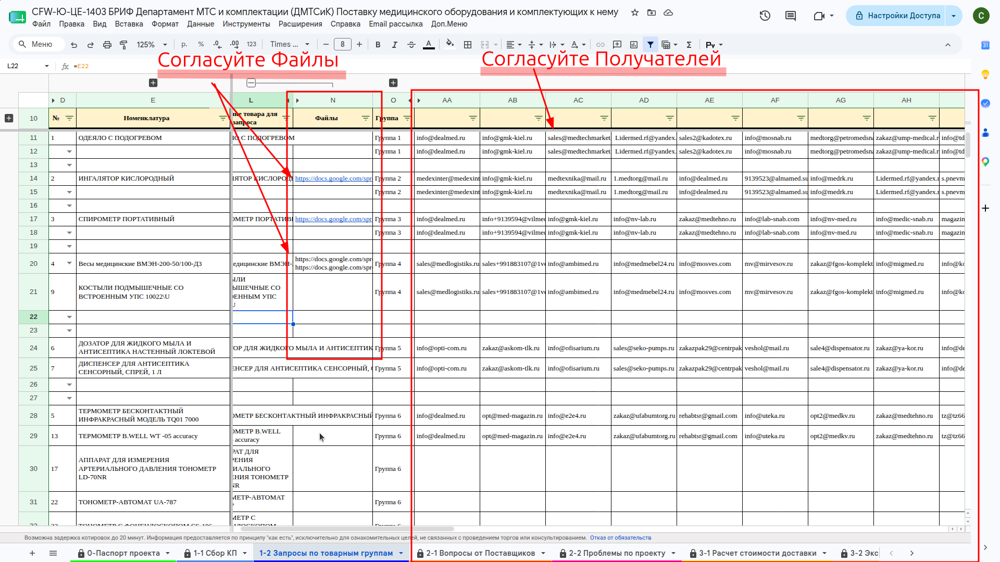 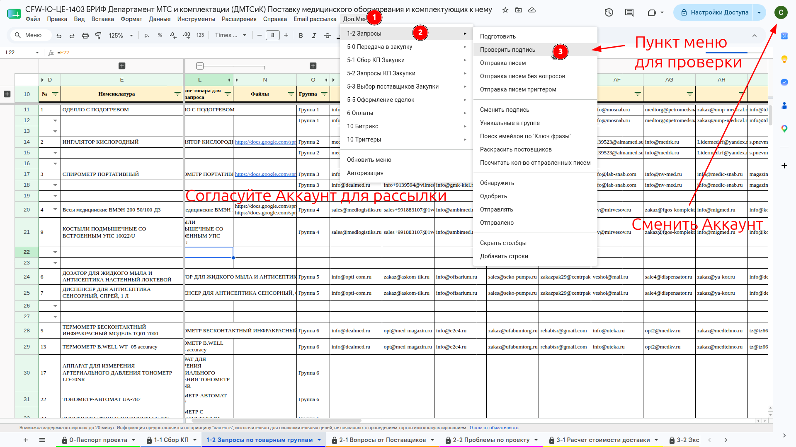 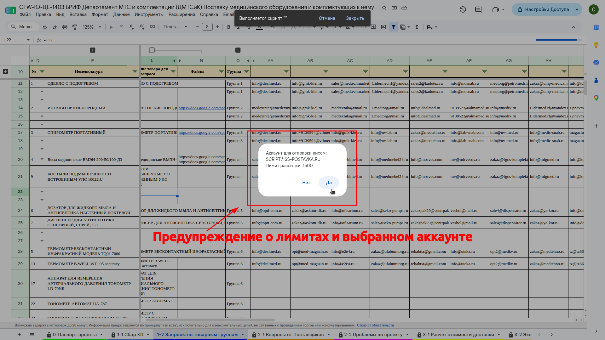 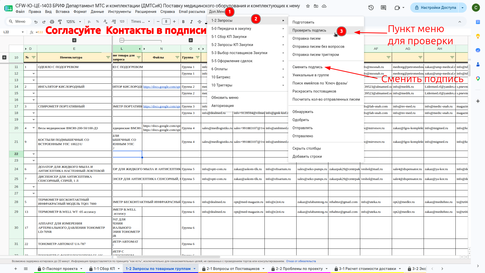 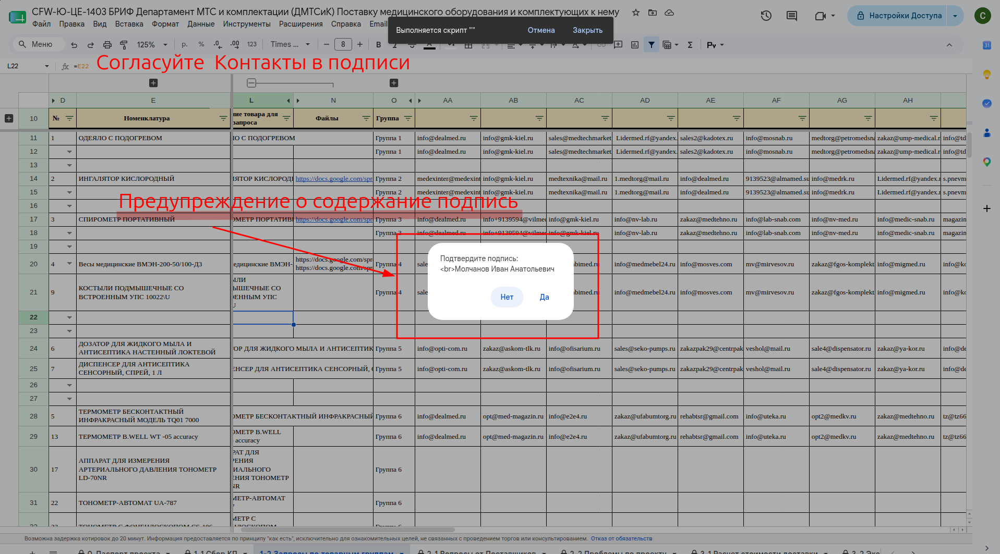 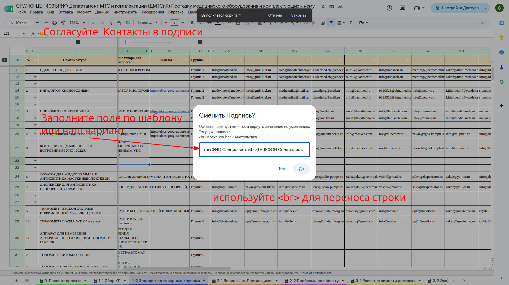 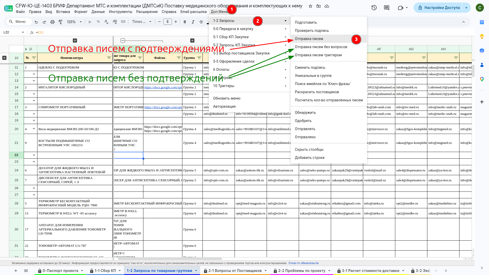 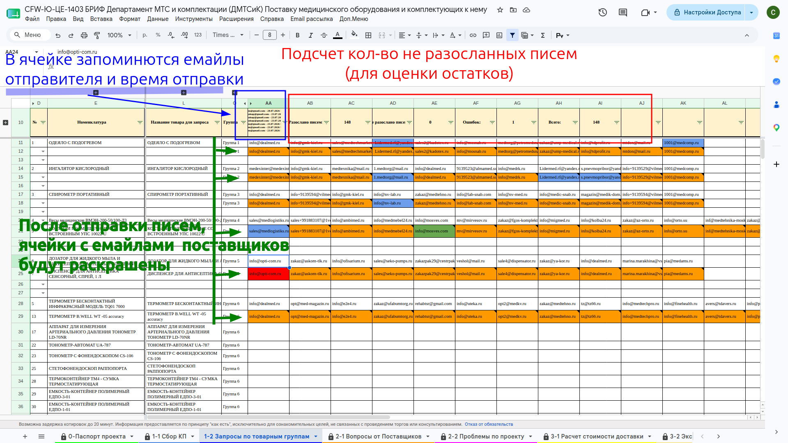 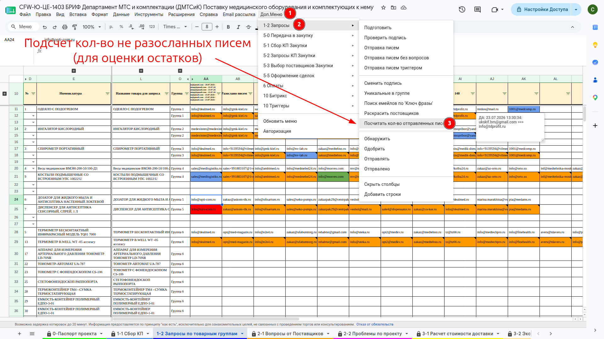

**Текст на фото:** 
    
* Согласуйте Файлы
* Согласуйте Получателей
* Согласуйте Аккаунт для рассылки
* Сменить аккаунт
* Предупреждение о лимитах и выбранном аккаунте
* Согласуйте  Контакты в подписи
* Пункт меню для проверки
* Предупреждение о содержание подпись
* Сменить подпись
* Заполните поле  "\<br\>"  перенос строки.
* Отправка писем с подтверждениями
* Отправка писем без подтверждений с установленными значениями.
* После отправки писем, будут раскрашены ячейки с емейлами поставщиков во второй строки группы
* Запоминает емайлы отправителей и время отправки
* Подсчет кол-во не разосланных писем (для оценки остатков)
    

---

### [Задача. Занесение ответов поставщиков]{#zadacha-zanesenie-otvetov-postavshchikov}

**Навигация / Путь в системе / Ресурсы**

* Битрикс -> CRM -> Смарт-процесса "Расчет" 
    * Ссылка на Смарт-процесс "Расчет"
    * ***Название сделки*** или название  Смарт-процесса "Расчет" 
    * ***Файлы тендера*** из Смарт-процесса "Расчет" поле 'Файлы тендера'
    * ***Таблица расчета*** из Смарт-процесса "Расчет" поле 'Ссылка на таблицу расчета' или создайте по этой инструкции
    * ***1-1 Сбор КП*** лист из ***Таблица расчета*** 
    * ***2-2 Проблемы по проекту***, ***2 Вопросы от Поставщиков*** лист из ***Таблица расчета*** 

**Основные пользователи**
* `Ответственный за расчет и тех. часть`

**Этап CRM** 
* Воронка смарт-процесса "Расчет":
    * Есть товары у которых нет цен
    * Есть товары у которых меньше 3х цен
     

#### **Описание**
Специалисту, `Ответственный за расчет и тех. часть`, будет необходимо проделать сбор коммерческих предложений от поставщиков, перенося актуальные цены, сроки и условия из входящих писем на лист «1-1 Сбор КП» в таблице расчета проекта. При заполнении данных важно вносить информацию строго по формату - шагами в 3 столбца, учитывая правила для оригинальной продукции и аналогов. Если у поставщиков возникнут технические вопросы или появятся проблемы, их нужно зафиксировать на специальных листах («Вопросы от Поставщиков», «Проблемы по проекту» или «Звонки»). В переписке с поставщиками рекомендуется отвечать на входящие письма, используя готовые шаблоны.

#### **Шаги**

**[Шаг. Занесение ответов поставщиков]{#shag-zanesenie-otvetov-postavshchikov}**

1. **Сбор коммерческих предложений (КП)**
    **Цель:** Перенос цен и условий из входящих писем на лист ***1-1 Сбор КП***.
    1. Фильтрация
        1. Откройте входящее письмо от поставщика.
        1. Перейдите на лист ***1-1 Сбор КП***.
        1. В **Группа** выберите в фильтре нужную группу товаров из письма.
    1. Заполнение предложения (Шаг в 3 столбца)
        Каждый поставщик занимает **ровно 3 столбца подряд**, начиная со столбца **AA** и далее вправо:
        * в шапке **Столбец 1** (AA, AD, AG...): Email поставщика.
        * в строке товара **Столбец 1** (AA, AD, AG...): Цена.
        * в строке товара **Столбец 2** (AB, AE, AH...): Срок поставки.
        * в строке товара **Столбец 3** (AC, AF, AI...): Название товара и изготовитель.
    1. Обработка аналогов (Правило дублирования)
        * **Только аналог:** Выделите столбец с ценой **желтым цветом**.
        * **Оригинал + Аналог:** Внесите поставщика **дважды** в разные группы столбцов:
        1. *Для оригинала:* Обычный ввод (без выделения).
        1. *Для аналога:* Выделите столбец цены **желтым цветом**, а к email добавьте индекс в скобках.
        * *Пример много Аналогов:* `brout-sale@compani.com` -> `brout-sale@compani.com (1)` -> `brout-sale@compani.com (2)`
    1. Валидация и проверка цен
        1. После ввода всех цен проверьте **итоговую сумму** в таблице.
        1. Она должна строго совпадать с итогом в счете или КП от поставщика.
        1. Подробный разбор механики заполнения см. в [[tio.tseny-sroki-modeli|Подробной инструкции]].

1. **Занесите  вопросы и проблемы**
    1. Если поставщик задает технические вопросы
        1. **Базовый ответ:** Найдите нужную информацию в файлах ***Файлы тендера***. Отправьте поставщику **только фрагмент текста**, который относится строго к его продукции (не высылайте весь файл целиком!).
        1. **Если ответа нет в документации:** Зафиксируйте вопрос на листе ***2 Вопросы от Поставщиков***:
            * Выберите из выпадающего списка **номер товара** (остальные данные подтянутся автоматически).
            * Укажите **email поставщика**.
            * В графе «Вопрос» подробно внесите суть вопроса.
        1. **Контроль статусов вопросов:**
        * **Желтая подсветка строки:** На вопрос появился ответ — его можно отправлять.
        * **Зеленая подсветка строки:** Вы отправили ответ поставщику и поставили галочку в столбце **«Ответ разослан»**.
    1. Если вы получили от поставщика критическое сообщение, которое требует особого внимания:
        * Перенесите данные на лист ***2-2 Проблемы по проекту***.
1. **В переписке** с поставщиком используйте шаблонов ответов например: *"Выставьте счет"*, *"Есть более дешевое предложение"*, *"Срок поставки"* и др.
    
###### **Внешний вид / Фото**

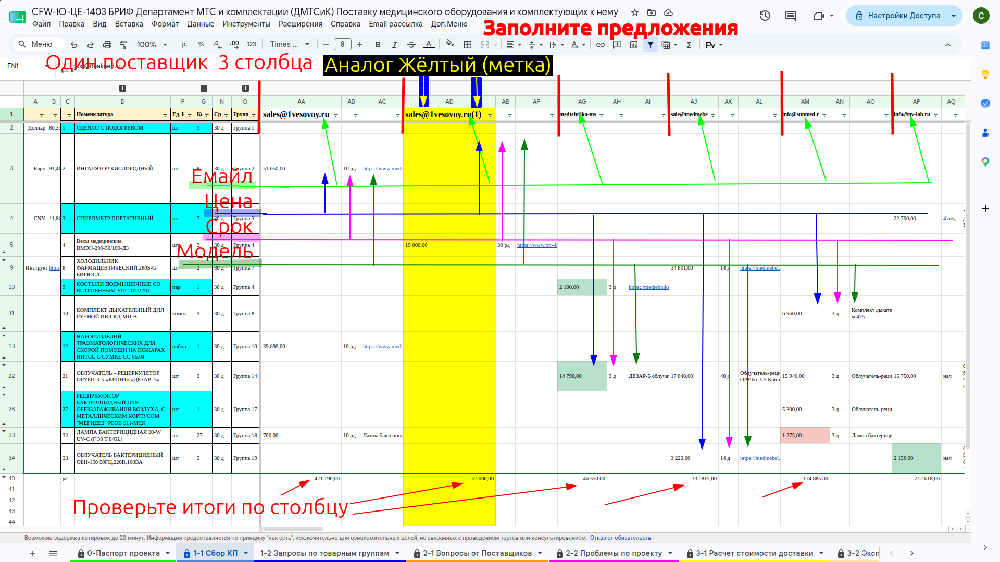 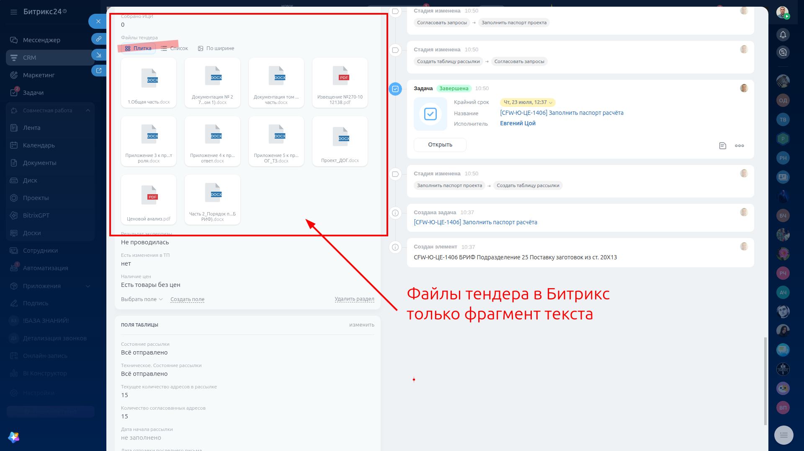 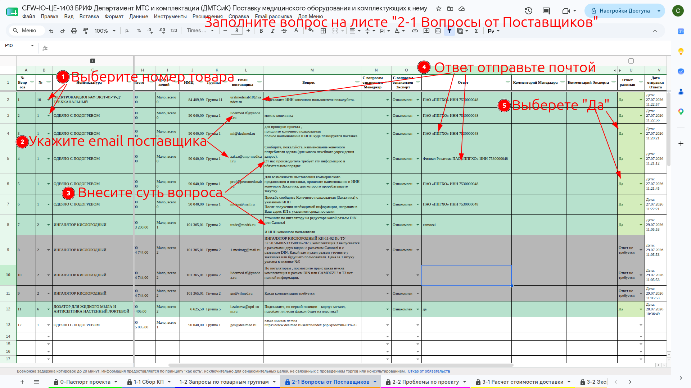 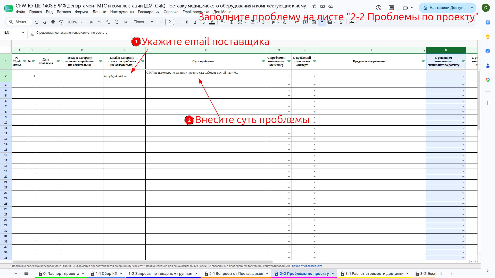

**Текст на фото:**

* Заполните предложения
* Один поставщик  3 столбца
* Емайл цена срок модель аналог Жёлтый  + метка
* проверьте итоги по столбцу
* Файлы тендера в битрикс  - только фрагмент текста
* Заполните вопрос на листе "2-1 Вопросы от Поставщиков"
* Выберите номер товара
* Укажите email поставщика
* Внесите суть вопроса
* Есть ответ 
* Ответ отправьте почтой
* Выберете "Да"
* Заполните проблему на листе "2-2 Проблемы по проекту"
* Укажите email поставщика
* Внесите суть проблемы

