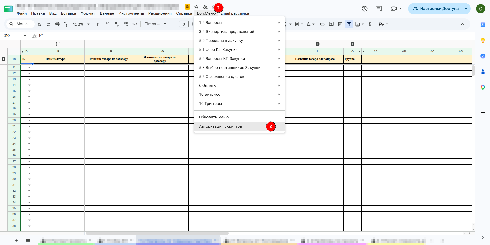
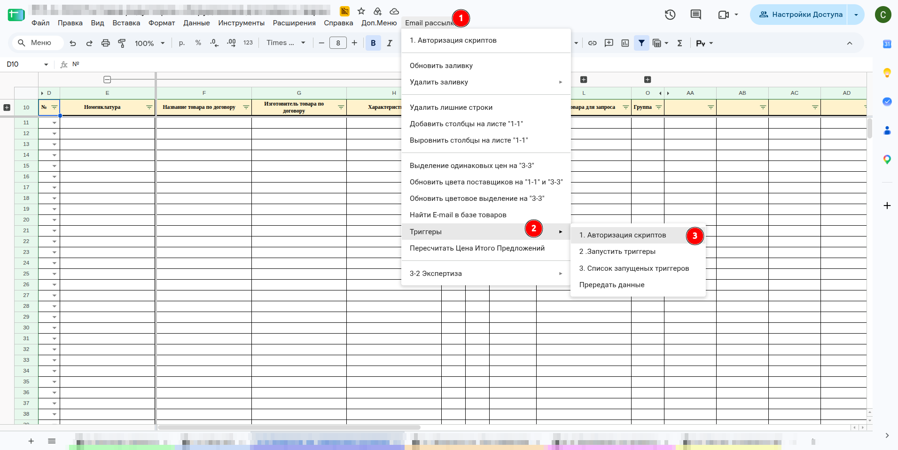
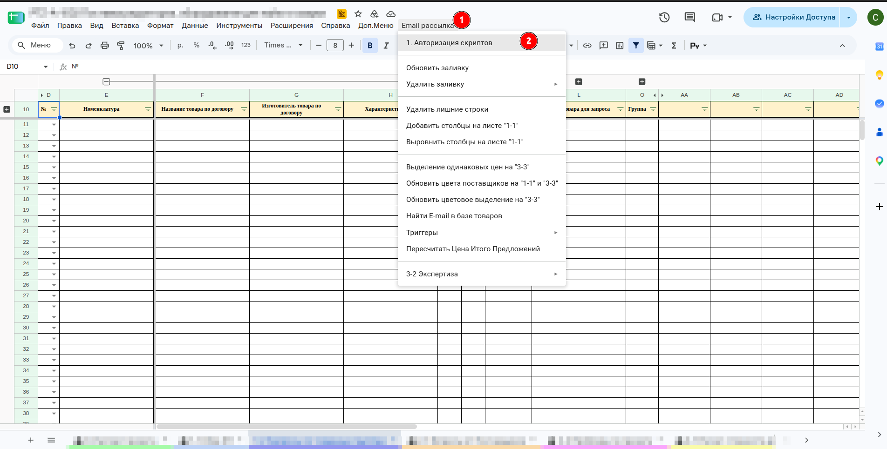
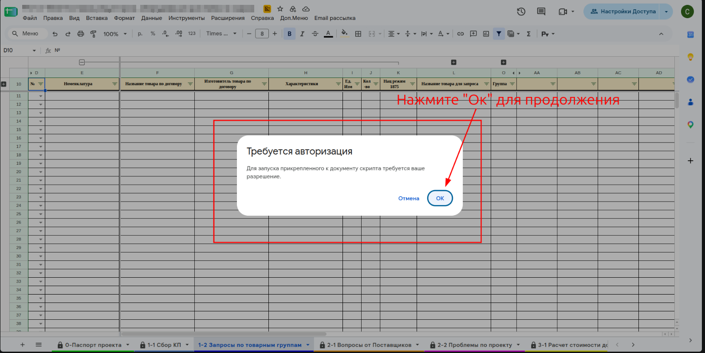
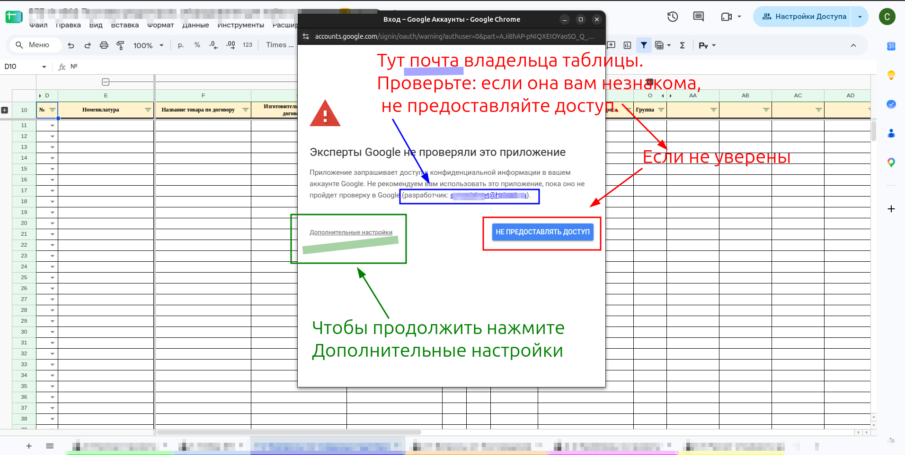
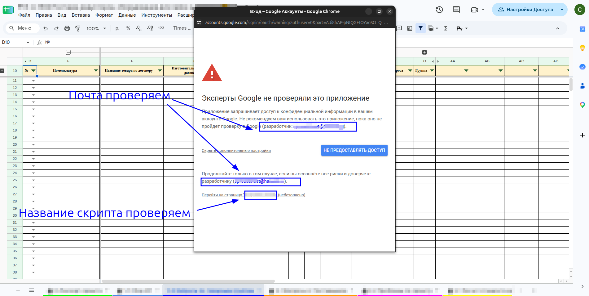
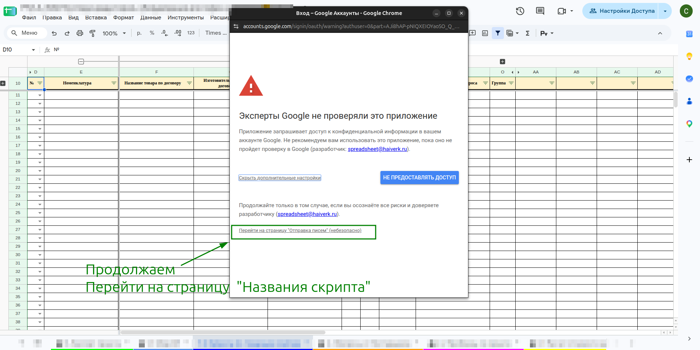
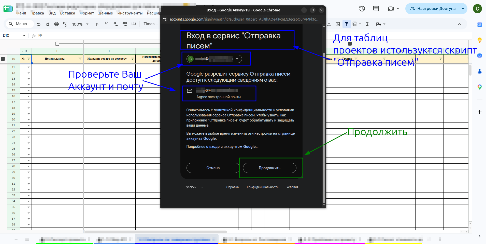
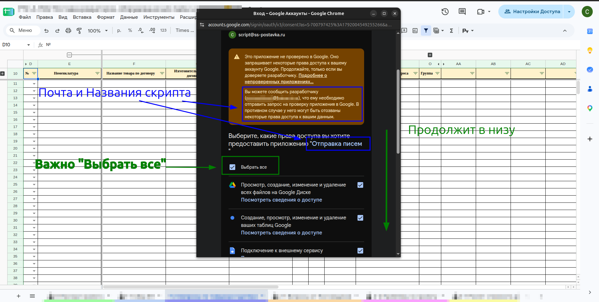
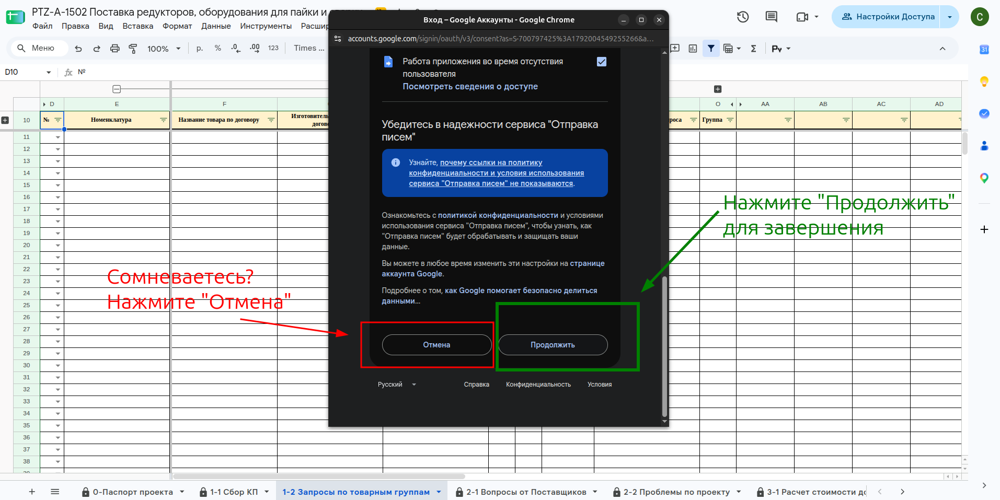

# Авторизация скриптов

**Описание**

Скрипты таблицы не работают от вашего аккаунта, пока вы не дали им разрешение. Разрешение даётся **один раз для каждой таблицы и каждого аккаунта**: при первом запуске любого пункта меню Google показывает окно «Требуется авторизация».

**ВНИМАНИЕ** авторизуйтесь специальным пунктом «Авторизация скриптов», а не рабочим пунктом меню. Сразу после авторизации Google выполняет нажатый пункт, но не показывает [[zna.skr-plashka]] — легко нажать ещё раз и запустить рабочий скрипт дважды. Пункт «Авторизация скриптов» безопасен: он запускает небольшую функцию, которая ни на что не влияет.

**Навигация / Путь в системе**

Пункт «Авторизация скриптов» есть в нескольких меню. Задача у них одна — можно выбирать любой, если не договорились иначе:

- `Доп.Меню` → `Авторизация скриптов`;
- `Email рассылка` → `1. Авторизация скриптов`;
- `Email рассылка` → `Триггеры` → `1. Авторизация скриптов`.

**Основные пользователи**

- [[rol.raschet]]
- все, кто запускает пункты меню в таблице проекта.

**Когда используем**

- сразу после создания копии таблицы расчёта (инструкция для специалиста по расчёту, задача «Подготовка рабочей таблицы»);
- перед рассылкой писем, после перехода в согласованный аккаунт для рассылки (там же, шаг «Отправьте письма»);
- перед запуском любых скриптов, если не уверены, что авторизация в этой таблице уже была.

**Что подготовить**

- Открытую таблицу проекта.
- Нужный аккаунт: проверьте, под каким аккаунтом вы вошли (значок в правом верхнем углу).

**Что получится**

- Следующие запуски пунктов меню **от этого аккаунта в этой таблице** идут без окна с запросом разрешений.

**Как проверить**

- Нажмите «Авторизация скриптов» ещё раз: окна «Требуется авторизация» нет, вверху появляется [[zna.skr-plashka]].

## Знания / Умения / Инструкции

[[zna.skr-plashka]]

## Шаги

##### [Шаг 1. Запустите пункт «Авторизация скриптов»]{#shag-1-punkt}

1. Выберите любой из пунктов «Авторизация скриптов»:
    1. `Доп.Меню` → `Авторизация скриптов`;
    1. `Email рассылка` → `Триггеры` → `1. Авторизация скриптов`;
    1. `Email рассылка` → `1. Авторизация скриптов`.

##### [Шаг 2. Подтвердите запрос]{#shag-2-ok}

1. Если авторизация нужна, появится окно **«Требуется авторизация»**. Нажмите **«ОК»**.
    1. Окна нет — значит, авторизация в этой таблице уже была. Больше ничего делать не нужно.
1. Если Google попросит выбрать аккаунт — выберите тот, под которым работаете.

##### [Шаг 3. Проверьте, чей это скрипт]{#shag-3-proverka}

1. Откроется окно **«Эксперты Google не проверяли это приложение»**. Это нормально для внутренних скриптов компании.
1. В строке «(разработчик: …)» стоит **почта владельца таблицы**. Проверьте её.
    1. **ВНИМАНИЕ** если почта вам незнакома или вы не уверены — нажмите **«Не предоставлять доступ»** и обратитесь к руководителю.
1. Чтобы продолжить, нажмите **«Дополнительные настройки»**.

**Текст на фото:**

* Тут почта владельца таблицы. Если она вам незнакома — не предоставляйте доступ.
* Если не уверены — «Не предоставлять доступ».
* Чтобы продолжить — «Дополнительные настройки».

##### [Шаг 4. Перейдите к скрипту]{#shag-4-pereyti}

1. Ниже появится текст «Продолжайте только в том случае, если вы осознаёте все риски и доверяете разработчику».
1. Ещё раз проверьте почту разработчика и название скрипта. Для таблиц проектов скрипт называется **«Отправка писем»**.
1. Нажмите **«Перейти на страницу "Отправка писем" (небезопасно)»**.

##### [Шаг 5. Проверьте свой аккаунт]{#shag-5-akkaunt}

1. Откроется окно **«Вход в сервис "Отправка писем"»**.
1. Проверьте, что вверху и в строке «Адрес электронной почты» стоит **ваш** аккаунт.
1. Нажмите **«Продолжить»**.

##### [Шаг 6. Выдайте все права]{#shag-6-prava}

1. В разделе «Выберите, какие права доступа вы хотите предоставить приложению "Отправка писем"» отметьте **«Выбрать все»**.
    1. **ОБЯЗАТЕЛЬНО** отметьте все права. Без части прав скрипты будут работать с ошибками.
1. Прокрутите окно вниз.

##### [Шаг 7. Завершите]{#shag-7-zavershit}

1. Внизу окна нажмите **«Продолжить»**.
    1. Сомневаетесь — нажмите **«Отмена»**: доступ не будет выдан.
1. **ВНИМАНИЕ** после «Продолжить» несколько секунд ничего не нажимайте: пункт меню выполняется, хотя плашки «Выполняется скрипт» может не быть.

## Как отозвать доступ

Если доступ выдан, а вы передумали, его можно закрыть в любой момент:

1. Откройте страницу управления доступом аккаунта Google: `https://myaccount.google.com/permissions`.
1. Найдите в списке сервис **«Отправка писем»**.
    1. **ВНИМАНИЕ** у всех таблиц проектов скрипт называется одинаково — «Отправка писем», поэтому нужный бывает трудно найти.
1. Нажмите на него и выберите **«Удалить доступ»**.

## На что инструкция не отвечает

- Как отличить в списке доступа «Отправку писем» одной таблицы от другой.

## Осталось сделать

Собрано 2026-10-14 по объяснению и снимкам директора.

- Пройти по новой копии таблицы.
- В папке `imgs/` лежит неиспользованный снимок `04-trebuetsya.png` — то же окно «Требуется авторизация», что и `05-ok.png`.
