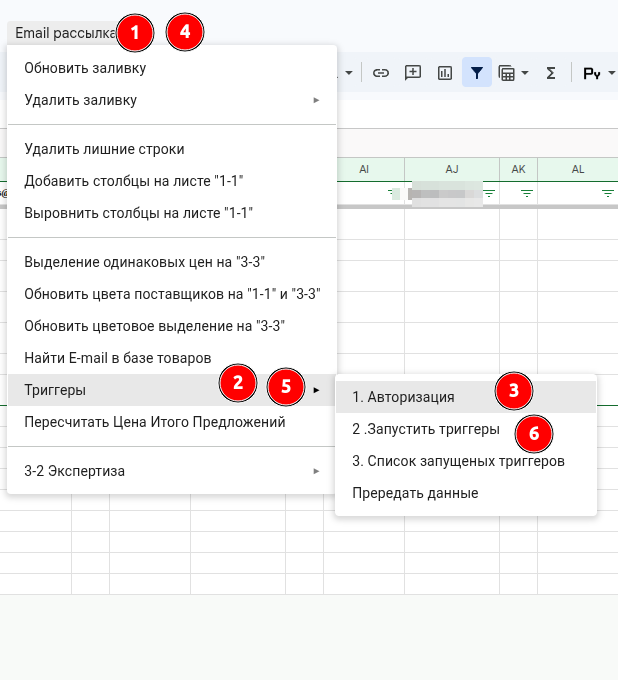

# Авторизация скриптов

**Описание**

В новой копии таблицы расчёта скрипты не работают, пока им не дан доступ от имени аккаунта. Доступ даётся один раз для каждой таблицы и каждого аккаунта: при первом запуске любого пункта меню Google показывает окно с запросом разрешений.

**ВНИМАНИЕ** авторизуйте скрипты специальным пунктом `1. Авторизация`, а не рабочим пунктом меню. После авторизации Google сразу выполняет нажатый пункт и не показывает, что скрипт работает. Пункт `1. Авторизация` безопасен: он только заново строит меню. Рабочий пункт в такой момент легко запустить дважды.

**Навигация / Путь в системе**

- Таблица расчёта проекта — по ссылке из CRM.
- Меню таблицы `Email рассылка` → `Триггеры` → `1. Авторизация`.

**Основные пользователи**

- [[rol.raschet]]

**Когда используем**

- сразу после создания копии таблицы расчёта (инструкция для специалиста по расчёту, задача «Подготовка рабочей таблицы»);
- перед рассылкой писем, после перехода в согласованный аккаунт для рассылки (там же, шаг «Отправьте письма»).

**Что подготовить**

- Открытая таблица расчёта проекта.
- Вход в нужный аккаунт: `spreadsheet@haiverk.ru` — для работы с таблицей; аккаунт рассылки — на этапе отправки писем.

**Что получится**

- Пункты меню таблицы выполняются без окна с запросом разрешений.

**Как проверить**

- нажмите `1. Авторизация` ещё раз: окно разрешений не появляется, вверху видна [[zna.skr-plashka]].

## Знания / Умения / Инструкции

[[zna.skr-plashka]]

## Шаги

##### [Шаг. Дайте доступ скриптам]{#shag-dayte-dostup-skriptam}

1. Убедитесь, что вы вошли под нужным аккаунтом.
1. Нажмите `Email рассылка` → `Триггеры` → `1. Авторизация`.
1. В появившемся окне нажмите **«Продолжить»** и выберите аккаунт.
1. Нажмите **«Дополнительные настройки»** и перейдите по ссылке **«Перейти на страницу (небезопасно)»**.
1. Нажмите **«Разрешить»**.
1. **ВНИМАНИЕ** после этого ничего не нажимайте несколько секунд: пункт меню выполняется, хотя плашки «Выполняется скрипт» может не быть.

###### **Внешний вид / Фото**

**Текст на фото:**

* 1–2–3: Email рассылка → Триггеры → 1. Авторизация.

## На что инструкция не отвечает

- Внизу меню `Доп.Меню` тоже есть пункт «Авторизация» — это то же самое?
- Нужно ли авторизовать отдельно в аккаунте рассылки, и каким пунктом.

## Осталось сделать

Порядок действий — по объяснению директора от 2026-10-13. Надписи в окне Google взяты из начатой переработки 3.1.2 (`v2.md`) и по живой таблице не сверены.

- Сверить надписи на кнопках в окне Google.
- Снимки окна Google: `02-okno-prodolzhit.png`, `03-vybor-akkaunta.png`, `04-dop-nastroyki.png`, `05-razreshit.png`.
- Снимок меню переделать во весь экран (пометка директора).
