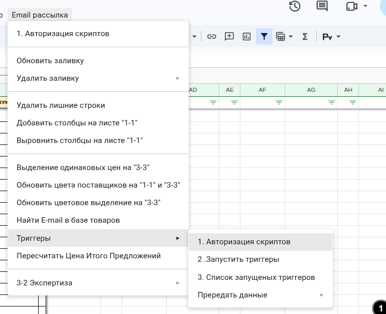
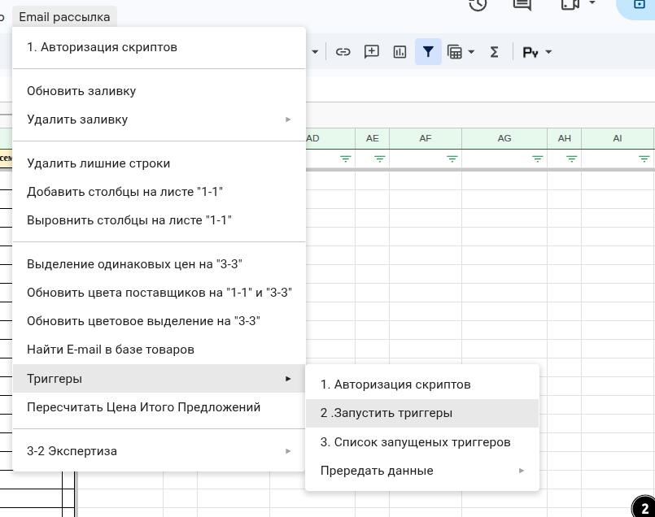

## Правильная последовательность работы с триггерами

- **Шаг 1. Авторизуйте скрипты**
    - Нажмите Email рассылка → Триггеры → 1. Авторизация скриптов.
    - Если появится окно «Требуется авторизация» — пройдите авторизацию до конца: авторизация скриптов.
    - **ВНИМАНИЕ** этот шаг нельзя пропускать, даже если кажется, что скрипты уже авторизованы.
- **Шаг 2. Запустите триггеры — один раз**
    - Нажмите Email рассылка → Триггеры → 2. Запустить триггеры.
    - Дождитесь, пока появится и исчезнет плашка «Выполняется скрипт».
    - **ВНИМАНИЕ** второй раз пункт не нажимайте.
    - Пункт Email рассылка → Удалить лишние строки тоже включает триггеры. Если вы его уже выполняли — проверьте список, прежде чем запускать триггеры ещё раз.

###### **Внешний вид / Фото**

**Текст на фото:**

* Email рассылка → Триггеры → 1. Авторизация скриптов. 
* Email рассылка → Триггеры → 2. Запустить триггеры.
* Второй раз не нажимайте.