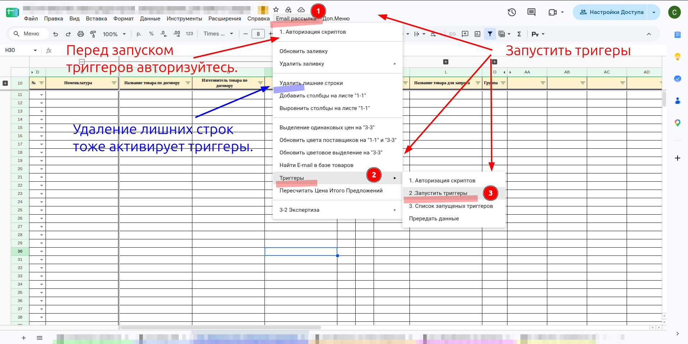
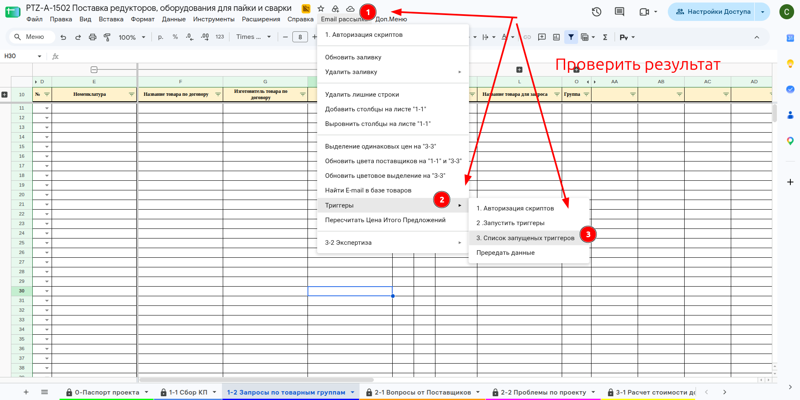
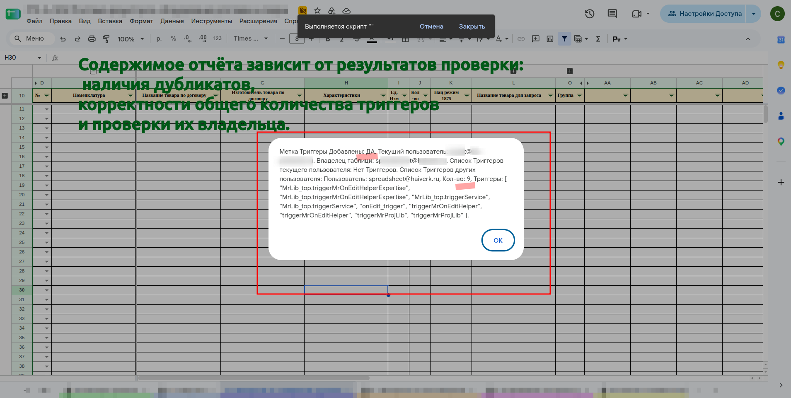
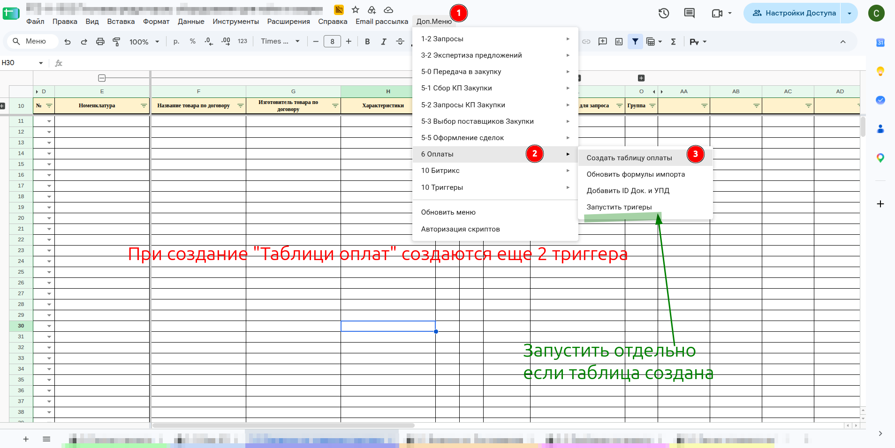
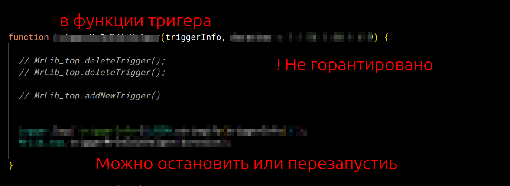

# Запуск триггеров

**Описание**

Часть скриптов таблицы проекта работает сама: по расписанию и при правке ячеек. Такой автоматический запуск называется триггером. В таблице проекта должно работать **пять триггеров**, каждый в одном экземпляре.

**ВНИМАНИЕ** запускать триггеры должен **владелец таблицы**.

**ВНИМАНИЕ** возможна ошибка — запустить создание триггеров дважды. Тогда каждый триггер появится в двух экземплярах, и скрипты будут выполняться по два раза.

Почему так бывает: первый запуск любого пункта меню требует авторизации скриптов. Сразу после авторизации Google выполняет выбранный пункт, но [[zna.skr-plashka]] не показывает. Сотрудник не видит, что скрипт уже работает, и нажимает пункт ещё раз. В скрипте есть защита от повторного создания, но при нажатиях с разницей в секунды она не успевает сработать.

Поэтому порядок такой: сначала отдельно авторизовать скрипты, потом один раз запустить триггеры, потом проверить.

**Навигация / Путь в системе**

- Меню таблицы `Email рассылка` → `Триггеры`.
- Список триггеров — консоль Google Apps Script: `Расширения` → `Apps Script` → «Триггеры».

**Основные пользователи**

- Владелец таблицы — аккаунт, от которого создана копия таблицы ([[rol.raschet]]).

**Когда используем**

- один раз после создания копии таблицы расчёта (инструкция для специалиста по расчёту, задача «Подготовка рабочей таблицы», пункт «Запустите скрипты»);
- если триггеры пропали: у триггеров есть **время жизни — 40 дней**, после этого они удаляются сами.

**Что получится**

- В таблице работают пять триггеров, каждый в одном экземпляре, владелец — владелец таблицы.

**Как проверить**

- в консоли Apps Script ровно пять триггеров, функции не повторяются, у владельца таблицы в столбце «Владелец» — «Я».

## Знания / Умения / Инструкции

[[tio.skr-avtorizatsiya]]

[[zna.skr-plashka]]

[[um.skr-proverit-triggery]]

## Шаги

##### [Шаг 1. Авторизуйте скрипты]{#shag-1-avtorizatsiya}

1. Нажмите `Email рассылка` → `Триггеры` → `1. Авторизация скриптов`.
1. Если появится окно «Требуется авторизация» — пройдите авторизацию до конца: [[tio.skr-avtorizatsiya]].
1. **ВНИМАНИЕ** этот шаг нельзя пропускать, даже если кажется, что скрипты уже авторизованы.

##### [Шаг 2. Запустите триггеры — один раз]{#shag-2-zapusk}

1. Нажмите `Email рассылка` → `Триггеры` → `2. Запустить триггеры`.
1. Дождитесь, пока появится и исчезнет плашка «Выполняется скрипт».
1. **ВНИМАНИЕ** второй раз пункт не нажимайте.
1. Пункт `Email рассылка` → `Удалить лишние строки` тоже включает триггеры. Если вы его уже выполняли — проверьте список, прежде чем запускать триггеры ещё раз.

**Текст на фото:**

* Перед запуском триггеров авторизуйтесь.
* Запустить триггеры: Email рассылка → Триггеры → 2. Запустить триггеры.
* Удаление лишних строк тоже активирует триггеры.

##### [Шаг 3. Посмотрите отчёт]{#shag-3-otchet}

1. Нажмите `Email рассылка` → `Триггеры` → `3. Список запущеных триггеров`.
1. Появится окно-отчёт. Что в нём смотреть:
    1. **«Метка Триггеры Добавлены»** — «ДА», если триггеры уже создавались;
    1. **«Текущий пользователь»** и **«Владелец таблицы»** — кто вы и кто владелец;
    1. **«Список Триггеров текущего пользователя»** и **«других пользователей»** — сколько триггеров и какие функции. Должно быть 5 разных функций у владельца таблицы.
1. Если триггеров больше пяти или функции повторяются — переходите к шагу 4.

**Текст на фото:**

* Содержимое отчёта зависит от результатов проверки: наличия дубликатов, правильного общего количества триггеров и их владельца.

##### [Шаг 4. Проверьте в консоли Apps Script]{#shag-4-konsol}

[[um.skr-proverit-triggery:tekst]]

## Триггеры таблицы оплат

При создании таблицы оплат (`Доп.Меню` → `6 Оплаты` → `Создать таблицу оплаты`) создаются ещё 2 триггера — для неё. Если таблица оплат уже создана, а её триггеры не работают, их запускают отдельно: `Доп.Меню` → `6 Оплаты` → `Запустить тригеры`.

## Что стоит за триггерами

Пять функций-триггеров таблицы проекта. По служебному листу **S-10 Триггеры** из выгрузки таблицы от 2026-10-13; по коду скриптов не проверено.

| Функция | Что обслуживает |
|---|---|
| `triggerMrProjLib` | лист 1-2 и листы 5 |
| `triggerMrOnEditHelper` | листы 3-3 Выбор поставщиков и 1-1 Сбор КП |
| `MrLib_top.triggerMrOnEditHelperExpertise` | лист 3-2 Экспертиза предложений |
| `MrLib_top.triggerService` | сервисные работы в фоне: подсчёт, передача |
| `onEdit_trigger` | реакция на правку ячеек, может выполняться дольше обычной |

Лист **S-10 Триггеры** и надпись в ячейке **AB9** листа 5-5 показывают состояние всех триггеров.

## Для администратора

Памятка на случай, если триггеры надо остановить или перезапустить через код. В функции триггера есть закомментированные вызовы `MrLib_top.deleteTrigger()` и `MrLib_top.addNewTrigger()`: раскомментировав их, триггер можно остановить или перезапустить.

**ВНИМАНИЕ** результат не гарантирован.

## На что инструкция не отвечает

- **Как убрать лишние триггеры**, если их создали дважды: удалить вручную в консоли или через код администратора?
- **Что делает пункт** `Прередать данные` в подменю «Триггеры».

## Осталось сделать

Собрано 2026-10-14 по объяснению и снимкам директора.

- Пройти по новой копии таблицы.
- Отчёт «3. Список запущеных триггеров» сейчас выдаёт сплошной текст. У директора есть набросок понятного отчёта — записан в `inst/PLAN.md`, раздел «Решить». Это доработка скрипта.
