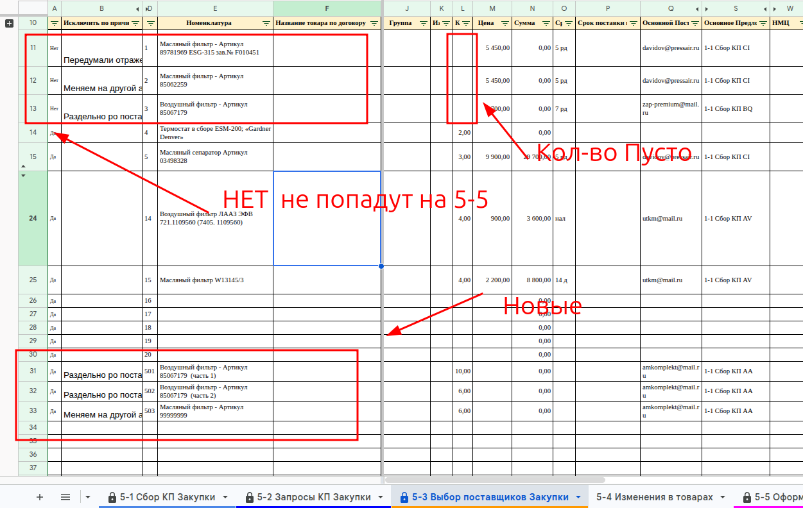
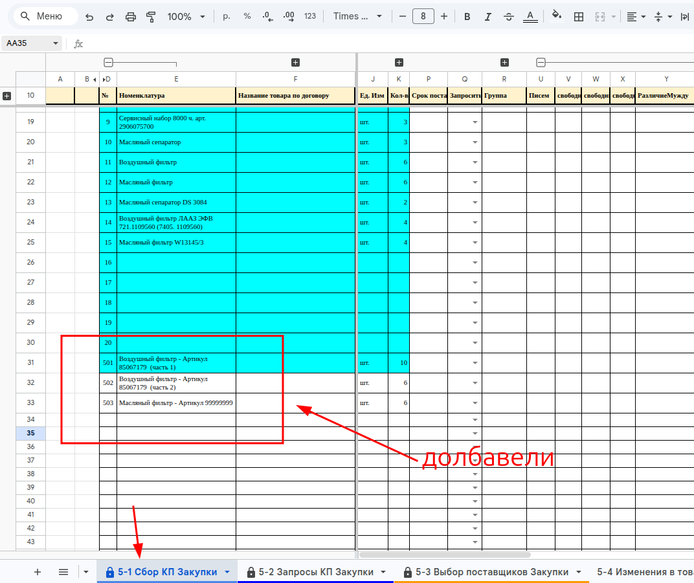
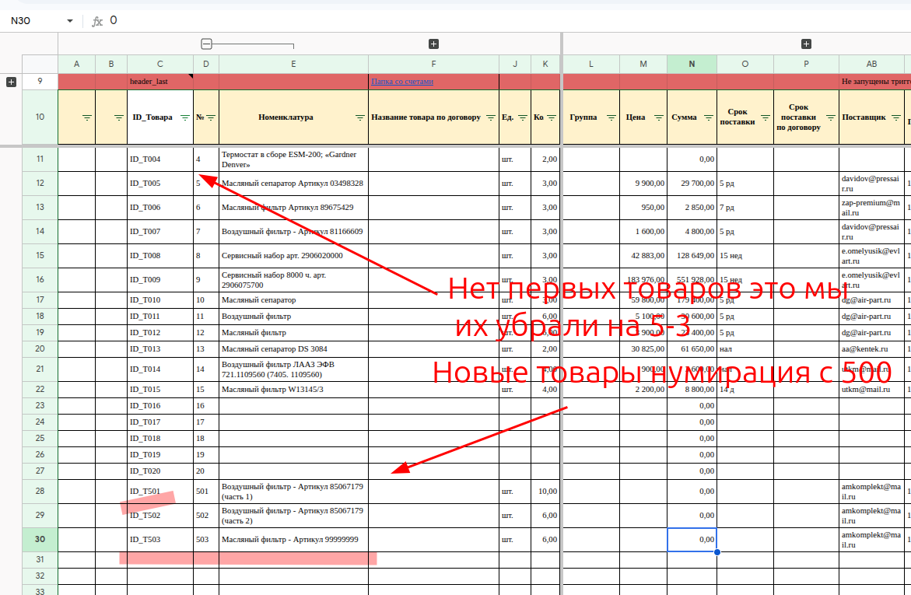

# Инструкция по разделению товаров в таблице расчета

**Описание**

Эта инструкция содержит пошаговое руководство по разделению товаров в таблице расчета при изменении закупках. Оригинальные товары из договора остаются без изменений — их строки не удаляются, а к ним добавляются комментарии о планируемых изменениях. Новые товары описываются точно так же, как в договоре, и попадают в единый список **[[lis.k2-5-0-tovary:kratko]]**. Лист **[[lis.k2-5-0-peredacha:kratko]]** остаётся как в договоре. На лист **[[lis.k2-5-4-izmeneniya:kratko]]** добавляются комментарии к существующему перечню, изменения и новые товары с указанием причин. На листе **[[lis.k2-5-3-vybor-postavshchikov:kratko]]** в столбце A вместо «Да» пишется «Нет», чтобы товар не попал в списки на лист **[[lis.k2-5-5-sdelki:kratko]]** и не влиял на сумму итого.

**ВНИМАНИЕ** лист **[[lis.k2-5-0-peredacha:kratko]]** не трогаем: это отражение договора. Изменения планируются на листе **[[lis.k2-5-4-izmeneniya:kratko]]** и подтверждаются на листе **[[lis.k2-5-3-vybor-postavshchikov:kratko]]**.

**Навигация / Путь в системе**

- Таблица расчёта проекта — по ссылке из CRM: [[res.bitrix24]] → поле «Ссылка на таблицу расчета».
- Файлы тендера — в CRM: смарт-процесс «Расчет» → «Файлы тендера».
- Листы, с которыми работаем: **[[lis.k2-5-4-izmeneniya:kratko]]**, **[[lis.k2-5-3-vybor-postavshchikov:kratko]]**; смотрим результат на **[[lis.k2-5-1-sbor-kp:kratko]]** и **[[lis.k2-5-5-sdelki:kratko]]**.

**Основные пользователи**

- [[rol.zakupka]]

**Когда используем**

При изменении контракта, замене товаров, разделении поставок на несколько партий.

**Что подготовить**

- **Файл тендера** – спецификация оборудования из CRM (формат: .xlsx, .pdf)
- **Измененный контракт** – если есть изменения (формат: .pdf, .docx)

**Что получится**

- На листе **[[lis.k2-5-4-izmeneniya:kratko]]** — причины изменений у исходных позиций и новые позиции.
- На листе **[[lis.k2-5-1-sbor-kp:kratko]]** — все товары, исходные и новые.
- На листе **[[lis.k2-5-3-vybor-postavshchikov:kratko]]** — все товары, исходные и новые, с причинами изменений; у исключённых в столбце A «Сделка» стоит «Нет», количество пустое.
- На листе **[[lis.k2-5-5-sdelki:kratko]]** — только товары с «Да».

**Как проверить**

- лист **[[lis.k2-5-0-peredacha:kratko]]** соответствует договору;
- на листах **[[lis.k2-5-3-vybor-postavshchikov:kratko]]** и **[[lis.k2-5-1-sbor-kp:kratko]]** — все товары, а на листе **[[lis.k2-5-5-sdelki:kratko]]** — только те, у которых «Да» в столбце A «Сделка» листа **[[lis.k2-5-3-vybor-postavshchikov:kratko]]**;
- отключённые товары не влияют на сумму на листе **[[lis.k2-5-3-vybor-postavshchikov:kratko]]** и не попадают на лист **[[lis.k2-5-5-sdelki:kratko]]**.

## Знания / Умения / Инструкции

[[lis.k2-5-0-peredacha]]

[[lis.k2-5-4-izmeneniya]]

[[lis.k2-5-3-vybor-postavshchikov]]

[[um.tab-chisla-bez-probelov]]

## Шаги

##### [Шаг 1. Запланируйте изменение исходной позиции]{#shag-1-isklyuchit}

Откройте лист **[[lis.k2-5-4-izmeneniya:kratko]]**.

[[um.tov-k2-5-4-isklyuchit:tekst]]

##### [Шаг 2. Добавьте новые позиции]{#shag-2-dobavit}

На том же листе. При разделении позиции на части каждая часть — отдельная новая позиция, заполненная так же, как товар в договоре.

[[um.tov-k2-5-4-dobavit:tekst]]

**ВНИМАНИЕ** все изменения должны быть обоснованы: у каждой правки — причина и пометка, что проверить.

##### [Шаг 3. Подтвердите на листе 5-3]{#shag-3-podtverdit}

Исходную позицию, которую заменили или разделили, отключите; новые — включите.

[[um.tov-k2-5-3-sdelka:tekst]]

Если нужно изменить количество — не правьте его руками: запланируйте на листе **[[lis.k2-5-4-izmeneniya:kratko]]** новую позицию с другим количеством, а старую отключите.

##### [Шаг 4. Проверьте результат]{#shag-4-proverka}

1. На листе **[[lis.k2-5-4-izmeneniya:kratko]]** у исходных товаров указаны причины, новые товары заполнены так же, как товары в договоре.
1. На листе **[[lis.k2-5-3-vybor-postavshchikov:kratko]]** у отключённых товаров в столбце **A «Сделка»** стоит «Нет», а в столбце **L «Кол-во»** пусто.
    1. Количество очищается само, формулой: `=ЕСЛИ(A19="Да";'5-1 Сбор КП Закупки'!K19;)`.
1. Причины в столбце **B** листа **[[lis.k2-5-3-vybor-postavshchikov:kratko]]** совпадают с причинами на листе **[[lis.k2-5-4-izmeneniya:kratko]]**.
1. На листе **[[lis.k2-5-1-sbor-kp:kratko]]** появились новые товары, с номерами от 501.
1. На листе **[[lis.k2-5-5-sdelki:kratko]]** нет отключённых товаров и есть новые.

###### **Внешний вид / Фото**

**Текст на фото:**

* «Нет» — не попадут на 5-5; количество у них пусто.
* Новые товары — внизу списка.
* На 5-1 новые товары добавились.
* На 5-5 нет первых товаров — их убрали на 5-3; у новых товаров нумерация с 500.

## На что инструкция не отвечает

- **С чем сверять итоговую сумму.** Лист «0-Паспорт проекта» для этого не годится. Теоретически можно сверить с листом 3-3 — что было в расчёте до закупки. Вопрос открыт.
- **Где хранится изменённый контракт.** В «Что подготовить» он назван, а где его искать — не сказано.

## Осталось сделать

Описание — директора. Шаги собраны 2026-10-13 по ответам и снимкам директора.

- Пройти инструкцию целиком по живой таблице.
- Все снимки переделать во весь экран — так легче ориентироваться (пометка директора). Закрашивать на снимках ничего не нужно.
