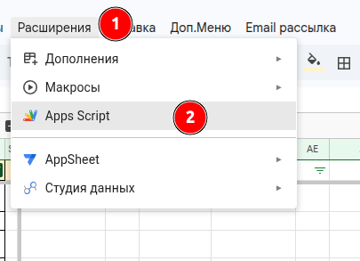
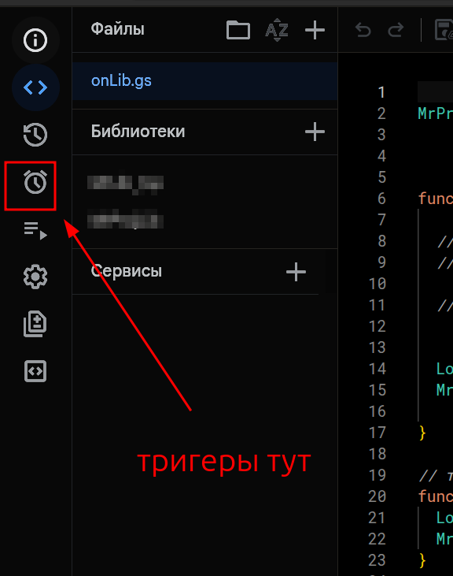
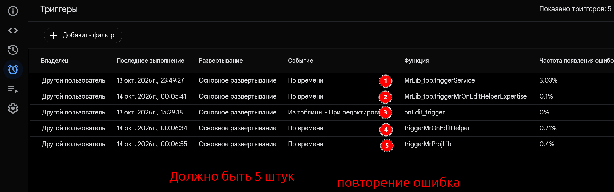

# Проверить список триггеров

Это достоверный способ узнать, какие триггеры работают в таблице.

1. В таблице откройте меню `Расширения` → `Apps Script`.
1. В открывшемся редакторе нажмите слева значок с будильником — **«Триггеры»**.
1. Посмотрите список. Вверху справа написано «Показано триггеров».
    1. Должно быть **ровно 5** триггеров, по одному на каждую функцию:
        1. `MrLib_top.triggerService`
        1. `MrLib_top.triggerMrOnEditHelperExpertise`
        1. `onEdit_trigger`
        1. `triggerMrOnEditHelper`
        1. `triggerMrProjLib`
    1. **Повторение функции в списке — ошибка**: триггеры создали дважды.
    1. В столбце «Последнее выполнение» видно, когда триггер срабатывал.

**Текст на фото:**

* Расширения → Apps Script.
* Триггеры — значок с будильником слева.
* Должно быть 5 штук.
* Повторение — ошибка.
