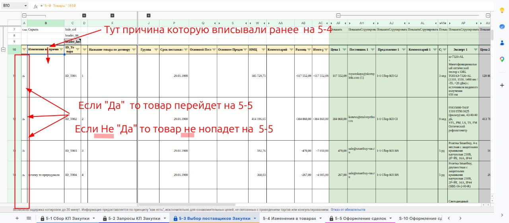

# Включить или исключить товар из сделок

Лист **[[lis.k2-5-3-vybor-postavshchikov:kratko]]**, столбец **A «Сделка»**.

1. Найдите строку товара. В столбце **B** видна причина, которую раньше вписали на листе **[[lis.k2-5-4-izmeneniya:kratko]]**.
1. В столбце **A** поставьте **«Да»**, если товар идёт в исполнение, — он перейдёт на лист **[[lis.k2-5-5-sdelki:kratko]]**.
1. Чтобы исключить товар, замените «Да» на **«Нет»**.
    1. Всё, что не «Да», считается «Нет»: такой товар на лист **[[lis.k2-5-5-sdelki:kratko]]** не попадёт.
    1. Количество в столбце **L «Кол-во»** у такого товара очистится само — руками его не меняйте.

**Текст на фото:**

* Тут причина, которую вписывали ранее на 5-4.
* Если «Да» — товар перейдёт на 5-5.
* Если не «Да» — товар не попадёт на 5-5.
