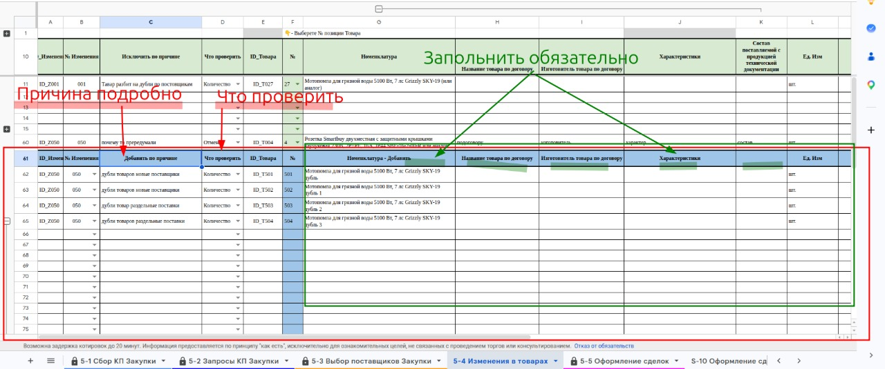

# Добавить новую позицию товара

Нижний блок листа **[[lis.k2-5-4-izmeneniya:kratko]]** (строки 62–112, заголовок «Добавить по причине»).

1. В столбце **B «№ Изменения»** выберите из списка номер изменения, к которому относится новый товар — тот же, что у исключённой позиции в верхнем блоке.
1. В столбце **C «Добавить по причине»** впишите причину подробно.
    1. Пример: «Раздельно по поставщикам».
1. В столбце **D «Что проверить»** выберите короткое напоминание.
1. Заполните столбцы **G–Q** руками, так же, как описаны товары в договоре: Номенклатура, Название товара по договору, Изготовитель, Характеристики, Состав документации, Ед. Изм, Кол-во, НМЦ, Срок поставки, Нац режим 1875, Код ОКПД 2.
    1. **ОБЯЗАТЕЛЬНО** номенклатура должна быть уникальной. Если товары называются одинаково — добавьте отличие: «…(часть 1)», «…(часть 2)».
1. Столбцы **E «ID_Товара»** и **F «№»** заполнятся сами (новые позиции получают номера с 501).
1. **ВНИМАНИЕ** столбцы **A** и **E** не трогайте — в них формулы.

**Текст на фото:**

* Впишите причину подробно.
* Выберите, что проверить.
* Заполните обязательно столбцы товара.
