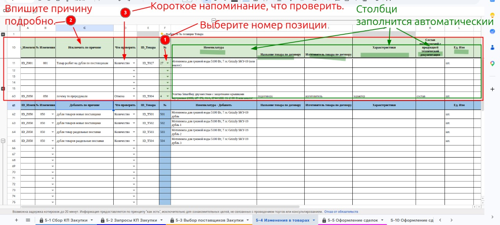

# Запланировать исключение или изменение позиции

Верхний блок листа **[[lis.k2-5-4-izmeneniya:kratko]]** (строки 11–60, заголовок «Исключить по причине»).

1. В столбце **F «№»** выберите номер позиции товара из списка.
    1. Столбцы с данными товара (Номенклатура, Название по договору, Характеристики, Ед. Изм и другие) заполнятся сами.
1. В столбце **B «№ Изменения»** укажите номер изменения: 001, 002, 003… По этому номеру исключённая позиция связывается с новыми, которые добавляются взамен.
1. В столбце **C «Исключить по причине»** впишите причину подробно.
    1. Пример: «Товар разбит на дубли по поставщикам».
    1. Эта причина появится на листе **[[lis.k2-5-3-vybor-postavshchikov:kratko]]**.
1. В столбце **D «Что проверить»** выберите короткое напоминание: «Количество», «Замена», «Слияние», «Отмена» или «Добавление».
1. **ВНИМАНИЕ** столбцы **A** и **E** не трогайте — в них формулы.

**Текст на фото:**

* Выберите номер позиции.
* Впишите причину подробно.
* Выберите короткое напоминание, что проверить.
* Остальные столбцы заполнятся автоматически.
