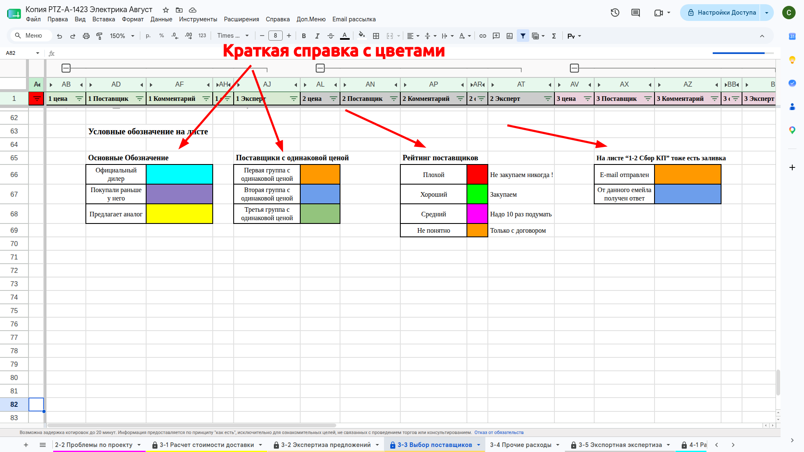
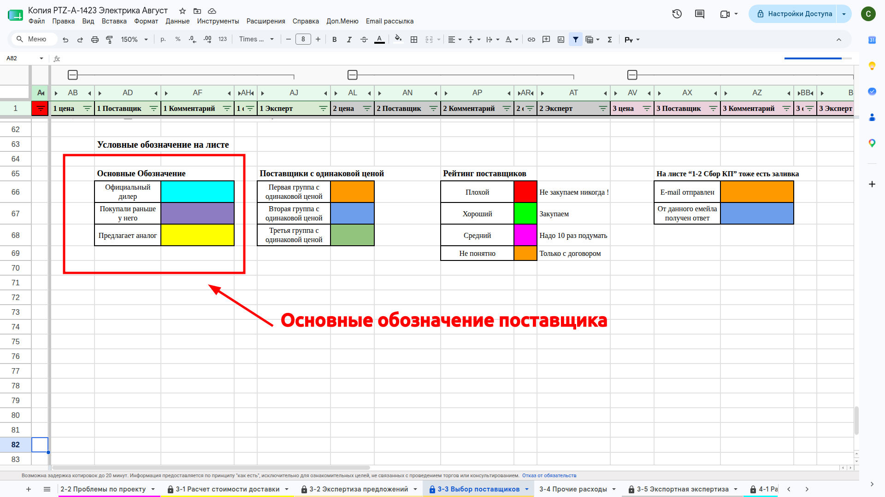
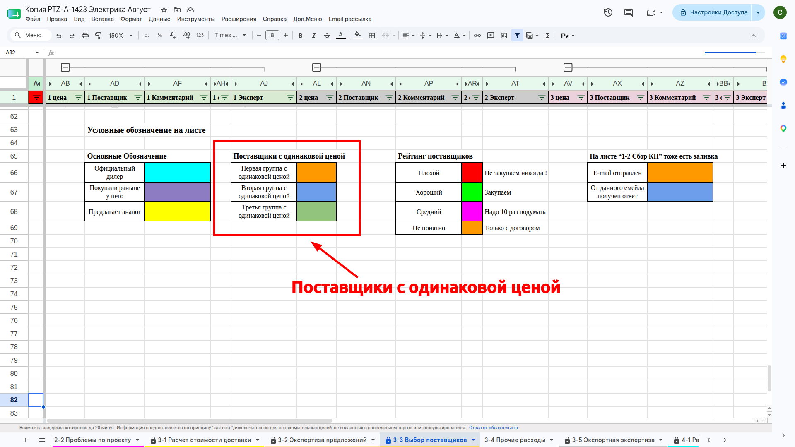
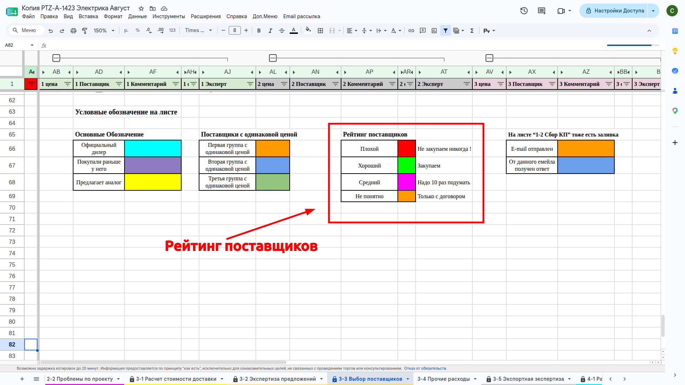
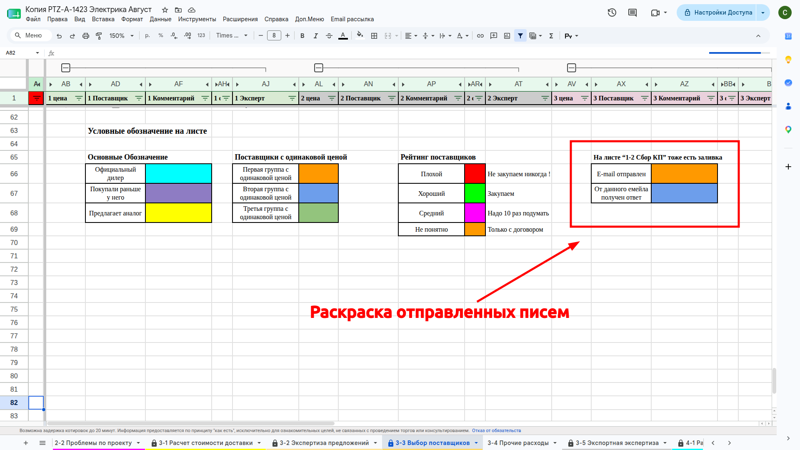

# Цвета раскраски емайлов

##### Знание. Цвета раскраски емайлов

Цвет фона (заливки) ячейки с **Email-адресом поставщика** может быть раскрашен разними цветами.  Расшифровка (смысл, значение) цвета зависит от листа и зоны (места на листе) в которой расположен ***Email-адрес поставщика***, то есть один и тот же цвет в разных частях таблицы может иметь разную расшифровку. 

Краткую справку с цветами и их значениями можно найти на листе "3-3 Выбор поставщиков" в нижней части листа правее столбца **AA**

###### Фото

 
 
 

**Текст на фото**

- Краткая справка с цветами.
- Основные обозначение поставщика
- Поставщики с одинаковой ценой
- Рейтинг поставщиков
- Раскраска отправленных писем

#### Группы раскраски 

##### Основные обозначение поставщика
Эта группа статусов предназначена для экспресс-оценки надёжности, рисков и технического соответствия поставщика на этапах сбора коммерческих предложений (КП), проработки товарных групп и финального выбора исполнителя. Раскраска встречается на листах ***1-1 Сбор КП***, ***1-2 Запросы по товарным группам***, ***3-3 Выбор поставщиков***.
- Официальный дилер	
- Покупали раньше у него
- Предлагает аналог
- Плохой

##### Поставщики с одинаковой ценой
Группирует поставщиков и их предложения с одинаковой ценой на листе ***"3-3 Выбор поставщиков"*** в 7 блоках с информацией о предложение от поставщиков где раскрашиваются не только ячейки с поставщиком, но и все ячейки этих предложений.
- Первая группа с одинаковой ценой
- Вторая группа с одинаковой ценой
- Третья группа с одинаковой ценой

##### Рейтинг поставщиков
Рейтинг известных нам поставщиков и их надежность по нашей оценки и опыту взаимодействия с ними Эта группа встречается на листах ***1-2 Запросы по товарным группам***, ***3-3 Выбор поставщиков***.

- Плохой
- Хороший
- Средний
- Не понятно

##### Раскраска отправленных писем.
Раскраска информирует о результате отправки письма поставщику используется на листе ***1-2 Запросы по товарным группам***.

Не отправляли при белом цвете заливки.
Ошибка отправки
E-mail отправлен
От данного E-mail получен ответ

##### Лист. 1-1 Сбор КП
- Основные обозначение поставщика.   Используется шапке листа в блоке с предложениями товаров
- Рейтинг поставщиков.  Используется шапке листа в блоке с предложениями товаров

##### Лист. 1-2 Запросы по товарным группам
**Используются раскраски**
- Раскраска отправленных писем. Используется во второй строке группы товаров в блоке с email поставщиков.
- Рейтинг поставщиков. Используется в первой строке группы товаров в блоке с email поставщиков. 
- Основные обозначение поставщика. Используется в первой строке группы товаров в блоке с email поставщиков.

##### Лист. 3-3 Выбор поставщиков

- Поставщики с одинаковой ценой. Используется в 7 блоках с информацией о предложение от поставщиков.
- Рейтинг поставщиков. Используется в 7 блоках с информацией о предложение от поставщиков.
- Основные обозначение поставщика. Используется в 7 блоках с информацией о предложение от поставщиков.

