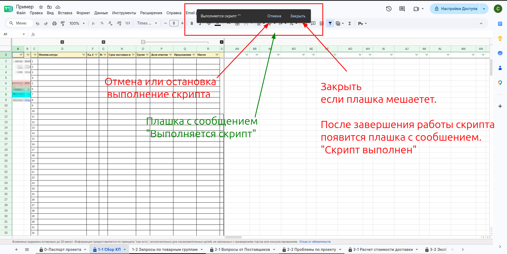
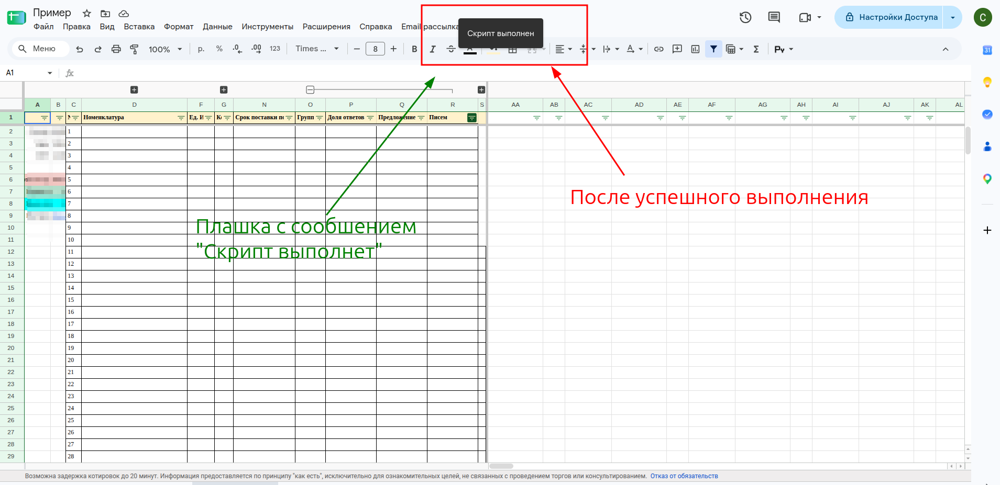
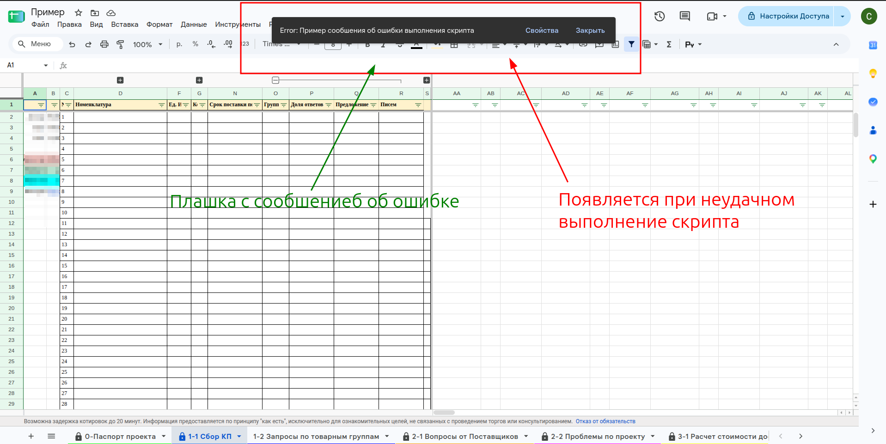
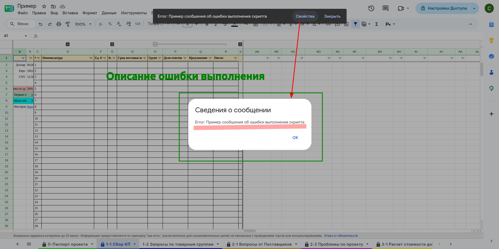

# Плашки скриптов

Когда пункт меню запускает скрипт, вверху таблицы появляется тёмная плашка. По ней видно, что происходит со скриптом.

| Плашка | Когда появляется | Что делать |
|---|---|---|
| **«Выполняется скрипт»** | пока скрипт работает | ждать; тот же пункт меню повторно не нажимать |
| **«Скрипт выполнен»** | на пару секунд после успешного завершения | ничего, плашка исчезнет сама |
| **«Error: …»** | если скрипт завершился с ошибкой | нажать **«Свойства»**, прочитать описание ошибки |

## Выполняется скрипт

- **«Отмена»** — остановить выполнение скрипта.
- **«Закрыть»** — убрать плашку, если она мешает. Скрипт при этом продолжает работать.
- Пока скрипт работает, можно вызывать другие пункты меню — но только если вы уверены, что одновременная работа двух скриптов не испортит результат.

**ВНИМАНИЕ** не нажимайте тот же пункт меню второй раз подряд. Скрипт запустится дважды, даже если между нажатиями прошли секунды.

**Плашки может не быть.** Сразу после авторизации скриптов Google выполняет нажатый пункт меню, но плашку «Выполняется скрипт» не показывает. Поэтому авторизацию делают отдельным безопасным пунктом — [[tio.skr-avtorizatsiya]].

## Скрипт выполнен

## Ошибка

Нажмите **«Свойства»** — откроется окно «Сведения о сообщении» с описанием ошибки. Его текст пригодится, если придётся обращаться к администратору.

