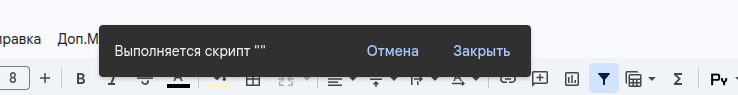

# Плашка «Выполняется скрипт»

Когда пункт меню запускает скрипт, вверху таблицы появляется тёмная плашка **«Выполняется скрипт»**. Пока она видна — скрипт работает.

- **Плашка видна** — ждите, пока она исчезнет. Повторно пункт меню не нажимайте.
- **Плашки нет** — скрипт мог всё равно запуститься. Так бывает сразу после авторизации скриптов: Google выполняет пункт меню, а плашку не показывает.

**ВНИМАНИЕ** не нажимайте тот же пункт меню второй раз подряд. Скрипт запустится дважды, даже если между нажатиями прошли секунды: система не успевает запомнить, что работа уже начата.

Чтобы не попасть в эту ловушку, сначала авторизуйте скрипты безопасным пунктом меню, а уже потом запускайте рабочие пункты.
